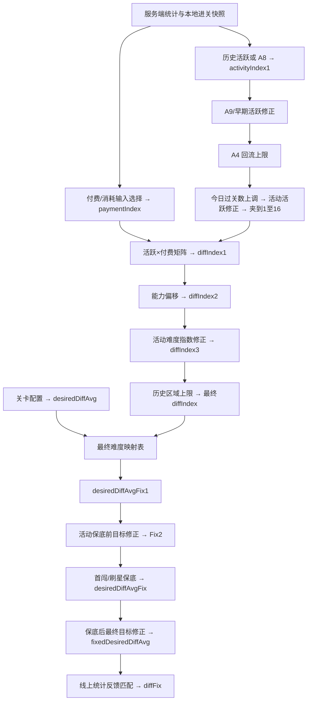
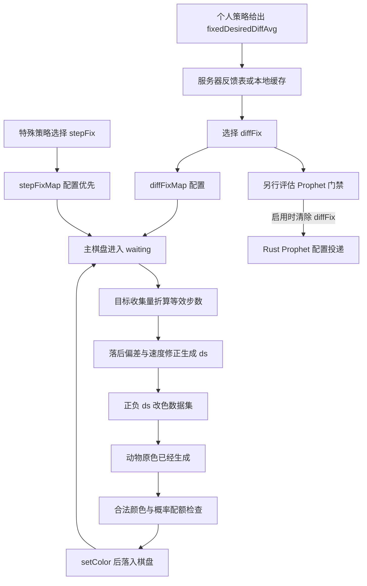

# 开心消消乐 1.162 HE：动态难度详细研究报告

2026-10-21 · 客户端静态证据与构造演算；无真实账号运行。

# 通俗讲解

## 先看结论：哪些因素调难，哪些因素调简单

**主要调整方向：主矩阵中，活跃档位、付费档位越高，越往调高难度的方向走；符合条件的失败保底往降低方向走；连胜在部分回流分支中也会触发上调。**

这里的“调高／降低”指代码中的难度指数或内部设定变化，**不是实测通关率变化**。以下比较均固定其他输入、配置和分支；不能把多项因素混在一起后仍认为结果必然同向。

| 哪些因素参与？ | 改变方向 | 具体条件与含义 |
|---|---|---|
| **近期活跃程度** | **活跃档越高，主矩阵基础指数不降低：整体往更难方向调。** | 已逐格核查主矩阵全部8组。不是“越活跃越简单”。近期闯关次数、活跃天数如何换成档位，取决于所用分支。 |
| **付费／消耗档位** | **付费档越高，主矩阵基础指数不降低：整体往更难方向调。** | 不是“付费越多越简单”。但这个档位不等于充值金额，服务端输入公式未知，不能换成“每多充多少元就更难”。 |
| **今天已经过了多少关** | **可上调活跃档，进而往调高方向走。** | 默认分支每通关10关加1档；其他分支有不同门槛、上限或近似不增加的配置。不是每过一关就立即变难。 |
| **玩家能力值** | **参与修正，常见是高档向上调、低档向下调；不是所有配置都单调。** | 按服务端playerAbility查表，部分早期区域存在反向例外；正向修正还有限制。不能写成“能力每高一级都必加难”。 |
| **连胜** | **部分回流玩家分支会向上调。** | T3／T31开启、回流、最高关卡≤1000等条件下，连胜达到2次可把保底前设定乘1.5，但有输入范围和结果上限。不是全体玩家普遍规则。 |
| **同一未过关关卡的逻辑失败次数** | **达到保底条件后，向下调。** | 第99关的指定配置算例：3.59 → 累计5次失败时2 → 累计7次时1。退出重开不一定算逻辑失败，也不代表第8次必过。 |
| **回流、注册天数、关卡／区域、活动与分组** | **参与，但不能概括成统一升／降。** | 它们决定查哪张表、走哪个分支、限制多少。回流有压低活跃档的路径，也有上面连胜后的上调路径。 |
| **这一局的目标完成进度** | **局内会根据进度调整补棋控制强度。** | 选定参数后，再比较已用步数与目标完成情况。落后时可加强正向控制，但仍受档位、速度修正、阈值和限额等条件影响。 |

## 活跃档位与付费档位的独立作用：配置演算

以下只隔离主矩阵和最终映射表的效果：都选group0、关卡基础设定为4，**暂不应用能力修正、活动、区域限制和失败保底**。

| 固定什么，只改变什么 | 档位变化 | 矩阵指数变化 | 映射后的内部设定 |
|---|---|---|---|
| 付费固定第3档，只提高活跃档 | 活跃8 → 11 → 16 | −5 → −2 → 1 | **1.93 → 3.17 → 4** |
| 活跃固定第11档，只提高付费档 | 付费1 → 3 → 16 | −4 → −2 → 5 | **2.34 → 3.17 → 5.2** |

**这两行直接展示了调高方向，但不能换算成“胜率下降多少”。**它们也不与后文4→3.59的完整算例矛盾：完整算例还加了能力修正，这里刻意隔离两个表的作用。

<details><summary>连胜到底什么条件？为什么不能说“所有人连胜都会变难”？</summary><div class="detail-body"><p><b>T3：</b>开关开启、回流、最高关卡≤1000、全局连胜≥2、今日通关少于10关；仅当原设定≤3时乘1.5，结果最多3。例如原值2可变3，原值4不受这一项影响。</p><p><b>T31：</b>开关开启、回流、最高关卡≤1000、今日连胜≥2、今天连胜中断次数为0、今日通关≤10；仅当原设定≤2时乘1.5，结果最多2。例如1.2可变1.8，原值3不受这一项影响。</p><p>这两个修正都发生在失败保底之前，后续规则仍可能改变结果。本次没有真实账号开关数据，不能确认具体玩家正在启用哪项。</p></div></details>

<details><summary>“整体调高”为什么没有写成“最终必然更难”？</summary><div class="detail-body"><p>主矩阵8组的活跃方向、付费方向分别检查了1920次相邻比较，均没有反向下降；部分相邻档结果相同。</p><p>最终映射表有一处反向例外：group2、基础行14，指数−5→−4时设定5.07→5.03。能力修正表在group0／5／8、区域上界10／20也有ability_0→ability_1时修正1.5→0的例外。因此不能把每个阶段都说成严格递增。</p><p>这里核查的是主矩阵；活动替换表、分组变化、保底、上下限及其他修正，需要按实际命中的路径另算。最终补棋还有随机与规则门槛，尚未做真实账号胜率实验。</p></div></details>

依据：[主矩阵配置](source/ubfuuu_diff_index_map_config-c54eaae2.html#L3)、[设定映射表](source/ubfuuu_final_diff_map_config-3fa7d6b3.html#L17)、[连胜分支](source/DiffAdjustModMgr-bb0d46f4.html#L255)、[逐表方向核查数据](data/direction-audit.json)。

看服务器与客户端各给什么 → · 看付费档位公式 → · 看完整流程图 ↓


## 先分清：任务目标、内部设定和控制档位

**先分清这几个数，后面的流程就不会混在一起。**它们虽然都和难度有关，但各自做的事不同。

| 名称 | 它是什么 | 例子怎样读 |
|---|---|---|
| 界面上的过关目标 | 玩家真正要完成的任务 | “消除30块冰”，完成它才是过关要求。 |
| 关卡基础设定值 | 配置里给这关准备的起点 | 第99关某配置为4；个人调整从这里开始。不同配置或关卡范围可能读不同列。 |
| 难度指数 | 根据个人数据算出的查表索引 | 例如−1；客户端用它和基础设定值一起查表。不是失败次数。 |
| 个人内部难度设定值 | 这一次选控制档位时使用的数值 | 例如3.59；不是要消除3.59个东西，也不是保证平均3.59次过关。 |
| 难度反馈值 | 服务端提供的、与各控制档位对应的参考数值 | 客户端拿它和个人设定值比较；后台统计公式、统计人群尚未知。 |
| 控制档位 / 当前强度 | 一局使用的参数组 / 局内反复计算的控制程度 | 档位叫diffFix，强度叫ds；两者不是同一个数。 |

<div class="reader-example"><b>把它串成一句话</b><p>这关基础设定是4 → 个人指数是−1 → 查表得到本次设定3.59 → 用反馈表选一组控制参数 → 局内根据进度调整新动物颜色。</p><p>这里的4、−1、3.59来自后面的同一组配置算例；并没有改变界面上的收集任务。</p></div>

**“降低目标”在本文中统一改叫“下调内部设定值”。**这样就不会误以为系统把“消除30块冰”改成了“消除20块冰”。


## 服务器给什么，客户端又算什么

**服务器提供部分历史记录和评价数值；客户端结合当前状态，计算难度指数。**不是服务器只根据连胜、连败直接发一个最终难度。

## 服务器具体给什么？

| 提供的数据 | 大白话解释 | 代码字段 |
|---|---|---|
| 近期活跃记录 | 最近哪些天玩过 | activeDayInLast28Days |
| 每日闯关次数列表 | 最近每天玩了多少局 | challengeCountInLast30Days |
| 玩家能力值 | 服务端给出的能力评价，用于查修正表；生成公式未知 | playerAbility |
| 付费分档使用的数值 | 客户端拿来划付费档位；不能直接等同累计充值金额 | v250801CashValue、v250801FarmCashValue |
| 历史区域记录 | 之前各区域的难度及部分道具使用记录等 | areaSummaryBeans |
| 当天计数 | 今天过关数、连胜计数、连胜中断计数；客户端还会继续更新 | todayPassLevelCount、todayStreakWinCount、todayStreakWinBreakCount |

“服务端提供”表示客户端有接收代码。本次未抓到真实响应，不保证每次下发全部字段。

## 客户端具体做什么？

| 客户端读取或计算 | 作用 |
|---|---|
| 汇总近期闯关次数、活跃天数 | 计算活跃档位；不同分支使用不同窗口和表。 |
| 读取当前最高关卡、关卡星级、开放关卡范围 | 判断现在适用哪组条件。它们是客户端可读状态，不意味着最初全由客户端产生。 |
| 结合注册天数、回流状态、今天过关数 | 按所启用的规则修正活跃档位等。 |
| 选择付费分档输入，再查包内表 | 计算付费档位；下一节给出具体公式。 |
| 用活跃档位和付费档位查矩阵，再修正 | 得到难度指数。能力修正使用上面的playerAbility。 |
| 读取这关的失败计数 | 主要用于后面的失败保底，不应把它全部算成指数矩阵的输入。 |

<div class="reader-example"><b>例子：今天又过了一关，谁来更新？</b><p>服务器先给出今天已经过了多少关；客户端在你继续通关后，本地把计数加1。因此，这类统计是“服务器初始化＋客户端继续更新”。</p></div>

**连胜字段被接收，不等于已经证明“连胜越多就越难”。**需要逐项看它实际进入哪条计算路径。

依据：[服务端字段与汇总](source/UBFuuuAdjustManager-7f6c2ab9.html#L1137)、[进关时读取状态](source/UBFuuuSelectAdjust-12c2c235.html#L550)、[难度指数计算](source/UBFuuuSelectAdjust-12c2c235.html#L1330)。


## 付费档位是什么？是不是充了多少钱？

**付费分档数值是客户端计算付费指数的输入。**这里统一叫“付费档位”，因为结果是1～16档，便于理解。

它不能直接解释成“你累计充了多少钱”。客户端有两种取数方式：

| 取数方式 | 具体做法 | 哪部分还不知道 |
|---|---|---|
| 优先使用服务端数值 | 本次安卓HE代码默认优先使用v250801CashValue；特定分支还会加上v250801FarmCashValue。 | 服务端生成公式、单位、统计窗口尚未知，不能说100就等于100元。 |
| 缺少该数值时，用消耗统计作备用 | 把加步和视频加步的使用次数加权求和。特定分支还计入其他道具。 | 这条客户端公式已取得，但它不等于新版服务端字段的生成公式。 |

## 备用公式，直接用例子解释

```text
消耗统计值 = 加2步次数 × 0.5
           + 视频加步次数 × 0.1
           + 加5步次数 × 1
```

<div class="reader-example"><b>假设：用了4次加2步、10次视频加步、3次加5步</b><p>算出来是：4×0.5＋10×0.1＋3＝6。</p><p><strong>6是加权后的消耗统计值，不是6元，也不是难度指数6。</strong>道具使用次数本身也不能证明这些道具全部通过付费获得。</p></div>

随后还要查表，才得到付费档位：

<div class="reader-chain">服务端数值，或备用消耗统计值<br>↓<br>按配置组和最高进度区域查阈值表<br>↓<br>得到付费档位，再应用适用修正，限定在1～16<br>↓<br>与活跃档位一起查表，得到初始难度指数</div>

**真实配置算例：**在第99关算例所选的group0、区域行中，输入100大于第2档上限83，不超过第3档上限138，因此查到第3档。这里的100是假设输入，不是假设充值100元。

<details><summary>展开：其他道具、平台分支和数值0的处理</summary><div class="detail-body"><p>E4且有锤子统计时，备用公式再加：锤子次数×0.5＋火箭次数＋刷子次数。鸿蒙分支的默认输入选择不同；E5/E6可切换，E7在两个服务端值都存在时合并它们。</p><p>服务端数值为0仍算“有值”，不会因此回退到备用消耗公式。</p></div></details>

**已经证实的是它参与付费／消耗分档。尚未证实的是新版服务端数值的组成，更不能直接推出“付费越多一定越难”。**

依据：[输入选择和备用公式](source/UBFuuuSelectAdjust-12c2c235.html#L1335)、[付费档位查表](source/UBFuuuSelectAdjust-12c2c235.html#L700)。


## 为什么同一关，对不同人可能不一样

**同一关先有一份基础设定；客户端再根据个人数据查表，得到这一次的内部设定值。**这里不是修改界面上的收集任务。

## 第一步：先算个人难度指数

<div class="reader-chain">近期游玩记录＋适用的当前状态修正 → 活跃档位<br>服务端付费分档数值，或备用消耗统计 → 付费档位<br>↓ 两个档位一起查矩阵<br>初始难度指数<br>↓ 能力修正、活动等外部修正、历史区域限制<br>最终难度指数</div>

活跃不是简单“连赢多少次”。例如普通旧分支会汇总近期闯关频率；另一条分支会用28天活跃天数和每个活跃日的平均闯关次数。具体走哪条取决于开关与分组。

## 第二步：把指数和这关的基础设定结合

下面是一组**包内真实配置＋假设玩家状态**的演算，不是线上账号实测：

| 这一步做什么 | 本例得到什么 |
|---|---|
| 读取第99关的基础设定 | 4 |
| 按近期游玩记录计算活跃档位，按付费分档数值计算付费档位 | 活跃第11档、付费第3档 |
| 用这两个档位查矩阵 | 初始难度指数−2 |
| 本例能力表给出＋1修正，后续限制不改变结果 | 最终难度指数−1 |
| 用基础设定4和指数−1查映射表 | 本次内部设定值3.59 |

**不是4−1＝3。它是查表，表里这个格子写的是3.59。**

## 第三步：失败保底等规则还可能继续调整

<div class="reader-example"><b>同一算例，其他输入固定，只增加符合条件的逻辑失败次数</b><p>累计0～4次失败：设定值3.59<br>累计5～6次失败：下调为2<br>累计7次及以上失败：下调为1</p><p>适用于本例的最高未过关关卡、0星和所选配置；不是全服统一门槛，也不代表第8次必过。</p></div>

“逻辑失败”有判定条件，退出重开不一定计入。已过关后刷星也有另一套计数。处理顺序还允许活动等规则在保底前、保底后修正。

**下一步才是拿最终设定值去选控制档位。**3.59不是补棋概率，更不能换算成1÷3.59的通关率。


## 内部设定值和难度反馈值，怎么配合？

**内部设定值是“本次用来选档的要求”；难度反馈值是“各档位可供比较的参考数值”。**两者结合，客户端才知道本局选哪个控制档位。

| 数据 | 从哪里来 | 做什么 |
|---|---|---|
| 本次内部设定值 | 客户端根据关卡配置、个人输入和修正规则计算 | 告诉选档代码本次要匹配哪个数值。 |
| 各档位的难度反馈值 | 服务端下发或已有缓存 | 告诉选档代码各个候选档位对应什么参考数值。 |
| 档位对应的控制参数 | 客户端配置 | 选定档位后，决定后续怎样计算局内控制强度。 |

## 用一张假设的表说明

假设本次内部设定值是2，反馈表里有两个相邻候选：

| 控制档位 | 假设反馈值 |
|---|---|
| 档位0 | 1.8 |
| 档位1 | 2.6 |

**2落在1.8和2.6之间，而且更接近1.8。**对应的相邻候选分支会按距离随机选择：第一阶段名义上75%选档位0、25%选档位1；之后还有小概率上下扰动，所以这不是最终分布。

<div class="reader-example"><b>这张表不表示什么？</b><p>1.8不是已证实的“平均1.8次通关”；我们还不知道服务器的统计单位，也不知道它统计的是本人、同类玩家还是其他人群。</p><p>档位0、1对应的执行参数在客户端。这里没有一套名字叫“方案A／B”的服务端算法。</p></div>

## 这两路数据是汇合，不是前后生成

<div class="reader-merge"><div class="lane mixed"><b>客户端算好本次设定值</b><span>例如2</span></div><div class="lane server"><b>读取服务器反馈表或缓存</b><span>例如档位0→1.8、档位1→2.6</span></div></div>
<div class="reader-chain">↘ 两路一起交给客户端选档代码 ↙<br>选中档位 → 读取客户端参数 → 进入局内控制</div>

**不能理解成“客户端先把2发给服务器，服务器立刻返回一个方案”。**上图描述的是客户端已有这两类输入后，怎样完成选档。

依据：[反馈选档实现](source/UBFuuuSelfFeedback-ea368436.html#L200)。完整边界和扰动演算可在后面的补棋演示中核查。


## 设定值怎样真的改变补棋

**设定值不会直接指定“下一颗掉红色”。它先选一组参数，再结合当前进度算控制强度，最后由补棋规则决定是否改色。**

## 局内进度评估

游戏会把各个收集目标的完成情况，与关卡参考曲线比较，换算成进度。比如用了15步，完成量只相当于参考曲线的第12.3步，就有约2.7步的落后。

这是解释用的假设局面。实际计算还会使用所选档位的曲线偏移、历史速度等参数。

## 同一局面，参数不同，控制强度可以不同

| 实际配置里的档位 | 在演示固定条件下得到的强度 | 满足同一类规则条件时的名义门槛 |
|---|---|---|
| diffFix＝0 | ds＝4 | 正向改色规则A为40/100 |
| diffFix＝−16 | ds＝15 | 正向改色规则A为85/100 |

这组演示固定静态30步、已用15步、完成量等效12.3步，历史速度修正为0，使用包内真实参数。**它展示的是规则门槛变化，不是40%或85%的通关率，也不是所有新动物的最终改色率。**

## 最后，代码真的改了什么？

<div class="reader-chain">生成一颗新动物，已有原来的颜色<br>↓<br>检查当前强度、规则条件、随机门槛、合法颜色和历史次数限制<br>↓<br>满足条件时，用setColor改写颜色<br>↓<br>新动物再进入棋盘</div>

<div class="reader-example"><b>直观例子</b><p>原本将生成蓝色动物，规则允许时可能改成红色。颜色仅作示意；哪种颜色符合目标与规则，要看当时棋盘。</p><p>不是每颗都改，也不保证改完立刻能消除。已有的旧棋子不会因为这段生成逻辑被追溯改色。</p></div>

棋盘再次稳定后，客户端重新评估进度，为后续生成计算强度。因此**一局选定的档位可以不变，但局内控制强度会变化**。

# 完整证据与技术附录

# 先看结论：哪些因素调难，哪些因素调简单

**主要调整方向：主矩阵中，活跃档位、付费档位越高，越往调高难度的方向走；符合条件的失败保底往降低方向走；连胜在部分回流分支中也会触发上调。**

这里的“调高／降低”指代码中的难度指数或内部设定变化，**不是实测通关率变化**。以下比较均固定其他输入、配置和分支；不能把多项因素混在一起后仍认为结果必然同向。

| 哪些因素参与？ | 改变方向 | 具体条件与含义 |
|---|---|---|
| **近期活跃程度** | **活跃档越高，主矩阵基础指数不降低：整体往更难方向调。** | 已逐格核查主矩阵全部8组。不是“越活跃越简单”。近期闯关次数、活跃天数如何换成档位，取决于所用分支。 |
| **付费／消耗档位** | **付费档越高，主矩阵基础指数不降低：整体往更难方向调。** | 不是“付费越多越简单”。但这个档位不等于充值金额，服务端输入公式未知，不能换成“每多充多少元就更难”。 |
| **今天已经过了多少关** | **可上调活跃档，进而往调高方向走。** | 默认分支每通关10关加1档；其他分支有不同门槛、上限或近似不增加的配置。不是每过一关就立即变难。 |
| **玩家能力值** | **参与修正，常见是高档向上调、低档向下调；不是所有配置都单调。** | 按服务端playerAbility查表，部分早期区域存在反向例外；正向修正还有限制。不能写成“能力每高一级都必加难”。 |
| **连胜** | **部分回流玩家分支会向上调。** | T3／T31开启、回流、最高关卡≤1000等条件下，连胜达到2次可把保底前设定乘1.5，但有输入范围和结果上限。不是全体玩家普遍规则。 |
| **同一未过关关卡的逻辑失败次数** | **达到保底条件后，向下调。** | 第99关的指定配置算例：3.59 → 累计5次失败时2 → 累计7次时1。退出重开不一定算逻辑失败，也不代表第8次必过。 |
| **回流、注册天数、关卡／区域、活动与分组** | **参与，但不能概括成统一升／降。** | 它们决定查哪张表、走哪个分支、限制多少。回流有压低活跃档的路径，也有上面连胜后的上调路径。 |
| **这一局的目标完成进度** | **局内会根据进度调整补棋控制强度。** | 选定参数后，再比较已用步数与目标完成情况。落后时可加强正向控制，但仍受档位、速度修正、阈值和限额等条件影响。 |

## 活跃档位与付费档位的独立作用：配置演算

以下只隔离主矩阵和最终映射表的效果：都选group0、关卡基础设定为4，**暂不应用能力修正、活动、区域限制和失败保底**。

| 固定什么，只改变什么 | 档位变化 | 矩阵指数变化 | 映射后的内部设定 |
|---|---|---|---|
| 付费固定第3档，只提高活跃档 | 活跃8 → 11 → 16 | −5 → −2 → 1 | **1.93 → 3.17 → 4** |
| 活跃固定第11档，只提高付费档 | 付费1 → 3 → 16 | −4 → −2 → 5 | **2.34 → 3.17 → 5.2** |

**这两行直接展示了调高方向，但不能换算成“胜率下降多少”。**它们也不与后文4→3.59的完整算例矛盾：完整算例还加了能力修正，这里刻意隔离两个表的作用。

<details><summary>连胜到底什么条件？为什么不能说“所有人连胜都会变难”？</summary><div class="detail-body"><p><b>T3：</b>开关开启、回流、最高关卡≤1000、全局连胜≥2、今日通关少于10关；仅当原设定≤3时乘1.5，结果最多3。例如原值2可变3，原值4不受这一项影响。</p><p><b>T31：</b>开关开启、回流、最高关卡≤1000、今日连胜≥2、今天连胜中断次数为0、今日通关≤10；仅当原设定≤2时乘1.5，结果最多2。例如1.2可变1.8，原值3不受这一项影响。</p><p>这两个修正都发生在失败保底之前，后续规则仍可能改变结果。本次没有真实账号开关数据，不能确认具体玩家正在启用哪项。</p></div></details>

<details><summary>“整体调高”为什么没有写成“最终必然更难”？</summary><div class="detail-body"><p>主矩阵8组的活跃方向、付费方向分别检查了1920次相邻比较，均没有反向下降；部分相邻档结果相同。</p><p>最终映射表有一处反向例外：group2、基础行14，指数−5→−4时设定5.07→5.03。能力修正表在group0／5／8、区域上界10／20也有ability_0→ability_1时修正1.5→0的例外。因此不能把每个阶段都说成严格递增。</p><p>这里核查的是主矩阵；活动替换表、分组变化、保底、上下限及其他修正，需要按实际命中的路径另算。最终补棋还有随机与规则门槛，尚未做真实账号胜率实验。</p></div></details>

依据：[主矩阵配置](source/ubfuuu_diff_index_map_config-c54eaae2.html#L3)、[设定映射表](source/ubfuuu_final_diff_map_config-3fa7d6b3.html#L17)、[连胜分支](source/DiffAdjustModMgr-bb0d46f4.html#L255)、[逐表方向核查数据](data/direction-audit.json)。

看服务器与客户端各给什么 → · 看付费档位公式 → · 看完整流程图 ↓


# 先看流程图：它到底怎样改变难度

<p class="flow-lead"><b>先看这一条线：系统根据玩家状态选本局参数，再根据局内进度，调整补出来的动物颜色。</b><br>图中讲的是已经追通的旧 Lua 路径；不是所有账号、所有策略都会走这条线。</p>
<nav class="question-links" aria-label="按问题阅读"><a href="#terms">这几个数有什么区别？</a><a href="#inputs">两端各提供什么？</a><a href="#spending">付费档位怎么算？</a><a href="#feedback">反馈值到底是什么？</a></nav>
<div class="flow-key"><span>绿色：客户端代码已确认</span><span>黄色：服务端生成过程未知</span></div>
<div class="plain-flow">
<div class="flow-phase">第一段 · 进入关卡时</div>
<div class="flow-node"><b>① 读取玩家状态</b><p>服务器给近期游玩记录、能力值、付费分档数值等；客户端结合当前关卡、今天过关数、失败次数等状态。</p><small>客户端读取与使用这些信息的代码已取得；能力值和付费分档数值怎样由服务端生成，尚未知。</small><a href="#inputs">服务器和客户端各给什么 →</a></div>
<div class="flow-down">↓</div>
<div class="reader-merge"><div class="flow-node"><b>② 客户端算本次内部设定值</b><p>个人数据 → 难度指数 → 与关卡基础配置查表 → 失败保底等修正。</p><small>比如从基础4得到3.59。这不是收集任务，也不是平均过关次数。</small><a href="#personal">用第99关的例子算一遍 →</a></div><div class="flow-unknown"><b>另一路输入：服务器反馈表或已有缓存</b><p>提供各控制档位对应的参考数值，供客户端比较。</p><small>它不是由左边这一步现场算出来的。后台统计公式与人群仍未知。</small><a href="#feedback">设定值和反馈值有什么区别 →</a></div></div>
<div class="flow-down">↘ 两路数据汇合，交给客户端选档 ↙</div>
<div class="flow-node"><b>③ 选一组本局控制参数</b><p>根据反馈表选出一个档位，再读取该档的参数。代码把档位叫 <code>diffFix</code>。</p><small>这些参数会影响后面如何评估局内进度、采用多大的补棋控制强度。</small><a href="#execution">看选档和参数 →</a></div>
<div class="flow-down">↓ 带着这组参数进入对局</div>
<div class="flow-phase">第二段 · 对局过程中，重复执行</div>
<div class="flow-node"><b>④ 评估目标完成进度</b><p>比较“已经用了多少步”和“实际收集完成了多少”。用关卡参考曲线判断哪些目标落后了。</p><small>例如：用了10步，完成量只相当于参考曲线的第7步，就落后约3步。这是解释用的假设局面。</small></div>
<div class="flow-down">↓</div>
<div class="flow-node"><b>⑤ 算当前补棋要采用多强的控制</b><p>把<strong>本局选定的参数</strong>和<strong>当前进度</strong>合起来，算出当前强度。代码把强度叫 <code>ds</code>。</p><small>所以：同一局里，参数档位不变，当前控制强度仍然可以变化。</small><a href="#demos">拖动演示，看强度怎样变化 →</a></div>
<div class="flow-down">↓</div>
<div class="flow-node flow-focus"><b>⑥ 真正影响棋盘：可能改写新动物的颜色</b><p>先生成原来的颜色，再经过概率与历史次数检查，可能改成另一种允许颜色，最后落入棋盘。</p><div class="color-example"><span class="blue-animal">原本蓝色</span><span>→ 规则允许时 →</span><span class="red-animal">改为红色</span></div><small>颜色只是示意。不是每颗都改，也不保证落下来就能消除，更不保证通关。实际代码有 <code>setColor</code> 写入。</small></div>
<div class="flow-repeat">↻ 棋盘再次稳定后，回到④重新评估，再控制后续生成。</div>
<div class="flow-phase">第三段 · 这一局结束后</div>
<div class="flow-node"><b>⑦ 更新玩家状态，供下一局使用</b><p>按具体结算条件更新失败、通关、刷星等计数。下次再进入关卡，回到①，可能算出不同参数。</p><small>退出重开不一定等于一次逻辑失败；刷星也有单独计数口径。</small><a href="#lifecycle">看重试、结算与恢复 →</a></div>
<div class="flow-down">↓ 符合采集条件的对局才附加反馈上报</div>
<div class="flow-unknown"><b>后台怎样把上报变成新的反馈表？</b><p>这一段目前未知。不能说“每输一局，服务器就立即重算，并保证下局更简单”。</p></div>
</div>
<div class="flow-takeaway"><b>机制对游戏体验的影响：</b>界面上的收集任务可以仍然相同，但后续补出来的颜色可能受到个人参数和局内进度的共同影响。<br><b>阅读顺序：</b>先懂这张图，再点你关心的节点查看公式；原代码和完整表放在后面供核查。</div>


# 先分清：任务目标、内部设定和控制档位

**先分清这几个数，后面的流程就不会混在一起。**它们虽然都和难度有关，但各自做的事不同。

| 名称 | 它是什么 | 例子怎样读 |
|---|---|---|
| 界面上的过关目标 | 玩家真正要完成的任务 | “消除30块冰”，完成它才是过关要求。 |
| 关卡基础设定值 | 配置里给这关准备的起点 | 第99关某配置为4；个人调整从这里开始。不同配置或关卡范围可能读不同列。 |
| 难度指数 | 根据个人数据算出的查表索引 | 例如−1；客户端用它和基础设定值一起查表。不是失败次数。 |
| 个人内部难度设定值 | 这一次选控制档位时使用的数值 | 例如3.59；不是要消除3.59个东西，也不是保证平均3.59次过关。 |
| 难度反馈值 | 服务端提供的、与各控制档位对应的参考数值 | 客户端拿它和个人设定值比较；后台统计公式、统计人群尚未知。 |
| 控制档位 / 当前强度 | 一局使用的参数组 / 局内反复计算的控制程度 | 档位叫diffFix，强度叫ds；两者不是同一个数。 |

<div class="reader-example"><b>把它串成一句话</b><p>这关基础设定是4 → 个人指数是−1 → 查表得到本次设定3.59 → 用反馈表选一组控制参数 → 局内根据进度调整新动物颜色。</p><p>这里的4、−1、3.59来自后面的同一组配置算例；并没有改变界面上的收集任务。</p></div>

**“降低目标”在本文中统一改叫“下调内部设定值”。**这样就不会误以为系统把“消除30块冰”改成了“消除20块冰”。


# 研究结论与机制总览

## 阅读结论

**开心消消乐 1.162 HE 客户端中，已找到从个人状态、内部难度设定、反馈选档、逐回合进度评估到实际补棋颜色改写的连通链路。** 本报告完整展开这条旧 Lua 路径，并单独说明 stepFix、初始棋盘与 Prophet/Rust 的分支边界。

“已找到代码”与“这个账号线上正在使用”是两件事。前者由 APK 中恢复的文本、配置和调用关系支持；后者还需要真实分组、热更新及运行轨迹。本次没有登录游戏、请求业务服务器或进行真实账号逐局实验。

本报告沿用 RM 当前报告的组织方式：**拆包事实 → 分析提炼 → 未确认与边界**。沿用的是证据规范与阅读结构，不把 RM 的试验结果、随机链或难度状态移植成开心消消乐的结论。

| 本次最重要的判断 | 证据程度 |
|---|---|
| 按个人活跃、价值、能力等计算难度指数与内部设定值 | 客户端恢复源码与包内表可直接核对 |
| 在本人的最高未过关关卡，根据逻辑失败数降低设定值 | 有明确条件、配置、持久状态与后续消费；不等于必过 |
| 通过服务器反馈表匹配 diffFix 档位 | 接口、解析、缓存与选档算法已知；实际回包与后台公式未取得 |
| 每次棋盘进入 waiting 时，按进度重算 ds | 调用链与数值公式已恢复 |
| 改色发生在原始动物生成之后、落入棋盘之前 | 已找到生成调用方、改色规则和 setColor 写入点 |
| 内部设定值 3.59 就是平均 3.59 次通关 | **未证明；不能作为结论** |
| 所有玩家、所有关卡都启用同一调难路径 | **未证明；存在资格、开关、分组与替代路线** |
| 已完整恢复后台和 Prophet 的原生算法 | **没有；只恢复部分客户端合同与配置投递** |

## 样本、方法与证据分级

| 项目 | 固定范围 |
|---|---|
| 游戏 | 开心消消乐；官方 Android HE 渠道 |
| 版本 | 1.162，versionCode 175；研究日期 2026-10-21 |
| 包名 | com.happyelements.AndroidAnimal |
| APK SHA-256 | ff321d4a200d6d98107e6c33fa0951f29810cafd88689b46bbec480e6a8d7421 |
| APK 大小 | 402,090,661 字节 |
| Lua | 恢复 11,871 份，106,016,497 字节；保留成员路径与哈希 |
| 配置覆盖 | 24 张难度策略表、21,799 行；16,683 条关卡配置；13,755 条进度模型 |
| 模型寻址 | UUID + tag + 包偏移，13,755 条精确匹配；不能只按 JSON 内 level_id 关联 |
| REA 提取证据 | ev_951fbefa4c3cbe88f483c5349fe1319283efda9c01ddd30773d0fb64e39ded8a |
| 工具边界 | REA 包提取成功；原生加载器支持 Lua 恢复；JADX MCP JAR 缺失，不能宣称完整 Java 反编译 |
| 运行边界 | 本次没有实机命中日志、线上统计回包、服务端实现或效果实验 |

下载链保存过一个与实际文件不同的 CDN 声称 MD5；本研究固定实际 APK SHA-256，不用 URL 标签替代样本身份，也不猜测差异原因。

| 标识 | 本报告的含义 | 不能扩展为 |
|---|---|---|
| C·客户端事实 | 已恢复文本、表值、协议接收和明确调用/写入 | 某个账号已命中或全服正在启用 |
| M·构造演算 | 给定明确假设输入，按实际表和公式复算 | 原游戏运行、真实账号记录、胜率估计 |
| A·分析提炼 | 由 C/M 解释功能与约束，保留前提 | 未见的后台目标、商业动机或因果效果 |
| U·未确认 | 当前证据不能决定的问题及缺失位置 | 已证明不存在或永久关闭 |

## 一页机制图：两个时间尺度、一个服务端断点

<div class="mechanism-map" role="img" aria-label="服务器输入进入客户端，进关选参数，局内根据进度改色，结算选择性上报；后台聚合未知">
<div class="lane server"><b>服务器输入</b><span>分组 / 能力与价值统计 / 各档反馈值</span><em>能看接收字段；生成公式和本账号实际值未取得</em></div>
<div class="arrow">↓</div>
<div class="lane client"><b>进关生成或刷新策略</b><span>个人输入 → 活跃/价值档 → 难度指数 → 内部设定值 → 保底与活动修正 → diffFix</span><em>客户端公式与包内配置可核对</em></div>
<div class="arrow">↓</div>
<div class="lane client"><b>局内稳定状态后重估</b><span>实际收集量 → 等效步数 → 最落后目标 → lineFix / ds → 概率与历史约束 → 改色 → 落入棋盘</span><em>同一 diffFix 可随局面产生不同 ds</em></div>
<div class="arrow">↓</div>
<div class="lane mixed"><b>结算与下一局</b><span>个人计数更新 + 满足条件才附加反馈上报 → 后续缓存刷新</span><em>后台去重、入样、聚合、分群未知；不能假设每局实时重训</em></div>
</div>

## 术语：不要再把不同的“目标”混在一起

| 名称 | 变量或表现 | 真正用途 |
|---|---|---|
| 界面 goal | 收集狐狸、清冰等具体数量 | 判定关卡完成；本报告的内部设定下降不等于减少数量 |
| 基础内部设定 | desiredDiffAvg | 由关卡、实际分组、最高新关范围等读取包内目标表 |
| 个人难度指数 | diffIndex1…4 | 用活跃×价值矩阵、能力、外部修正和区域限制生成的中间量，最终 -9…9 |
| 最终内部设定 | fixedDesiredDiffAvg | 个人化映射、活动和保底之后，交给反馈选档器的标量 |
| 反馈难度 | diff_all / diff_300 / diff_1000 / diff_10000 | 每档统计值；只有消费者已知，当前准确统计口径未知 |
| 执行档位 | diffFix | 旧路径的配置索引 -16…7，不等于额外步数 |
| 剩余步数路线 | desiredStep / stepFix | 另一个设定/配置族；启用时优先读取 stepFixMap |
| 进度标尺 | fuuu 模型、等效步数 | 把当前完成量换算为曲线位置，用于判断领先/落后 |
| 当前控制强度 | ds / currDs | 当前 waiting 阶段选择正向/负向改色参数集的强度 |

“统计难度”是开发者注释用语。本报告用“内部难度设定值”解释其用途；这个命名并不补足其统计单位。既不能直接取倒数当胜率，也不能当作本玩家通关次数安排。


# 来源与可得性清单

|字段|来源|可得性|已知|未知|源码|
|---|---|---|---|---|---|
|关卡原始目标难度表|client|直接取得|包内 ubfuuu_ds_avg_map_config 含 avg/avg_Top/实验列；读取器按 levelId 与关卡分组建立索引。|目标表的设计/生产算法、线上是否另有热更新以及每列的统计单位未取得。|ubf/metaConfig/ubfuuu_ds_avg_map_config.lua:2|
|主线与顶关目标查表优先级|client|直接取得|普通范围按 avg_后缀→avg→0，顶关范围优先 avg_Top_后缀→avg_Top 再回退普通目标；写 desiredDiffAvg。|具体账号本次配置组、线上最终目标值没有运行记录。|ubf/UBFGamePlayScene/logics/sceneModules/gameMod/modFolder/diffAdjust/ubfuuu/UBFuuuSelectAdjust.lua:608|
|活跃分档静态映射表|client|直接取得|当前生产读取 ubf.metaConfig.ubfuuu_activity_index_map_config，按区域及配置组匹配分档。|配置阈值在全量玩家上的覆盖人数及实验效果未取得。|ubf/UBFGamePlayScene/logics/sceneModules/gameMod/modFolder/diffAdjust/ubfuuu/UBFuuuSelectAdjust.lua:1434|
|28天登录天数与日均闯关映射|client|直接取得|v202604 分支存在二维映射；调用时使用 loginDayCount28 和 playCount28/loginDayCount28。|线上是否命中该分支及命中玩家比例未取得；新用户代码中的 fixedPlayCount28 不应擅自补进分子。|ubf/UBFGamePlayScene/logics/sceneModules/gameMod/modFolder/diffAdjust/ubfuuu/UBFuuuSelectAdjust.lua:1412|
|付费/消耗指数静态映射表|client|直接取得|当前生产读取 ubfuuu_payment_index_map_config，findPaymentIndexInMap 按区域/配置组/输入消耗值查档。|它不等于直接按充值人民币分档；服务端 CashValue 的计算定义未恢复。|ubf/UBFGamePlayScene/logics/sceneModules/gameMod/modFolder/diffAdjust/ubfuuu/UBFuuuSelectAdjust.lua:1350|
|活跃×付费到难度指数矩阵|client|直接取得|表中以 activity、pay1…pay16、group 给出 diffIndex；客户端有默认、SuperBird及替代表路由。|线上实际采用哪组矩阵、各格人数及效果未取得。|ubf/metaConfig/ubfuuu_diff_index_map_config.lua:3|
|能力指数修正映射|client|直接取得|findAbilityFixValueInMap 按区域、能力、配置组取修正；能力导致的正向加值有上限处理。|playerAbility 的服务端训练、标签分布和校准数据未取得。|ubf/UBFGamePlayScene/logics/sceneModules/gameMod/modFolder/diffAdjust/ubfuuu/UBFuuuSelectAdjust.lua:1582|
|难度指数到修正目标表|client|直接取得|ubfuuu_final_diff_map_config 给出 desiredDiff 与 diffIndexN9…diffIndex9 的目标值；非整数指数有随机取整分支。|查表值的服务端/策划生成依据与实际通关率对应关系未取得。|ubf/UBFGamePlayScene/logics/sceneModules/gameMod/modFolder/diffAdjust/ubfuuu/UBFuuuSelectAdjust.lua:796|
|顶关失败保底静态表|client|直接取得|findBaoDiCountInMap 根据目标、失败次数与配置组匹配保底难度；入口区分顶关首闯与刷星。|线上失败事件聚合是否完全同客户端口径、保底触发率未取得。|ubf/UBFGamePlayScene/logics/sceneModules/gameMod/modFolder/diffAdjust/ubfuuu/UBFuuuSelectAdjust.lua:904|
|反馈空候选默认档位表|client|直接取得|包内给出 fixedDesiredDiffAvg 上界到默认 diffFix 的映射；与完全缺表停用不同。|线上缺候选的发生比例及其结果未取得。|ubf/metaConfig/ubfuuu_self_feedback_default_config.lua:3|
|玩家历史闯关次数列表|server|只见接收消费|接收 challengeCountInLast30Days 并映射 dailyPlayCountList，客户端据此计算多个窗口值。|服务端计数事件定义、放弃/重玩/异常计入规则及真实玩家列表未取得；注释窗口与索引1作今天的代码存在需核实的口径差异。|ubf/UBFGamePlayScene/logics/sceneModules/gameMod/modFolder/diffAdjust/ubfuuu/UBFuuuAdjustManager.lua:1150|
|玩家历史登录日列表|server|只见接收消费|activeDayInLast28Days 用于 dailyLoginCountList；客户端累加7/28天活跃日。|服务端日界线、补记规则、真实玩家数据和全服分布未取得。|ubf/UBFGamePlayScene/logics/sceneModules/gameMod/modFolder/diffAdjust/ubfuuu/UBFuuuAdjustManager.lua:1146|
|加权闯关活跃值|mixed|直接取得|客户端计算 fixedPlayCount1=floor((p3/3+2*p7/7+2*p30/30)/5+0.5)，另有较重30天权重版本 fixedPlayCount2。|能复算客户端公式；服务端输入事件定义和真实账号数值未取得。|ubf/UBFGamePlayScene/logics/sceneModules/gameMod/modFolder/diffAdjust/ubfuuu/UBFuuuAdjustManager.lua:1194|
|玩家活跃指数算法|mixed|直接取得|客户端有旧7天/加权尝试分支、A7分支和28天二维分支，再施加活动、回流及上限修正。|需要完整账号输入和命中开关才能复算某次实际结果；不代表已取得全部玩家分层。|ubf/UBFGamePlayScene/logics/sceneModules/gameMod/modFolder/diffAdjust/ubfuuu/UBFuuuSelectAdjust.lua:1408|
|玩家道具/消耗价值字段|server|只见接收消费|区域摘要累计 add2/add5/videoAddStep、锤子/火箭等；接收 v250801CashValue、FarmCashValue 和 PropUsageMap。|服务端价值折算/过期道具计价、完整流水及人群分布未取得。|ubf/UBFGamePlayScene/logics/sceneModules/gameMod/modFolder/diffAdjust/ubfuuu/UBFuuuAdjustManager.lua:1360|
|玩家消耗指数算法|mixed|直接取得|客户端按加2步×0.5、视频加步×0.1、加5步等得替代消耗值；主分支可优先 CashValue，E7还合并 FarmCashValue，再查档与活动修正。|不应把指数解释成现金充值金额；CashValue生成器和账号命中版本未取得。|ubf/UBFGamePlayScene/logics/sceneModules/gameMod/modFolder/diffAdjust/ubfuuu/UBFuuuSelectAdjust.lua:1335|
|能力标签输入|server|只见接收消费|接收 playerAbility、新手skill值/标签、topPlayerAbilityValue、abilityV250521Index等；缺值有0/-1回退。|标签训练样本、模型、阈值、更新频率、准确率及真实标签分布未取得。|ubf/UBFGamePlayScene/logics/sceneModules/gameMod/modFolder/diffAdjust/ubfuuu/UBFuuuAdjustManager.lua:1230|
|服务端能力训练算法|server|未取得|消费端证明能力标签参与 diffIndex 修正；没有恢复标签生成器。|特征工程、监督目标、训练/更新过程、置信区间与偏差均未知。|ubf/UBFGamePlayScene/logics/sceneModules/gameMod/modFolder/diffAdjust/ubfuuu/UBFuuuSelectAdjust.lua:1575|
|最近区域统计摘要|server|只见接收消费|接收 areaSummaryBeans，读取区域能力、旧/新难度指数、道具和现金价值等。|区域计数原始明细、聚合排除规则与真实响应数据未取得。|ubf/UBFGamePlayScene/logics/sceneModules/gameMod/modFolder/diffAdjust/ubfuuu/UBFuuuAdjustManager.lua:1153|
|最终个人难度指数|mixed|直接取得|活跃×消耗查矩阵，再按能力修正、外部 adjustFixInfo、区域上下限修正，最终夹在[-9,9]。|没有线上具体账号输入及实验组就不能声称某类玩家普遍命中某指数。|ubf/UBFGamePlayScene/logics/sceneModules/gameMod/modFolder/diffAdjust/ubfuuu/UBFuuuSelectAdjust.lua:1571|
|本局修正后目标|mixed|直接取得|原始目标→难度指数表→活动修正→顶关或刷星保底→显式最终目标修正；最终至少为1。|目标值的统计业务单位、线上成功率和用户体验提升未实测。|ubf/UBFGamePlayScene/logics/sceneModules/gameMod/modFolder/diffAdjust/ubfuuu/UBFuuuSelectAdjust.lua:1717|
|本地当日次数与连胜状态|mixed|直接取得|主线胜或logicalFail累加todayPlayCount，胜局累加todayPassLevelCount；连胜与断连胜由独立事件更新，服务器返回时可整体重建缓存。|静态代码不能证明所有平台/所有异常路径的实际回调次数，也不能当作群体反馈分母。|ubf/UBFGamePlayScene/logics/sceneModules/gameMod/modFolder/diffAdjust/ubfuuu/UBFuuuAdjustManager.lua:1034|
|刷星失败次数与保底快照|mixed|直接取得|已有1–3星时，正常失败或过关未升星计数+1，升星清零；退出/重玩/异常不计；进关取快照，服务端同键可覆盖本地。|服务器对所有结束事件的计数实现及真实历史未取得。|ubf/UBFGamePlayScene/logics/sceneModules/gameMod/modFolder/diffAdjust/ubfuuu/UBFuuuAdjustManager.lua:757|
|服务端反馈映射解析|server|只见接收消费|客户端把每档逗号分隔四指标解析为 diff_all、diff_300、diff_1000、diff_10000，并按levelKey存缓存。|包内注释示例不等于线上实测；当前服务器返回的真实值与生成统计公式未取得。|ubf/UBFGamePlayScene/logics/sceneModules/gameMod/modFolder/diffAdjust/ubfuuu/UBFuuuAdjustManager.lua:488|
|反馈指标的群体/分母定义|server|未取得|注释称总难度/最近300次/1000次/10000次；客户端只见接收与查档。|“次”的事件集合、玩家去重、分母、成功/失败/删失、池化或先人均、平滑方式均未闭环；不能断言attempts/passes。|ubf/UBFGamePlayScene/logics/sceneModules/gameMod/modFolder/diffAdjust/ubfuuu/UBFuuuAdjustManager.lua:17|
|反馈指标优先级|client|直接取得|选档读取非零 diff_10000→diff_1000→diff_300，不读取 diff_all；本函数未专门过滤-1。|服务端如何保证缺值标记与实际生产值的有效性未取得。|ubf/UBFGamePlayScene/logics/sceneModules/gameMod/modFolder/diffAdjust/ubfuuu/UBFuuuSelfFeedback.lua:109|
|反馈关卡实验与采样池寻址|mixed|直接取得|levelKey包含关卡、实验/配置组、前置加步、版本及poolkey等；选取池与采集池可分开。|同一键覆盖的是哪些玩家、跨人群重加权方式及每池样本数未取得。|ubf/UBFGamePlayScene/logics/sceneModules/gameMod/modFolder/diffAdjust/ubfuuu/UBFuuuAdjustManager.lua:663|
|目标到diffFix随机选档|client|直接取得|按上下候选与目标差距选档，存在精确命中/上下档/相隔多档等路径；结果再钳制到允许范围。|需要真实反馈表、随机种子及本局上下文才能复现某次选档；不等于确定胜败。|ubf/UBFGamePlayScene/logics/sceneModules/gameMod/modFolder/diffAdjust/ubfuuu/UBFuuuSelfFeedback.lua:148|
|缺表和无候选的不同回退|client|直接取得|完全无映射返回kFeedback_NoDiffDsMap；有表但无上下候选且目标>1.03时走80/10/10默认档位，Top按默认表±1、非Top为1/0/2。|缺表/空候选在真实玩家群体中的比例未取得。|ubf/UBFGamePlayScene/logics/sceneModules/gameMod/modFolder/diffAdjust/ubfuuu/UBFuuuSelfFeedback.lua:560|
|反馈上报采样门槛|client|直接取得|显式采样开关优先；普通门槛受其他局前/局中道具影响；stepFix可在无显式开关时允许；diffFix必须存在。|服务端是否二次过滤、权重、去重、异常检测及最终纳入分母规则未知。|ubf/UBFGamePlayScene/logics/processFlow/flowNode/UBFELSendPassLevelProcess.lua:488|
|反馈上报字段|client|直接取得|包含diffFix、payTag/actTag、addSteps、stepFix、moveCount/staticMoveCount、N0/N3指标及levelKey；preAddSteps此处硬编码0。|字段已发送不代表被服务端纳入统计；moveCount是局内步数，不是重玩次数。|ubf/UBFGamePlayScene/logics/processFlow/flowNode/UBFELSendPassLevelProcess.lua:504|
|客户端实验配置组路由|mixed|只见接收消费|createSwitchInfos读取维护项/分组，并生成cfgGroup与modGroup；存在模块和配置组替换。|服务端分桶算法、盐值、占比、真实账号名单及历史迁移未取得。|ubf/UBFGamePlayScene/logics/sceneModules/gameMod/modFolder/diffAdjust/ubfuuu/UBFuuuSelectAdjust.lua:194|
|服务端玩家分桶生成|server|未取得|客户端使用维护分组结果；能识别消费入口。|确定性分桶公式、随机种子、白名单/黑名单明细及实时分层人数未取得。|ubf/UBFGamePlayScene/logics/sceneModules/gameMod/modFolder/diffAdjust/ProphetLaunchStrategy.lua:669|
|按UID的个人/映射持久化|client|直接取得|LocalDB文件名后缀使用uid；context、diff/step映射、更新时戳分开保存。|具体账号本地数据库内容没有采集；不能把缓存机制等同取得玩家数据。|ubf/UBFGamePlayScene/logics/sceneModules/gameMod/modFolder/diffAdjust/ubfuuu/UBFuuuAdjustManager.lua:133|
|映射刷新TTL与离线冷清理|client|直接取得|普通1800秒、最近30关1秒、此前区间120秒触发刷新；4天冷数据在初始化清理；getter不逐次校验4天。|驻留运行和网络竞争下实际缓存新鲜度需运行轨迹验证。|ubf/UBFGamePlayScene/logics/sceneModules/gameMod/modFolder/diffAdjust/ubfuuu/UBFuuuAdjustManager.lua:97|
|统计刷新与当前局的时序|client|直接取得|onStartLevel在跨区域/低关/跨天时异步刷新；回调重建缓存。预热触发映射更新后立即success。|当前策略生成前是否已收到新响应、响应与结算计数的竞态需要运行采样。|ubf/UBFGamePlayScene/logics/sceneModules/gameMod/modFolder/diffAdjust/ubfuuu/UBFuuuAdjustManager.lua:981|
|进关生成/刷新Mod时计算个人目标|client|直接取得|正常生成入口重建context并checkAdjustStrategy，激活后写runtime.adjustData；通用refreshModData可再生成，不应称整个启动严格只算一次。|具体启动过程中生成次数和具体账号命中需要日志。|ubf/UBFGamePlayScene/logics/sceneModules/gameMod/modFolder/diffAdjust/DiffAdjustModMgr.lua:400|
|重试新局重新生成策略|client|直接取得|retryStart新建playId/Runtime，重试流包含MOD_INIT和LOAD_MOD，仍属START_LEVEL。|与上一局结算回写的精确交错需运行验证；不能无条件假定已读到最近计数。|ubf/UBFGamePlayScene/logics/processFlow/UBFProcessManager.lua:258|
|闪退恢复使用保存Mod列表|client|直接取得|Resume独立流程调用resumeGamePlayModList(levelInfo.modList)，没有普通LOAD_MOD；此恢复器不调用createModData。|断面/Rust完整恢复是否覆盖某些策略字段未逐项闭环，不能等同普通新局重算。|ubf/UBFGamePlayScene/logics/processFlow/flowNode/UBFSLResumeStartProcess.lua:21|
|fuuu进度模型的等效步数插值|client|直接取得|LevelProgressLogic将目标实际收集量映射为等效步数，读模型scaler并做分段插值；不是直接胜率。|模型训练/采集生成过程和包外模型更新未取得。|ubf/UBFPlay/logics/progress/LevelProgressLogic.lua:108|
|局内偏差到currDs控制|client|直接取得|每次waiting用本局diffFix/stepFix配置、当前和历史回合偏差计算currDs，再选Positive/Negative参数集。|没有真实账号逐步输入/输出日志；不证明每个账号使用该Lua链。|ubf/UBFPlay/logics/product/UBFProductItemDiffChangeLogicV2.lua:145|
|Lua执行到出块改色|client|直接取得|只处理允许列表内的动物颜色；A/B/C与负侧规则约束改色；itemContext:setColor为实际写点。|某次改色导致通关率/留存/营收变化的因果效果未实测。|ubf/UBFPlay/logics/product/UBFProductItemDiffChangeLogicV2.lua:392|
|Prophet门禁与替换旧diffFix|mixed|直接取得|Lua评估平台/版本/维护组/关卡/目标等门禁；启用后设置Prophet并按决策清除旧diffFix，控制旧采样。|具体玩家门禁结果、线上灰度占比、Rust是否实际收到消息未取得。|ubf/UBFGamePlayScene/logics/sceneModules/gameMod/modFolder/diffAdjust/ProphetLaunchStrategy.lua:1306|
|Rust Prophet参数Schema与预设|client|直接取得|Lua提供ordinary/smooth等配置及endpoint_shift_moves、strength、预算；存在单优先级owner策略。|这些字段的Rust内部确切单位、候选搜索与接受/拒绝算法没有完整恢复。|ubf/UBFPlay/rust/ProphetNewUserExperienceConfig.lua:166|
|Prophet投递到Rust运行入口|client|直接取得|构造enabled=true、mType=kProphet消息并sendMessage；存在运行/棋盘准备门禁。|有投递代码不代表已捕获线上实际投递或Rust具体改棋轨迹。|ubf/UBFGamePlayScene/logics/UBFGameSceneManager.lua:362|
|Rust内部难度与候选算法|client|局部恢复|已取得原生库并定位diff_stats.rs候选及局部反编译；Lua到Rust配置投递边界明确。|内部业务字段、候选枚举/目标函数/最终选棋链未完整恢复；不能把某个浮点除法认定统计难度公式。|ubf/UBFGamePlayScene/logics/UBFGameSceneManager.lua:381|
|动态难度的实际通关因果效果|mixed|未取得|客户端代码能写出块颜色；能确认影响棋盘的能力，不是仅改显示标签。|真实对照实验、账号轨迹、通过率增量、失败数变化、统计显著性未取得。|ubf/UBFPlay/logics/product/UBFProductItemDiffChangeLogicV2.lua:396|
|动态难度对留存/付费的效果|server|未取得|客户端消费活跃、消耗和能力字段；存在策略分组及上报。|留存/营收/付费转化/投诉等指标、实验归因和业务目标函数未取得。|ubf/UBFGamePlayScene/logics/sceneModules/gameMod/modFolder/diffAdjust/DiffAdjustModMgr.lua:441|
|目标难度的精确统计单位|mixed|未取得|客户端标签叫预期难度，与反馈难度比较选档；包内值可大于1，不能当作原始概率。|目标是否等于期望尝试次数、倒数能否解释单局胜率、样本窗口及校准定义未取得。|ubf/UBFGamePlayScene/logics/sceneModules/gameMod/modFolder/diffAdjust/ubfuuu/UBFuuuSelectAdjust.lua:1893|

# 客户端与服务端的责任边界

# 动态难度报告的证据边界：事实、分析与未知

本章与 `availability.json` 配套。清单覆盖49个字段或算法项；“直接取得”指本次包内配置、源码或客户端公式已取得，不表示拿到了真实玩家数据。“只见接收消费”表示可见字段进入客户端后的处理，不能将其升级为服务端生成算法已恢复。本次证据为离线APK、解码Lua、资源索引和局部原生反编译，没有登录账号、请求游戏服务器或完成线上对照实验。

以下源码路径均相对于 `analysis/native_decode/decoded/`。为便于核查，正文将 `ubf/UBFGamePlayScene/logics/sceneModules/gameMod/modFolder/diffAdjust/` 缩写为 `D/`，其 `ubfuuu/` 子目录缩写为 `U/`，`ubf/UBFGamePlayScene/logics/processFlow/` 缩写为 `F/`。

## 第一层：直接可核查的事实

**包内存在完整的客户端策略与配置消费链。** `U/UBFuuuLevelTargetAvg.lua:10–37` 从静态表取原始目标；`U/UBFuuuSelectAdjust.lua:608–636` 按关卡范围和实验列取 `desiredDiffAvg`。活跃和消耗指数在该文件1330行起计算；1571–1612行将矩阵指数、能力修正、外部活动修正、区域限制结合；1717–1903行进行目标修正、保底和最终下限约束。这些是可以在已知输入下复算的客户端代码。

**个人输入的相当一部分是服务端下发值。** `U/UBFuuuAdjustManager.lua:1137–1259` 接收历史闯关、登录、区域摘要、能力标签、上一指数及当日计数；1360–1366行接收消耗价值与道具使用映射。这里没有能力标签训练器、CashValue完整计价器或全服玩家记录。接收到一个字段，与取得该字段的生产算法是两件事。

**反馈映射的客户端接口和消费次序可见。** `U/GetUBFuuuDsToDiffMapHttp.lua:4–8` 指向 `ubfuuuGetNext30DiffFixDataV2`；`U/UBFuuuAdjustManager.lua:488–494` 将四指标解析为 `diff_all/diff_300/diff_1000/diff_10000`。`U/UBFuuuSelfFeedback.lua:109–126` 优先取非零10000档，再1000、300；没有读取 `diff_all`，也没有显式把-1当无效值排除。前部接口注释称“最近N次”，但没有定义每“次”的纳入事件。

**缺表与空候选的处理不同。** 反馈映射完全不存在时返回 `kFeedback_NoDiffDsMap`（`U/UBFuuuSelfFeedback.lua:611–615`）。映射存在、目标>1.03却没有上下候选时，才用80%/10%/10%默认档（560–600行）。短TTL过期触发刷新，不立即清空旧缓存；4天冷数据由管理器初始化时清理（`U/UBFuuuAdjustManager.lua:97–100,322–355,402–452`）。

**局内控制有实际棋盘写点。** `ubf/UBFPlay/logics/product/UBFProductItemDiffChangeLogicV2.lua:145–181` 每次waiting根据本局配置和进度更新DS、取dataset；392–396行最终调用 `itemContext:setColor`。因此至少这条Lua链具备影响生成颜色的执行能力。它仍受动物类型、颜色允许列表、规则阈值及dataset存在等条件限制；这不证明某个真实账号已命中。

**本局策略与后续回写有生命周期界限。** `D/DiffAdjustModMgr.lua:400–469` 在启动生成/刷新Mod数据时计算并保存本局策略；`F/module/UBFProcessModManager.lua:197–203` 说明该生成可被再次刷新，不能写成全启动严格只算一次。局内waiting链没有重新调用个人目标选档。结算本地更新若干当日计数及刷星失败数（`U/UBFuuuAdjustManager.lua:992–1061`），采样上报另有道具/显式开关/stepFix门槛（`F/flowNode/UBFELSendPassLevelProcess.lua:488–566`），不能认定每次开局都进入服务端反馈分母。

**Prophet存在另一条有门禁的Rust策略入口。** `D/ProphetLaunchStrategy.lua:1306–1338` 可设置Prophet、控制旧采样并清除旧diffFix；`ubf/UBFGamePlayScene/logics/UBFGameSceneManager.lua:362–389` 构建并发送kProphet消息。`ubf/UBFPlay/rust/ProphetNewUserExperienceConfig.lua:166–182` 可直接读到endpoint shift与strength等预设。配置schema与发送入口可见，不代表Rust内部搜索和候选接受算法已经恢复，也不表示两套旧新机制同时累加。

## 第二层：由事实支持的分析

现有调用链支持把系统解释为“个人设定选择、服务器反馈查档、局内进度反馈控制”三段：客户端将个人状态变成目标，从下发的经验映射挑diffFix，再依本局进度调整生成干预。这里不能确定反馈是否针对群体或个人；**其真实参与人群、分组分母和权重仍未知**，不应写成“所有玩家共同训练”“仅同类付费玩家”或“固定人数样本池”的既定事实。

活跃×消耗矩阵及能力修正说明玩家状态会影响策略。它支持“存在玩家差异化难度”的判断，但不支持进一步宣称“付费越多必然更难”“系统预定某玩家这局必须输”。活动覆盖、实验列、能力修正、保底、随机选档及Prophet替换都可能改变最终行为；必须给定具体输入和命中路径才可计算单次结果。

动态难度具有两种时间尺度：启动生成/刷新Mod时决定个人目标，局内waiting时改变DS。前者依赖统计缓存和实验/活动配置；后者依赖步数、当前与历史进度及加步。异步请求不被入口等待，故当前局可能用旧缓存，也可能在响应已到后用新缓存。缓存机制本身不能证明某次启动使用了哪一份输入。

包内目标可达远大于1的数，且代码将它和反馈“难度”比较。这足以否定“该字段就是0到1原始胜率”的解释；**不足以证明它严格等于尝试次数/成功次数，也不足以允许无条件用倒数换算胜率**。应称为目标统计难度；若举“平均几次过关”例子，必须标注为假设口径的演示，不能当作已恢复定义。

## 第三层：尚未取得的关键内容

| 未知项 | 当前最近证据边界 | 不能越过的结论 |
|---|---|---|
| diff四指标及原始目标的统计定义 | 下发解析、查档及接口注释 | 不能给定attempts/passes、用户均值、成功玩家限定、平滑公式或置信区间 |
| 能力标签生成 | 客户端接收并查修正表 | 不能声称还原训练集、模型、能力分段的真实覆盖比例 |
| CashValue/区域价值生成 | 客户端接收后用于paymentIndex | 不能把字段解释成现金充值额，也不能推断限时道具完整计价 |
| 服务端实验分桶/玩家分层全集 | Maintenance分组消费和配置路由 | 不能给出分桶盐、流量比例、实时人群规模或具体名单 |
| Rust内部算法 | Lua消息投递；原生候选及局部反编译 | 不能把endpoint shift当作可见加步数，不能把任意浮点除法认作统计难度公式 |
| 线上启用情况 | 包内代码静态可达 | 不能认定每个平台、每个账号、每局都命中同一链 |
| 实际玩家结果及业务效果 | Lua改色写点、策略与采样字段 | 不能报告胜率/留存/付费提升、因果效果或显著性 |
| 闪退恢复逐字段覆盖 | 保存modList恢复入口 | 不能当作新局目标重算，亦不能断言全部Rust策略状态保持不变 |

本次对非Lua成员、内部gzip和原生候选的扫描见 `analysis/difficulty-semantics/native-findings.md`。原生diff_stats候选已局部定位，但没有完成业务字段到目标四指标的赋值链。精确字符串未命中，只能说明本次覆盖未找到对应明文，不能证明包内或服务端绝对不存在该算法。

补证应优先获取经授权的接口响应样本及埋点字段定义，再记录同一版本、配置快照和账号下的策略选择与逐步执行轨迹；因果效果需要真实对照实验。上述均为未完成项，报告中的代码演算、模拟输入和表内样例不得伪装成线上测量。


# 服务器给什么，客户端又算什么

**服务器提供部分历史记录和评价数值；客户端结合当前状态，计算难度指数。**不是服务器只根据连胜、连败直接发一个最终难度。

## 服务器具体给什么？

| 提供的数据 | 大白话解释 | 代码字段 |
|---|---|---|
| 近期活跃记录 | 最近哪些天玩过 | activeDayInLast28Days |
| 每日闯关次数列表 | 最近每天玩了多少局 | challengeCountInLast30Days |
| 玩家能力值 | 服务端给出的能力评价，用于查修正表；生成公式未知 | playerAbility |
| 付费分档使用的数值 | 客户端拿来划付费档位；不能直接等同累计充值金额 | v250801CashValue、v250801FarmCashValue |
| 历史区域记录 | 之前各区域的难度及部分道具使用记录等 | areaSummaryBeans |
| 当天计数 | 今天过关数、连胜计数、连胜中断计数；客户端还会继续更新 | todayPassLevelCount、todayStreakWinCount、todayStreakWinBreakCount |

“服务端提供”表示客户端有接收代码。本次未抓到真实响应，不保证每次下发全部字段。

## 客户端具体做什么？

| 客户端读取或计算 | 作用 |
|---|---|
| 汇总近期闯关次数、活跃天数 | 计算活跃档位；不同分支使用不同窗口和表。 |
| 读取当前最高关卡、关卡星级、开放关卡范围 | 判断现在适用哪组条件。它们是客户端可读状态，不意味着最初全由客户端产生。 |
| 结合注册天数、回流状态、今天过关数 | 按所启用的规则修正活跃档位等。 |
| 选择付费分档输入，再查包内表 | 计算付费档位；下一节给出具体公式。 |
| 用活跃档位和付费档位查矩阵，再修正 | 得到难度指数。能力修正使用上面的playerAbility。 |
| 读取这关的失败计数 | 主要用于后面的失败保底，不应把它全部算成指数矩阵的输入。 |

<div class="reader-example"><b>例子：今天又过了一关，谁来更新？</b><p>服务器先给出今天已经过了多少关；客户端在你继续通关后，本地把计数加1。因此，这类统计是“服务器初始化＋客户端继续更新”。</p></div>

**连胜字段被接收，不等于已经证明“连胜越多就越难”。**需要逐项看它实际进入哪条计算路径。

依据：[服务端字段与汇总](source/UBFuuuAdjustManager-7f6c2ab9.html#L1137)、[进关时读取状态](source/UBFuuuSelectAdjust-12c2c235.html#L550)、[难度指数计算](source/UBFuuuSelectAdjust-12c2c235.html#L1330)。


# 付费档位是什么？是不是充了多少钱？

**付费分档数值是客户端计算付费指数的输入。**这里统一叫“付费档位”，因为结果是1～16档，便于理解。

它不能直接解释成“你累计充了多少钱”。客户端有两种取数方式：

| 取数方式 | 具体做法 | 哪部分还不知道 |
|---|---|---|
| 优先使用服务端数值 | 本次安卓HE代码默认优先使用v250801CashValue；特定分支还会加上v250801FarmCashValue。 | 服务端生成公式、单位、统计窗口尚未知，不能说100就等于100元。 |
| 缺少该数值时，用消耗统计作备用 | 把加步和视频加步的使用次数加权求和。特定分支还计入其他道具。 | 这条客户端公式已取得，但它不等于新版服务端字段的生成公式。 |

## 备用公式，直接用例子解释

```text
消耗统计值 = 加2步次数 × 0.5
           + 视频加步次数 × 0.1
           + 加5步次数 × 1
```

<div class="reader-example"><b>假设：用了4次加2步、10次视频加步、3次加5步</b><p>算出来是：4×0.5＋10×0.1＋3＝6。</p><p><strong>6是加权后的消耗统计值，不是6元，也不是难度指数6。</strong>道具使用次数本身也不能证明这些道具全部通过付费获得。</p></div>

随后还要查表，才得到付费档位：

<div class="reader-chain">服务端数值，或备用消耗统计值<br>↓<br>按配置组和最高进度区域查阈值表<br>↓<br>得到付费档位，再应用适用修正，限定在1～16<br>↓<br>与活跃档位一起查表，得到初始难度指数</div>

**真实配置算例：**在第99关算例所选的group0、区域行中，输入100大于第2档上限83，不超过第3档上限138，因此查到第3档。这里的100是假设输入，不是假设充值100元。

<details><summary>展开：其他道具、平台分支和数值0的处理</summary><div class="detail-body"><p>E4且有锤子统计时，备用公式再加：锤子次数×0.5＋火箭次数＋刷子次数。鸿蒙分支的默认输入选择不同；E5/E6可切换，E7在两个服务端值都存在时合并它们。</p><p>服务端数值为0仍算“有值”，不会因此回退到备用消耗公式。</p></div></details>

**已经证实的是它参与付费／消耗分档。尚未证实的是新版服务端数值的组成，更不能直接推出“付费越多一定越难”。**

依据：[输入选择和备用公式](source/UBFuuuSelectAdjust-12c2c235.html#L1335)、[付费档位查表](source/UBFuuuSelectAdjust-12c2c235.html#L700)。


# 个人输入 → 难度指数 → 内部设定 → 保底

# 从个人输入到单局目标：可复算教学

本文件回答“同一关为什么对不同的人、不同失败次数给出不同目标”。依据为本次 APK 解码材料；示例使用真实配置和明确设定的输入，不冒充线上账号实测。只解释个人目标链，不重复补色、ds 和 RuleA 的棋盘执行过程。

## 阅读约定与指标边界

所有源码都位于 `analysis/native_decode/decoded/`。下文缩写：

- **S**：`ubf/UBFGamePlayScene/logics/sceneModules/gameMod/modFolder/diffAdjust/ubfuuu/UBFuuuSelectAdjust.lua`
- **M**：同目录 `UBFuuuAdjustManager.lua`
- **R**：`ubf/UBFGamePlayScene/logics/processFlow/module/UBFuuuSLRuntimeAdjustLogic.lua`
- **D**：`ubf/UBFGamePlayScene/logics/sceneModules/gameMod/modFolder/diffAdjust/DiffAdjustModMgr.lua`
- **A9**：S 同目录 `UBFuuuA9ReturnActivityAdapter.lua`
- **配置表**：`ubf/metaConfig/` 下完整文件名。

`activityIndex/paymentIndex` 是 1–16 档，`diffIndex` 是 -9…9 的难度指数，`desiredDiffAvg/fixedDesiredDiffAvg` 是目标统计难度，`diffFix` 才是后续干预档位。它们不能互换。调试界面明确把 `diffIndex` 标作“最终难度指数”、`desiredDiffAvg` 标作“预期难度”（`…/modFolder/UserDebug/UBFUserDebugModMgr.lua:238–246`）。

当前目标统计难度 ≥1，**不是已证明的“平均 X 次过关”或概率**。精确分子/分母仍由服务端定义，见同目录 `metric-formulas.md`。因此本文的 4→3.59→2→1 是目标数值变化，不能直接换成 25%→27.86%→50%→100% 通关率。

## 一、先看完整次序



原始基础目标在重建上下文时读取（S:608–636）；个人指数由 `__calculateDiffIndex` 计算（S:1330–1612）；基础目标和指数映射为 Fix1，活动修正为 Fix2，之后保底（S:1717–1857）；最后还可被 `kFixedDesiredDiffAvg` 修正（S:1893–1903），再交给反馈选档（S:1965–1983）。这意味着保底并非所有外部修正的最后一道处理。

此链有数据资格检查：场景/关卡范围由 S:352–376 校验；缺 `dailyPlayCountList` 时返回禁用原因（S:1937–1940），缺 `fixedPlayCount` 时请求刷新并返回 nil（S:1875–1882），初始目标<1也拒绝（S:1885–1890）。不是服务器画像缺失时自动按最低难度运行。

## 二、个人输入先从哪里来

| 输入 | 当前代码来源 | 对算法的作用 |
|---|---|---|
| 每日闯关计数、每日活跃标记 | M:1147–1151 | 生成历史闯关强度和登录天数 |
| 最近最多30区域统计 | M:1153–1154 | 消耗聚合、能力展示、历史区域指数 |
| `playerAbility` | 服务端值 `datas.playerAbility or 0`，M:1231 | 查能力偏移表；不是在此用成功数/失败数即时计算 |
| `v250801CashValue/FarmCashValue` | 服务端值，M:1360–1366 | 当前付费指数主输入，可随 E7 合并刷星值；不能仅凭名称当作人民币金额 |
| `topLevelFailCount` | 进关时读取 LevelAreaManager 的**逻辑失败数**，S:587–591 | 首闯保底触发和分段减难 |
| `farmStarFailCount` | M 本地缓存与服务端 map 合并后的进关快照，S:570–571 | 独立刷星保底 |
| `topLevel`、`levelStar`、包内最高范围 | S:580–598 | 区分未过关首闯、已过关刷星、最高新关范围 |

`playerAbilityValue` 则是对非零 `regionChallengeAbility` 求均值、截到3位小数（M:1340–1342、1372–1375）；**S:1575 实际用于能力偏移的是 `playerAbility` 档，不是这个均值**。

每日历史的下标有注释冲突：M:1150 写第一个槽位是昨天，但当前执行 M:1169–1179 将第1项单独当 `todayPlayCount`，第2–4项纳入3日、第2–8项纳入7日；M:1188 又明确 index2=昨天。复算应以执行下标为准，不能只援引前一处注释。

历史加权式（M:1195–1196）：

```text
C1 = floor((playCount3/3 + 2×playCount7/7 + 2×playCount30/30)/5 + 0.5)
C2 = floor((playCount3/3 + 3×playCount7/7 + 16×playCount30/30)/20 + 0.5)
```

登录天数统计只计 `activeDayInLast28Days` 中 >0 的槽位，前7项另累计 `loginDayCount7`（M:1200–1209）。一局正常赢或逻辑失败后，今日闯关数 +1；赢时今日过关数另 +1（M:1034–1049），影响下一次计算。

## 三、付费指数：先选输入，再查16档

S:1338–1345 先算旧消耗加权值：

```text
oldCost = 0.5×加2步数 + 0.1×视频加步数 + 加5步数
E4 且存在锤子统计时，再加 0.5×锤子 + 火箭 + 刷子
```

但当前非鸿蒙的默认输入是 `v250801CashValue or oldCost`（S:1353）；鸿蒙默认 oldCost，E5 才改为 cash（S:1355–1361）；随后 E6 可再次切回 cash，E7 且两个 cash 字段存在则以二者和覆盖（S:1364–1371）。**后执行的 E7 优先于 E6；Lua 中 0 仍是真值，因此 cash=0 不会回退旧值。**

`findPaymentIndexInMap` 按配置 group、最高进度区域，选第一条 `topLevelAreaId <= areaId` 的行，再选第一个“输入≤indexN”的 N（S:700–750）。查表后逐条执行 `kPaymentIndex` 外部修正，再夹到1–16（S:1373–1389）。区域号是 `ceil(topLevel/15)`（S:581–582），不是本关难度。

## 四、活跃指数：A8 优先替代旧公式，A9 在其后修正

### 旧分支（没有 A8）

默认使用 C1，A7 开启时若 C2 更小则改用 C2；再乘 `loginDayCount7 / min(userCreateDays,7)`，向下截到2位小数，查活跃阈值表（S:1436–1461）。表中选择第一个“输入≤AN”的档位（S:663–695）。这不是简单“打得越多就直接对应某个固定指数”，还受登录频次、注册天数和区域行影响。

### A8 分支

最高新关范围直接 A16；其余查二维表“28天活跃天数×每活跃日日均闯关次数”（S:1404–1428；查表 S:1169–1190）。最高新关范围条件是 `levelId > maxLevelId-topRangeLength`，**不同于“这个玩家的最高未过关关卡”**。

注册≤28天时，A8 给登录天数补上 `28-userCreateDays`（S:1415–1421）。代码还记录了 `fixedPlayCount28=fakeDays×20`，但实际日均计算 :1425 使用的是原 `playCount28 / 补齐后的登录天数`；没有把这个虚拟闯关数加进分子。复刻/解释不能因为变量名而自行补加。

### A9 与后续共有处理

A9 开启会注入 A8 基础分支（A9:197–204）。D:389 在正式目标计算前添加早期活跃修正；S:1463 / :1137–1141 按插入次序执行。A9 最高新关设16（A9:275–282）；非回流保持基础值（:285–288）；回流查到表时 set 覆盖基础值（:299–318）。整表缺失直接 A8Fallback（:291–296）；表存在但缺匹配行/列时才可能套服务端历史指数+2上限（:321–330；资格与上限规则 :220–240）。

之后仍按下列顺序处理，A9 并不跳过它们：

1. A4 且非最高新关：查回流上限，只实际使用 upperLimit；满足时下压并记 `_flag`（S:1480–1492）。
2. 用今日过关数上调活跃档。默认每10关 +1；A3 每20关，A5 用99999999，A6 使用配置 levelCount 和 maxChange；分支优先级为 **A3→A5→A6**（S:1501–1511）。A6 返回的 fixValue 在这里没有参与乘法。
3. A4 若刚压过上限，增量为 `max(floor((todayPass-N)/N),0)`；否则是 `floor(todayPass/N)`，可受 maxChange 限制（S:1515–1527）。例如今日10关，普通 +1，刚受回流上限者 +0。
4. 四舍五入成整数，执行 `kActivityIndex` 修正，最后夹到1–16（S:1531–1548）。

## 五、从两个16档到最终 difficulty index

1. **矩阵**：按活跃行、付费列读取 diffIndex1（S:754–789、1573）；可先被 `kReplaceUBFuuuConfigFile` 替换矩阵文件（S:1555–1571）。配置 group 是每个表各自选择，不是“所有表一律同一个组”。
2. **能力偏移**：按当前关卡区域和服务端 playerAbility 选 `ability_Nx` 或 `ability_x`（S:976–1003、1575–1583）。正偏移有特别上限：基础指数<6时最多加到6；基础指数已≥6时忽略正偏移。非正偏移正常相加；随后夹到[-9,9]（S:1585–1599）。
3. **活动指数修正**：逐条执行 `kDiffIndex`，得到 diffIndex3（S:1601–1605）。
4. **跨区域上限**：常规最多是上一区域指数+2；缺值以6算，即默认上限8（S:1295–1300、1327）。D3 仅开关开启且 topLevel≤12000，使用最近三个区域指数；最多最近一区域+1，若区域指数上升还会限制在最近两区较大值；最后取 min（S:1301–1323）。优先读 regionDiffAdjustIndexV2（S:1221–1226）。缺区位先向更新侧最近值补、再向旧侧补（S:1241–1289）；完全无有效数据回退常规规则。最后再夹到[-9,9]（S:1609–1612）。

这些步骤说明：能力强并非无条件增加任意难度；活动指数也可能被区域上限压回去。

## 六、指数如何作用到关卡目标

基础 `desiredDiffAvg` 来自 `ubfuuu_ds_avg_map_config.lua` 的 levelId/分组条目。普通范围取 avg 的实验列；最高新关优先 avg_Top 的实验列，再逐级回退（S:608–636；读取器 `UBFuuuLevelTargetAvg.lua:17–37、45–66`）。最高新关取 Top 列是当前关卡位置条件，不是付费或高能力标签。

S:1734–1742 用“基础目标×最终指数”查 `ubfuuu_final_diff_map_config.lua` 得到 `desiredDiffAvgFix1`。实际不是乘法公式：先按 desiredDiff 升序排序，命中第一条“基础目标≤该行desiredDiff”的行，取指数列（S:846–896）。所以它是上界查表，例如输入3.59命中 desiredDiff=4 行。

若最终指数是小数且存在 playId，先以 playId 的 MD5 派生种子，在 floor/ceil 两个整数列间随机。源码例 -0.7 是30%选0、70%选-1；并不是把两列的目标值直接线性插值（S:803–840）。没有 playId 时不执行这段随机，可能因没有小数列而退回基础目标（S:846–858、896–901）。

Fix1 之后的 `kDesiredDiffAvgBeforeBaodi` 顺序执行，最后至少1，得到 Fix2（S:1745–1750）。**保底前活动作用于已个人化的目标，不是原始关卡 avg。**

## 七、失败保底不是一条“失败N次必过”规则

### 首闯：本人的最高未过关关、0星

条件是 `levelId==topLevel && levelStar==0`（S:1754–1756）。这里首闯保底主分支本身没有 baodiV1 总门禁；baodiV1 只改变查表输入：若 Fix2 高于基础目标，使用较小的基础目标查保底表；否则用 Fix2（S:938–955、1763）。

`findBaoDiCountInMap` 选择首条“查表难度≤max”的配置，并返回两种不同的数（S:904–933）：

- `baodiCount`：开始保底的失败次数门槛。
- `diffAvg`：在当前失败次数对应 Count1、Count2…区间的目标值；到最后超范围则沿用最后一个 Avg。

触发不是一次后即退出：若已有 toplevelBaoDiFlag 且锁定关卡等于当前 topLevel，继续生效；锁定关卡不符时只清标志，当次不重走阈值判定；无锁定时以 `failCount>=baodiCount` 触发，缺配置时门槛退回 Fix2（S:1772–1797）。触发后也只在配置 diffAvg 比当前目标更低时才覆盖（S:1806–1811）。所以保底不会在此主动把已经更低的活动目标升高。

D:466 将结果交给 `updateBaoDi`，S:1920–1931 把 flag 和锁定关卡写回上下文缓存，供下次进关继续使用；服务端登录统计也能带入 flag（M:1248–1252）。这解释了为何它能跨次挑战保持。

失败计数采用逻辑失败。当前 AMF 流程 `amf/feature/level/logic/UpdateTopLevelLogic.lua:15–21、40–51`：本人的主线最高关成功/跳关/代打清零；失败只有 logicalFail 才 +1。旧迁移链也在相同主线/最高关/logicalFail 条件下 +1（`…/processFlow/module/UBFELMigrator.lua:558–561`）。因此不应把退出重开、所有进关次数一概计为首闯保底失败。

### 刷星：已经过关、未满4星

条件 `0<levelStar<4 && baodiV2`；独立使用 per-level 的 farmStarFailCount，不读写首闯锁定 flag（S:1820–1857，maxLevelStar定义 S:19）。它总用 `min(Fix2,基础目标)` 查表，并必须存在 baodiCount 才触发。

计数定义比名字宽：旧星1–3，正常完成但**未升星**时 +1；升星赢局清零；退出/重玩不计；非正常失败不计（M:757–784）。因此成功过关但没提升星级也会累积，不能只写“输了几次”。结算写本地乐观值（M:788–816、1052–1061），服务器下发同 key 时覆盖，本次未下发的 key 保留本地值（M:823–844）；下一次进关快照才生效（S:570–571）。

### 保底后还有最终目标修正

保底输出 `desiredDiffAvgFix` 复制给 `fixedDesiredDiffAvg`；之后 `kFixedDesiredDiffAvg` 仍逐条执行并夹到至少1（S:1893–1903）。因此严格的优先级是：个人目标→保底前活动→保底→保底后目标修正。最终目标≤1只会使反馈选择最低 diffFix（`UBFuuuSelfFeedback.lua:246–248`），不能独立证明本局必胜。

## 八、例1：第99关，真实表从4算到3.59，再降到2和1

设定进关时：本人的最高未过关关=99、旧星0；99不是包内最高新关范围；注册>28天；最近3/7/30日累计=60/140/600，最近7日全登录；cashValue=100，playerAbility=2；没有 A8/A9/A4/A3/A5/A6、活动修正或 D3；今日过关数=0，E7不额外合并刷星价值，没有锁定其他关卡的残留保底标志；上一区域指数=6。各表独立选择：活跃/付费/矩阵/final/保底 group0，能力表group1。它们是可复算前提，**不是声称某账号在线被分配到这些组**。

| 步骤 | 算式/命中配置 | 输出与源码 |
|---|---|---|
| 原始关卡目标 | level99 avg=4 | 4；`ubfuuu_ds_avg_map_config.lua:100` |
| 历史活跃 | `(60/3+2×140/7+2×600/30)/5=20`；登录修正×7/7 | 20；M:1195，S:1444–1456 |
| 活跃档 | A10阈值18.46不够，A11阈值21满足 | A11；`ubfuuu_activity_index_map_config.lua:3` |
| 付费档 | area=ceil(99/15)=7，命中area10；100>83且≤138 | pay3；`ubfuuu_payment_index_map_config.lua:3` |
| 矩阵指数 | activity11/pay3 | -2；`ubfuuu_diff_index_map_config.lua:13` |
| 能力偏移 | group1、area≤20、ability_2=1 | -2+1=-1；`ubfuuu_player_ability_fixvalue_map_config.lua:5`；S:1585–1599 |
| 区域上限 | min(-1,6+2) | -1；S:1295–1327 |
| Fix1/Fix2 | desiredDiff4行的diffIndexN1=3.59，无活动 | 3.59；`ubfuuu_final_diff_map_config.lua:17` |
| 保底配置 | 3.59≤max4 | baodiCount5；Count1=6/Avg1=2，Count2=99999/Avg2=1；`ubfuuu_baodi_count_map_config.lua:7` |

若其他输入保持不变，各次进关看到的失败快照与最终目标：

| 已累计逻辑失败 | 是否触发 | 当前目标 |
|---:|---|---:|
| 0–4 | 尚未达到5 | 3.59 |
| 5–6 | 达到5且失败数≤6 | 2 |
| ≥7（表内正常范围） | 保持保底，进入后一段 | 1 |

“累计5次失败后”意味着下一次进关（通常第6次挑战）使用目标2，不是第5次挑战进行中突然改目标。例子冻结个人统计以便复算；真实重试期间活动、消耗、服务器输入和今日过关数变化仍可改变目标。

## 九、例2：同样第99关，A8使目标变成2.34

其余条件沿用例1，仅开启A8且它的二维表选择group1，28日活跃天=28、playCount28=560：

```text
日均=560/28=20
二维表 playcount20/day28 → activityIndex1=8
矩阵 A8/pay3 → diffIndex1=-5
能力+1 → finalIndex=-4
基础目标4 的 diffIndexN4 → Fix1=2.34
保底表 max2.5 → baodiCount=3，Avg1=1
```

来源：`ubfuuu_activity_index_map_by_28activeday_playcount_v202604_config.lua:6`；`ubfuuu_diff_index_map_config.lua:10`；`ubfuuu_player_ability_fixvalue_map_config.lua:5`；`ubfuuu_final_diff_map_config.lua:17`；`ubfuuu_baodi_count_map_config.lua:5`。

没有今日过关上调时，累计逻辑失败0–2目标2.34，第3次失败后的下一次进关目标1。若当日已过20关，默认每10关上调把A8抬到A10（S:1501、1523），矩阵改为-3、能力后-2、Fix1改为3.17（矩阵:12、final:17），保底重新命中max4/门槛5。**因此本日快速过关会反过来上调后续关卡目标，并可能推迟同一基础关的保底门槛。** 这不是追加的一条猜测规则，而是上述真实顺序的计算结果。

## 十、覆盖、叠加和需保留的限制

- R:45–72 用 `table.insert` 按调用次序添加同类修正；S 在每个阶段用 `ipairs` 依次执行。因此同类“先乘后设”和“先设后乘”不同，不存在统一的“所有活动取最难/最易”。配置替换则直接给同一 key 赋值，后写覆盖前写（R:36–42）。
- 通用修正支持加、乘、设值、映射、映射后加/乘；乘法向下截到3位小数（S:1074–1099）。rangeMin/Max 判断的是该条修正前输入；resultMin/Max 是带原值资格判断的边界，并非普通全局 clamp；minValue/Max才是输出硬边界（S:1061–1067、1107–1129）。
- 案例中的 group、开关、cash/能力值、历史区域和目标表均可能被服务器分配/更新；包内支持不等于对所有玩家同时启用。未获取目标账号的实际进关上下文，不能给其确定的个人目标。
- 完整复现当前“统计难度”的生产仍缺服务端窗口采样、过滤、平滑公式。当前文件能复算客户端目标与阈值，不能因此预测真实单次通关概率。
- 后续反馈和棋盘执行另见 `difficulty-runtime/findings.md` 及 `difficulty-semantics/` 的执行参数资料；特别注意 Prophet 等其他策略可能改变最终执行路线。

本轮验证：以完整源表解析并重新计算了例1/例2的活跃矩阵、能力偏移、final列和保底分段；没有请求游戏服务器或改动游戏源文件。


# 内部设定值和难度反馈值，怎么配合？

**内部设定值是“本次用来选档的要求”；难度反馈值是“各档位可供比较的参考数值”。**两者结合，客户端才知道本局选哪个控制档位。

| 数据 | 从哪里来 | 做什么 |
|---|---|---|
| 本次内部设定值 | 客户端根据关卡配置、个人输入和修正规则计算 | 告诉选档代码本次要匹配哪个数值。 |
| 各档位的难度反馈值 | 服务端下发或已有缓存 | 告诉选档代码各个候选档位对应什么参考数值。 |
| 档位对应的控制参数 | 客户端配置 | 选定档位后，决定后续怎样计算局内控制强度。 |

## 用一张假设的表说明

假设本次内部设定值是2，反馈表里有两个相邻候选：

| 控制档位 | 假设反馈值 |
|---|---|
| 档位0 | 1.8 |
| 档位1 | 2.6 |

**2落在1.8和2.6之间，而且更接近1.8。**对应的相邻候选分支会按距离随机选择：第一阶段名义上75%选档位0、25%选档位1；之后还有小概率上下扰动，所以这不是最终分布。

<div class="reader-example"><b>这张表不表示什么？</b><p>1.8不是已证实的“平均1.8次通关”；我们还不知道服务器的统计单位，也不知道它统计的是本人、同类玩家还是其他人群。</p><p>档位0、1对应的执行参数在客户端。这里没有一套名字叫“方案A／B”的服务端算法。</p></div>

## 这两路数据是汇合，不是前后生成

<div class="reader-merge"><div class="lane mixed"><b>客户端算好本次设定值</b><span>例如2</span></div><div class="lane server"><b>读取服务器反馈表或缓存</b><span>例如档位0→1.8、档位1→2.6</span></div></div>
<div class="reader-chain">↘ 两路一起交给客户端选档代码 ↙<br>选中档位 → 读取客户端参数 → 进入局内控制</div>

**不能理解成“客户端先把2发给服务器，服务器立刻返回一个方案”。**上图描述的是客户端已有这两类输入后，怎样完成选档。

依据：[反馈选档实现](source/UBFuuuSelfFeedback-ea368436.html#L200)。完整边界和扰动演算可在后面的补棋演示中核查。


# 反馈选档 → 每回合ds → 颜色写入

# 从反馈选档到实际补棋：动态难度执行链

证据对象为本次 APK `com.happyelements.AndroidAnimal.1.162.he.apk` 解出的 Lua。本文解释客户端能够执行什么；没有运行游戏、连接游戏服务器或取得某个账号的实际回合轨迹。服务器反馈表中的实际统计值、统计口径，以及 Rust 内的候选搜索算法仍有明确缺口。

**已闭合的旧 Lua 链路是：目标难度 → 根据反馈表选择 diffFix → 选择逐回合控制配置 → 用目标进度偏差计算 ds → 对新生成动物按概率与配额改色 → 将修改后的动物落入棋盘。** diffFix 不是最终补棋强度；同一 diffFix 在不同局面会产生不同 ds，甚至改变正负方向。

## 证据路径约定

以下缩写只是本文的引用索引，代码行号均为恢复文件的一基行号。`U` 代表源码目录 `ubf/UBFGamePlayScene/logics/sceneModules/gameMod/modFolder/diffAdjust/ubfuuu/`。

| 索引 | 实际文件 |
|---|---|
| F | [UBFuuuSelfFeedback.lua](source/UBFuuuSelfFeedback-ea368436.html#L1) |
| M | [UBFuuuAdjustManager.lua](source/UBFuuuAdjustManager-7f6c2ab9.html#L1) |
| S | [UBFuuuSelectAdjust.lua](source/UBFuuuSelectAdjust-12c2c235.html#L1) |
| D | [UBFuuuDiffLogic.lua](source/UBFuuuDiffLogic-6965835a.html#L1) |
| C | [UBFuuuDiffLogicConfigSetMap.lua](source/UBFuuuDiffLogicConfigSetMap-836b77dc.html#L1) |
| P | [UBFProductItemDiffChangeLogicV2.lua](source/UBFProductItemDiffChangeLogicV2-c51aff55.html#L1) |
| A | [UBFuuuFalsifyConfig.lua](source/UBFuuuFalsifyConfig-4ea8874f.html#L1) |
| B | [UBFGameBoardLogic.lua](source/UBFGameBoardLogic-3ccee6c1.html#L1) |
| G | [UBFFallingItemLogicV2_1.lua](source/UBFFallingItemLogicV2_1-2451dabf.html#L1) |
| E | [DiffAdjustModMgr.lua](source/DiffAdjustModMgr-bb0d46f4.html#L1) |
| R | [ProphetLaunchStrategy.lua](source/ProphetLaunchStrategy-f77ab817.html#L1) |

## 1. 先分清五种不同的量

| 量 | 在执行链中的作用 | 不能直接解释为 |
|---|---|---|
| `fixedDesiredDiffAvg` | 经过个人/策略修正后，希望反馈选档接近的目标统计值 | 本局必输/必赢概率；客户端已证明的平均尝试次数 |
| `diff_300 / diff_1000 / diff_10000` | 每个档位对应的反馈统计候选，客户端优先读非零的 10000，再 1000，再 300 | 根据字段后缀就能确定的统计窗口或样本数 |
| `diffFix` | 通常在开局准备阶段选出的配置档位，范围 −16…7 | 每步固定 ds、直接加减的可见步数 |
| `stepFix` | 特殊分支使用另一张配置族索引；启用时优先于 diffFix | 为玩家额外增加的步数 |
| `ds` / `currDs` | 在等待状态根据当前局面重算的改色控制强度；本链通常限制 −5…15 | 通关结果、精确胜率、某种颜色的固定掉落概率 |

依据：F:109–126 的字段读取优先级；S:13–14 的 diffFix 范围；D:833–843 的配置族选择；D:1026–1267 的 ds 计算。`desiredDiffAvg` 与统计字段的业务公式未由这些消费者给出，不能把“读取某字段”当成“恢复字段计算公式”。



图中 Prophet 对 **旧 diffFix 路径** 的替代有直接代码证据；特殊 stepFix 的边界见第 8 节，不能把图理解成对所有组合状态均已证明严格互斥。

## 2. 反馈表如何变成 diffFix

反馈数据并非只有 APK 内固定关卡表。M:582–610 的 `_updateDiffDsMap` 读取远端响应中的 `ubfuuuLevelDiffFixMap`、`ubfuuuLevelStepFixMap`；M:455–535 合并并保存 diffFix 数据；M:663–677 按 levelKey 取缓存。对应请求文件 [GetUBFuuuDsToDiffMapHttp.lua](source/GetUBFuuuDsToDiffMapHttp-73437733.html#L4) 使用协议名 `ubfuuuGetNext30DiffFixDataV2`，`useMockData=false`。本文没有调用该接口。

取表键包含关卡、实验/分组、前置加步标记、自反馈版本，并支持普通、超级鸟、Rust 等反馈池，因此一个显示关卡号并不足以唯一确定反馈表（M:179–192、225–229、633–650、663–670）。

实际选择步骤为：

1. S:1943–1983 先计算修正后的个人目标，再把 `fixedDesiredDiffAvg` 交给 `findDiffFixByDesiredDiff`；调用同时传入顶关范围和反馈池。
2. F:109–126 对每个档位取首个非零统计值：`diff_10000 → diff_1000 → diff_300`；F:214–230 建候选表。
3. F:10–45 在**统计值空间**找目标上方最近值和目标下方/相等最近值。它不是直接按档位号做相邻取整；统计值非单调也会走分支。
4. 最清楚的普通情况是两候选档位号相邻，且都不等于目标：F:290–301 用距离加权随机选择。若上方距离为 `du`、下方距离为 `dl`，F:52–70 的表达式意味着 `P(上档)=dl/(du+dl)`，`P(下档)=du/(du+dl)`。
5. 不相邻、单侧候选、异常数据均另有分支，不能把上述插值公式推广为整个函数的唯一算法（F:302–603）。F:607–609 最后限制档位范围，S:1994–2001 还可应用策略对 diffFix 的再次修正并限幅。

**仅作算式说明的假设反馈行：**若档位 0 的反馈值为 1.8，档位 1 为 2.6，目标为 2.0，则 `du=0.6, dl=0.2`，第一阶段选择档位 1 的概率为 25%，档位 0 为 75%；随后 F:304–314 还有98%保持、1%加一档、1%减一档。在均匀抽样假设且未碰限幅时，最终档−1/0/1/2分别为0.75%/73.75%/25.25%/0.25%。这是对真实代码分支的代入，不是本次取得的服务器反馈数据。F 内调试注释中的数值同样不能列作线上实测行。

低目标有专门捷径：在有反馈 map 的前提下，目标 ≤1 直接选最小档 −16；1<目标≤1.03 从档位 0 递归往下找。后者的真实判断是：反馈值 >1.05 就继续降档；1.03<反馈值≤1.05 且当前档≥−2 时继续降档；反馈≤1.03 即停；缺失当前值亦停（F:74–106、246–265）。严格不等号应按代码保留。

缺整张反馈 map 会返回 `kFeedback_NoDiffDsMap`（F:611–616），并非总有默认档位。若 map 存在、候选却都无效，才可能走 F:561–600 的默认随机：普通区间 80% 档1、10% 档0、10% 档2；顶关从元配置取基准档再 ±1。F:623–634 返回选档、随机种子、上下候选、距离与 feedpath，具备回溯选档依据的字段。

## 3. diffFix 与 stepFix 如何进入对局

E:421–452 要求目标值有效且 diffFix 存在，才建立 `runtime.adjustData`，同时携带 `activityIndex`、`paymentIndex`、`playerAbility`、`diffIndex`、目标与最终 diffFix。这里的 `ds=5` 是准备数据中的值；P:145–180 每次 waiting 会将 ds 清零后重新计算，不能直接把此处的 5 当作整局恒定强度。

B:219–224 在 `enableUBFuuu` 下构建 V2 改色逻辑；P:83–140 把开局数据带进 levelContext。D:833–843 的真正配置选择是：

```text
若 ubfuuCheckResult.stepFixEnable：读取 stepFixMap[stepFix]
否则：读取 diffFixMap[diffFix]
```

stepFix 的来源是 S:2010–2069：策略可先指定 `desiredStep`，经 `findStepFixByDesiredStep` 选档；也可对 stepFix 再修正；只要得到 stepFix 就启用此分支。它与 diffFix 是**两套配置族的优先选择**，不能将两个索引相加。

实际包内配置可直接看出差别：C:83–93 的 diffFix=0 使用 `lineFix=0, defaultDsFix=0, minDs=-5, maxDs=15`。C:277–287 的 stepFix=1 使用 `lineFix=-7, defaultDsFix=-15, minDs=-5, maxDs=0`，控制器正向强度上限为 0。它改变期望线、强度偏移和上下限；这些字段没有在这里对玩家剩余步数作加法。

## 4. 每次 waiting 如何算出 ds

时序有直接调用链：B:2426–2437 在主棋盘进入 waiting 时，先更新影子目标，再更新进度曲线，最后调用改色器 `onEnterWaiting`。P:145–180 清理旧 dataset/ds，调用 D 的 waiting 更新与 `calculateCurrDs`，再选择本次使用的数据集。这是稳定局面后的重估，并不是每颗动物都重选 diffFix。

对每个目标，进度模型将当前收集量折算为“相当于正常推进到了第几步”。模型解释及 UUID 寻址详见 [运行时证据](index.html#routes)。D:501–578 遍历各目标，计算：

```text
每目标落后步数 = 已用步数 − 该目标当前收集量对应的等效步数
maxDiffMove = 各目标落后步数中的最大值
```

例如玩家已用15步，一个目标只推进到等效12.3步，其落后为2.7步。正值表示落后，负值表示领先。D:565 的中文减法描述与 D:545、548–550 实现次序不一致，应按实现读取。这里取最落后目标，不是简单平均所有目标。

接着控制器做五类修正：

1. **期望线与加步区间。** D:632–647 将小数 `lineFix` 按带种子随机舍入为整数；D:685–756 可对前置/后置加步区间锁偏差、锁落后步数、固定或递增偏移；缺省前置区间可沿用递增偏移，缺省后置区间会关闭调节。D:790 把 lineFix 加入修正后的落后步数。
2. **标准化偏差。** D:797–812 用静态总步数标准化并截断：`deviation=sign(lag)*min(abs(lag),staticMoveCount)/staticMoveCount`；配置可锁定 deviation。D:955 再计算 `currRate=floor(deviation*100+0.000001)`。
3. **基础强度。** D:1104–1129：正 currRate≤30 用 `ceil(currRate/3+0.0001)`；31–35/36–40/41–45/46–50/>50 分别得到11/12/13/14/15。非正侧按 `<−30/<−20/<−15/<−10/<−5` 依次为−5/−4/−3/−2/−1，其余为0。边界严格性及 epsilon 都会影响结果，例如 currRate=9 的结果是4。
4. **变化速度。** D:975–1017 追踪最多4个先前回合的 currRate，计算相邻变化比例，以权重1、0.65、0.4、0.2加权后除以有效项数；此前值为0时有专门离散替代。D:1194–1222 将其放大取整，用正负偏差/变化方向的表进行强度修正。不能只看当前偏差推定 ds。
5. **档位偏移与末段加力。** D:1231–1266 加 `defaultDsFix`（非整数时按种子随机舍入），按剩余步数与 currRate 命中第一项 `stepDiffFix`，最后限制到 minDs/maxDs。不是三项末段修正全部累加；只有满足“步数及 rate”后才 break。

D:1043–1059 表示缺配置、回合数为0、`enableAdjust=false` 均不生成这一回合的 ds。D:1329–1382 将正数映射到 A 的 `Positive[ds]`，负数映射到 `Negative[abs(ds)]`，0 不提供改色数据集。

## 5. 可复算示例：真实包内配置 + 明示的假设局面

以下使用本包实际生效的 C、A 两张表；局面数值是为了复算选取的假设输入，**不是某关某账号的实测日志**。假设本局最终选中 diffFix=0，没有 stepFix、没有前后置加步区间修正，静态30步，已用15步；最落后目标的等效进度为12.3步；当前和此前有效4回合的 currRate 都为9。

| 计算 | 结果 | 依据 |
|---|---:|---|
| 选择 diffFix=0 配置 | lineFix0、defaultDsFix0、范围−5…15 | C:83–93 |
| 最落后目标步数差 | 15−12.3=2.7 | D:545、548–550 |
| 偏差 | 2.7/30=0.09 | D:800–812 |
| currRate | floor(0.09×100+0.000001)=9 | D:955 |
| 基础 ds | ceil(9/3+0.0001)=4 | D:1104–1106 |
| 变化速度修正 | 历史9→9，变化0；表无匹配，修正0 | D:985–1013、1194–1222 |
| 档位默认偏移 | 0 | C:85、D:1233–1245 |
| 剩余步数修正 | 还剩15步，未满足≤10/5/3，修正0 | C:86–90、D:1249–1257 |
| 限幅后 ds | **4** | D:1262–1266 |
| 改色表 | **Positive[4]** | D:1363–1382、A:142–169 |

因此最终不使用“diffFix0对应固定概率”，而是这一局面动态算出了 ds4，再使用 Positive4 的掉落规则。若采用另一个 diffFix、局面领先、进度突然变差，或进入末段，ds 都可能不同。

实际 Positive4 的参数为：

| 规则 | 包内数值 | 执行含义 |
|---|---|---|
| A | 当前步目标色累计数阈值3/5/10/9999，对应40/30/20/20 | 原色不是目标色时，以1…100随机数判定能否继续尝试改成目标色 |
| B | n=5/10/15/20，m=5/7/10/15 | 检查该生成口历史前缀，在最近 n−1 条之内目标色累计≥m即拒绝 |
| C | n步=1/2/3/5，m次=15/20/30/9999 | 检查当前及历史 n 步的实际正向改色累计，≥m即拒绝新的正向改色 |

数据来源 A:142–169；准确执行为 P:273–385。B 的判断不是简单的“最近 n 颗中最多 m 颗”文本公式，它逐条扫描历史并比较 `i≤n−1` 与 `count≥m`。例如 n5/m5 在最多4条历史里无法命中，其他窗口仍可能命中。

继续假设本步的目标色为红，当前步已生成红色2颗，新动物原色蓝，允许色包含红和蓝，生成口历史为空，当前/此前累计正向改色均为0：

- A 根据2≤3选40，种子随机整数若为17则通过；若为73则直接保留蓝色。
- 随机17通过时，B/C也通过，就调用 `setColor(红)`；这一次会把红色结果计数和正向改色计数各加1。
- 另设一个状态：当前步此前已经正向改色15次，目标色计数也至少15，因此A此时采用20门槛，随机17仍通过，但C的1步/15次门槛会拒绝；代码尝试从允许列表中随机选一个非红色，可能继续蓝色，也可能换成另一个非红色。
- 新动物原色本来就是红色时，代码将其作为“同色无需改动”保留，绕过 B/C，不计入 `changeColorCount`。因此 C 是对**新增正向改色次数**的限制，不是本步所有红色掉落数量的硬上限。

40/100是A的名义门槛。UBFRandom:calcValue使用15位值取模100，并非已证明精确均匀的1…100；实际种子分布未知，宜说约40%，不能承诺精确40%。实际改成红色还取决于原色、合法颜色、B/C历史。不能称作“40%掉红色”，更不能称作“40%通关率”。

## 6. 真正改变棋盘的是哪一步

G:1421–1429 先根据生成规则创建动物列表，此时已有原始颜色；G:1431 对 `forbiddenFalsify` 做拦截，允许时先执行其他生成口修正规则，再在 G:1445 调难度改色逻辑；G:1454–1457 才设置落点并取原始数据。故该链的干预发生在**原始生成之后、落入棋盘之前**，不是单纯修改统计标签。

P:230–264 遍历有 `produceColorList` 的生成元素；P:595–611 只对 Animal 类型且存在 dataset 的元素继续处理。P:456–477 选当前棋盘数量最多的颜色为 `maxColor`，并在本步缓存；出现相同最大数时，扫描1…6且只在严格更大时替换，较早颜色会保留。P:631–635 要求该颜色存在于当前生成口允许色列表中，否则保留原色并记录。

**正向 ds** 依次执行 A/B/C；A拒绝保留原色，B/C拒绝则尝试合法非目标色，全部通过才改目标色（P:676–729）。P:396 的 `itemContext:setColor(colorIndex)` 是实际写色点；P:398–409 更新本步目标色数量、改色次数、生成口历史与 dropNum；P:412–421 对保留原色也记录历史。

**负向 ds** 使用另一套规则：按允许色的缓存计数列表分组；阈值取缓存排序末项的count，复用期间不保证是即时盘面真正最大值；再用 `ruleD_weight_a1/a2` 与组内权重抽取（P:498–587）；Rule E涉及逻辑帧下的颜色计数缓存复用（P:741–786）；候选还通过 B 再决定改色或保留（P:791–809）。不能把负向档理解成简单“正向概率取反”。

随机性至少有三个层次：F:148–166、52–70 的开局反馈选档随机；D:632–647、1233–1242 的小数配置随机舍入；P:298、445、533等使用 `boardContext:nextSeed("diffAdjust")` 的逐元素抽样。只记录 diffFix 或 ds 都不足以重放完整补棋结果，还需要种子序列、允许色、原色、盘面与历史计数。

## 7. 为什么“放水”不等于一定通关

旧 Lua 正向策略能增加某种颜色的集中度，但没有在上述链路中直接写入胜利状态。它选的是本步缓存的最多色，未在这个消费者里为每颗候选搜索所有后续连消结果；掉落位置、障碍、目标类型、玩家后续交换和剩余步数仍会影响终局。

干预也可能被关闭或拒绝：moveCountWithRevert==0、缺配置、禁改生成规则、非动物、缺数据集、生成口不支持目标色、随机未过、生成口历史限额、跨步改色限额、加步区间策略都能改变结果。原色本就为目标色时，控制器又不会因为额度用完把自然掉落强行改走。因此有帮助的局面仍可失败，有负向调节的局面也可能成功。

这能证明“客户端存在实际补棋分布控制机制”，但没有提供某账号线上命中率、干预后的精确胜率或运营效果数据。

## 8. Prophet / Rust 怎样替代旧路径，互斥证据有多强

生产入口明确是 E:461–462 的 `ProphetLaunchStrategy:applySafely`；`ProphetLaunchStrategy2.lua:1–2` 自称候选策略，不能当成第二套同时生产执行。R:1148–1153 先评估新手路径，再继续旧体验矩阵；前者含平台、渠道、版本、Rust动态就绪、账号与关卡范围、目标难度等门禁。特别是 HE 渠道被排除的是新手路径，旧路径另有 `prophet_test_he`，不能说整个 HE 包永不启用 Prophet。

R:1306–1338 在 decision.enabled 时执行三件事：写入反馈采集标志、设置 Prophet configKey、按 removeDiffFix 清空 `runtime.adjustData.diffFix`。R:1170 及新手 R:948 均表明正式启用的配置要求 removeDiffFix。清空后，在普通的 `stepFixEnable=false` 路径上，D:841 查不到 diffFixMap配置，旧控制器因缺配置返回，形成对**旧 diffFix 控制路径**的替代。不能把旧 ds4概率与 Prophet强度10直接叠加。

这里有两个必须保留的细节：

1. `setSelfFeedbackEnableFlag(false)` 关闭的是**自反馈采集**，不是一个已经证明可直接关闭全部 Lua 改色的总开关。setter仅保存标志，见 [UBFuuuSLRuntimeAdjustLogic.lua:5](source/UBFuuuSLRuntimeAdjustLogic-b1a92da8.html#L5)；枚举注释说明采集状态，见 [UBFPlayConst.lua:649](source/UBFPlayConst-4d25a360.html#L649)；结算按该标志决定是否采集，见 [UBFELSendPassLevelProcess.lua:490](source/UBFELSendPassLevelProcess-742716ac.html#L490)。
2. D:838 优先读取 stepFixMap，R的 apply 只清 diffFix，没有清 `checkResult.stepFixEnable/stepFix`。本次未证明特殊 stepFix 与 Prophet不可能在任何上游组合中共存；因此准确结论是“生产策略明确移除旧 diffFix，并关闭旧反馈采集”，**不能升格为所有特殊分支均已证明绝对互斥**。若要做运行时复现，应同时记录 stepFixEnable 与 Prophet消息。

Prophet 的 Lua 层还可证明配置投递链与体验预算：`UBFSLRuntime:setProphet → UBFSLBeforeStartProcess.levelInfo.so_prophet → UBFGameSceneManager` 等棋盘ready后发送 `kProphet` 消息。实际参数与门禁行号见 [运行时审计第5节](index.html#routes)。新手 ordinary/smooth 的 endpoint_shift_moves 分别为−4/−12、正向默认强度10等字段，是可读配置证据；`step budget` 是策略内部预算字段，不能当作给玩家UI额外加步的数量。

Rust 内如何枚举补棋候选、如何把endpoint偏移转成候选评价、何时接受或拒绝、预算怎样影响实际盘面，尚未由原生语义恢复闭合。Lua schema与配置名不足以补上这段实现，故不能对 Prophet照搬旧 Lua 的 A/B/C 概率，也不能仅凭体验名 `guaranteed` 证明玩家必然获胜。

## 9. 本文可支持的复现与后续取证

离线复现旧链至少应保留：最终个人目标、精确反馈表键/候选值、选档种子与feedpath、最终diffFix及stepFix分支、每步目标等效步数、静态/已用/加步数、历史currRate、ds配置、初始生成颜色、允许颜色、生成口历史、改色计数和随机种子序列。这样才能区分“选档变化”“进度控制变化”“改色抽样变化”。

目前已足够基于实际包内规则重算一个假设输入的 ds 和改色接受条件；仍不足以宣称复现某个线上玩家、恢复服务器统计公式或证明实验收益。活动推送、关卡版本选择和玩家分层属于上游策略链，需与各专题账本结合，不能用这条补棋消费者单独代替。


# 何时计算、缓存、结算、重试与恢复

# 动态难度生命周期：进关、局内执行、结算与下一局

取证范围：本次解码得到的 Lua 代码；这是客户端静态调用链审计，不含线上账号观测、真实服务端聚合代码或流量采样。所有行号均为 `analysis/native_decode/decoded/` 中的解码文件行号。本文只描述 UBFuuu 当前入口，不将历史注释、编辑器模拟、AI 自动打关替身当作正式玩家行为。

## 结论

动态难度有两个不同时间尺度。**在启动流程生成/刷新难度 Mod 数据时，客户端以本地缓存的个人统计、主线关卡、活动/实验修正，计算本局目标并挑选 `diffFix`；进入棋盘后，在每次 `onEnterWaiting` 回调中，使用该档位及局内进度、步数、加步情况计算 `currDs`，再选出控制出块颜色干预的参数集。** 静态链路没有显示该局内回调重新请求个人标签或重新调用 `checkAdjustStrategy`。

结算不会在客户端重新训练“某档位的真实平均难度”。客户端更新本人的部分当日/保底计数，并按采样条件把本局结果与策略快照交给服务端；后续下载的统计和反馈映射再用于下一次策略检查。**个人计数、服务端反馈映射（统计人群尚未确认）、局内执行状态是三类不同数据。** `moveCount` 是局内移动步数，不能当成累计重玩次数；`diff_all` 等四指标的服务端分母定义在现有客户端中仍未闭合，参见 `server-contract.md`。

注意：“每次新局启动重新检查”不等于“启动全过程严格只能算一次”。通用 `refreshModData()` 可再次调用 `createModData()`；因此本文把计算时点精确表述为“启动流程生成/刷新 Mod 数据时”，不编造全局执行次数。

## 源码路径缩写

以下逻辑路径都相对于 `analysis/native_decode/decoded/`：

- `D/` = `ubf/UBFGamePlayScene/logics/sceneModules/gameMod/modFolder/diffAdjust/`
- `U/` = `D/ubfuuu/`
- `F/` = `ubf/UBFGamePlayScene/logics/processFlow/`
- `P/` = `ubf/UBFPlay/logics/product/`
- `M/` = `ubf/UBFGamePlayScene/logics/sceneModules/gameMod/`

如 `U/UBFuuuAdjustManager.lua:992` 即完整逻辑路径 `ubf/UBFGamePlayScene/logics/sceneModules/gameMod/modFolder/diffAdjust/ubfuuu/UBFuuuAdjustManager.lua:992`。

## 一、启动链路与计算时点

| 阶段 | 可验证行为 | 核心证据 |
|---|---|---|
| 登录/管理器初始化 | 加载目标表；接收已随用户资料下发的统计和 diff 映射；清理冷缓存；预取 Top30；异步更新个人统计 | `U/UBFuuuAdjustManager.lua:261–288,322–361` |
| 启动预热 | `checkUpdateDiffDsMapByLevelId()` 检查当前主线关及可能的 +30 关；节点立即 `success()`，不等待请求完成 | `F/flowNode/UBFSLPreheatProcess.lua:3–22` |
| Mod 资格 | `isWillingEnabled` 仅接受主线场景且 processType 为 START_LEVEL；`checkEnable` 再要求主线场景和 `1 <= levelId <= maxLevel` | `D/DiffAdjustModMgr.lua:32–35`；`U/UBFuuuSelectAdjust.lua:30,345–376` |
| Mod 生成/刷新 | 正常玩家调用 `createModSourceENVDataFromPlay()`；编辑器和 AI 自动打关走独立函数 | `M/UBFGameModManager.lua:4–33` |
| 入局前刷新个人上下文 | `onStartLevel()` 检查跨区域、低关新手和跨天等触发，必要时异步取统计；随后继续重建当前上下文 | `D/DiffAdjustModMgr.lua:109–146`；`U/UBFuuuAdjustManager.lua:926–987` |
| 目标和档位选择 | `rebuildContext()` → 活动/RUST/其他修正 → `checkAdjustStrategy()` → `__getFixedTargetAvg()` → `findDiffFixByDesiredDiff()` → 上下界钳制 | `D/DiffAdjustModMgr.lua:146,379–401`；`U/UBFuuuSelectAdjust.lua:1868–1906,1934–2008` |
| 本局策略固化 | 必须有有效 checkResult、目标均 >=1 且 diffFix 非 nil；写 runtime.adjustData 和 modEnvData，含 activityIndex、paymentIndex、playerAbility、diffIndex、原目标、修正目标、diffFix 和保底状态 | `D/DiffAdjustModMgr.lua:421–469` |

通用启动流程中 `UBFSLModInitProcess` 先收集愿意参与的 Mod；`LOAD_MOD` 节点在 startLevel 请求之后调用 `UBFProcessAmfDataHelper:loadModData()`。激活/刷新 Mod 时，`UBFProcessModManager:refreshModData` 调用具体类的 `createModData`。证据：`F/flowNode/UBFSLModInitProcess.lua:3–18`；`F/flowNode/UBFSLLoadModProcess.lua:3–7`；`F/module/UBFProcessModManager.lua:180–203`；`F/config/UBFStartLevelFlowRetry.lua:50–68`。某些上层事件可能在启动过程中多次刷新，现有链路不支持“严格只执行一次”的断言。

`onStartLevel()` 的具体刷新条件：进入比缓存 `currAreaId` 更后的区域；用户 TopLevel <=100；或者自然日变化。跨天先把 `todayPlayCount/todayPassLevelCount/todayStreakWinCount/todayStreakWinBreakCount` 清零，再发统计请求。`updateAdjustContextData()` 通过 Promise 回调写缓存，调用点未等待；预热映射请求同样不阻塞。因此本次策略可使用先前缓存，也可能在异步响应已到达后使用新缓存，**不能说每局必然用刚刚从服务端重新算出的标签**。证据：`U/UBFuuuAdjustManager.lua:943–986,1393–1449`。

## 二、本局到底读了哪些历史/个人数据

`rebuildContext()` 读 `UBFuuuAdjustManager:getAdjustContextData()`；只有缓存带 `logicVer` 才把它挂为 `ubfuuuStatisticInfo`。同时从运行时和其他管理器取当前关、关卡实验组、最高关、关卡星数、Top关逻辑失败次数及配置开关。刷星失败次数取进关时快照，结算只改变后续进关。证据：`U/UBFuuuSelectAdjust.lua:379–406,550–605`。

| 类别 | 来源/字段 | 用法边界 |
|---|---|---|
| 活跃/尝试历史 | 服务端 `challengeCountInLast30Days` → `dailyPlayCountList`，计算 playCount3/7/30/28、fixedPlayCount1/2；登录 activeDayInLast28Days → 登录天数 | `U/UBFuuuAdjustManager.lua:1146–1212`。注释称“列表不包含今天”，但执行代码明确把索引1赋给 todayPlayCount，且 playCount28 用索引2–29；不能仅凭注释确定线上窗口协议 |
| 能力与区域历史 | playerAbility、新用户 skill tag/value、topPlayerAbilityValue、abilityV250521Index/value、最近区域 areaSummaryBeans | `U/UBFuuuAdjustManager.lua:1140–1154,1230–1238,1270–1375`；若缺值，多项能力字段回退 -1 或0 |
| 道具/价值历史 | add2/add5/videoAddStep、hammer/rocket/lineBrush 与限时道具计数，v250801CashValue、farmCashValue、propUsageMap | `U/UBFuuuAdjustManager.lua:1214–1228,1270–1285,1356–1366`；这些是客户端可见输入，不能据此反推出未见的服务端计价算法 |
| 上一局/保底/当日状态 | prevLogicDiffIndex → topLevelLastPLayDiffIndex；toplevelBaoDiFlag/Level；todayPassLevelCount；todayStreakWinCount/BreakCount | `U/UBFuuuAdjustManager.lua:1246–1259`；`U/UBFuuuSelectAdjust.lua:600–605` |
| 当前关状态 | TopLevel、TopLevelFailCount、已有星数、farmStarFailCount、主线最大关、配置组、活动注入 adjustFixInfo | `U/UBFuuuSelectAdjust.lua:570–605`；`D/DiffAdjustModMgr.lua:389–401` |

`getAdjustContextData()` 和 `setAdjustContextData()` 使用内存缓存加 LocalDB；文件名 `ubfuuu_contextData_<uid>`，diff/step 映射也按 UID 持久化。证据：`U/UBFuuuAdjustManager.lua:79–85,133–154,1108–1126`。`lastResult` 另存，源码明确警告“不保证时效性和正确性，仅用于宏观统计打点，不要用于业务逻辑计算”（同文件1454行），不能把它当作下一局直接复用的权威策略。

## 三、局内持续调整的对象

`P/UBFProductItemDiffChangeLogicV2.lua:83–135` 把 Mod 的 `diffFix`、tarDiff、支付/活跃标签、反馈采样标记、upK/lowK/feedpath、checkResult 和 stepFixEnable 等写入本局 `UBFLevelContext.adjustDataKey`。`U/UBFuuuDiffLogic:onStartLevel` 另将标签与采样快照写入 dcData（350–378行）。

每次 `onEnterWaiting`：

1. 清空本次 dataset、把 currDS 复位0；读取本局 adjustData。
2. `UBFuuuDiffLogic:onEnterWaiting` 读取 moveCount、moveCountWithRevert、staticMoveCount、局前/局后加步来源，按已选 diffFix 对应配置和当前进度计算偏差。
3. `calculateCurrDs` 使用本步偏差、上步 currDs/rate、变化速度等计算本步 DS；`setCurrDs` 写入本步上下文。
4. 正/负 DS 对应 `UBFuuuFalsifyConfig.Positive/Negative` 参数集；DS=0 返回 nil dataset；出块逻辑据 dataset 干预颜色，非动物/无 dataset 直接返回。

证据：`P/UBFProductItemDiffChangeLogicV2.lua:145–181,590–612`；`U/UBFuuuDiffLogic.lua:847–896,934–939,1028–1092,1309–1382`。`tryGetCurrDatasetByDs` 的源码注释明确将 dataset 定义为控制生成口掉落概率的一组参数（1327–1329行）；Positive/Negative 是代码名，不能不看规则就用名称推断对玩家的帮助方向。

这说明局内控制确实会随进度、步数、加步变化，具有反馈控制性质；但本条调用链使用的是入局时的个人策略快照，没有调用 `rebuildContext/checkAdjustStrategy` 或下载个人能力标签。局内配置缺失、0步或未启用时，`calculateCurrDs` 返回 nil；上层复位到0/无 dataset，本条颜色干预路径不执行。证据：`U/UBFuuuDiffLogic.lua:1043–1059`；`P/UBFProductItemDiffChangeLogicV2.lua:145–180,608–612`。这不等于整个游戏“完全纯随机”，其他 Mod、固定关卡机制仍可能工作。

## 四、结算写回与下一次进关

| 数据/动作 | 时点和条件 | 证据 |
|---|---|---|
| 本地当日尝试数 | before pass/fail/quit 触发 onEndLevel；主线且胜利或 logicalFail 才 todayPlayCount+1 | `D/DiffAdjustModMgr.lua:57–69`；`U/UBFuuuAdjustManager.lua:992–1004,1034–1049` |
| 本地当日过关数 | 同上且胜利才 todayPassLevelCount+1 | 同文件1040–1049行 |
| 连胜/断连胜 | 独立全局事件；连胜+1，断连胜次数+1并将连胜置0 | `U/UBFuuuAdjustManager.lua:237–258` |
| 刷星失败次数 | 已有1–3星；正常失败，或过关未提高已有星数 → increment；过关提高星数 → reset；首闯0星、满星、退出、重玩、异常结束不计 | `U/UBFuuuAdjustManager.lua:757–815,1052–1061` |
| 当前保底状态 | 进关策略选成后本地保存；不是等结算才写 | `D/DiffAdjustModMgr.lua:466`；`U/UBFuuuSelectAdjust.lua:1920–1931` |
| 策略反馈请求 | common genBaseRequest 包含 `_injectFuuu`；胜/负/放弃/重玩均存在分支，非“只有过关上报” | `F/flowNode/UBFELSendPassLevelProcess.lua:33,154–169,210–245,250,336,383,427` |
| 服务端统计重建 | 后续接口返回时重建完整 context，logicVer=1，打 clientReceiveTime 并持久化；可覆盖本地乐观字段 | `U/UBFuuuAdjustManager.lua:1393–1404` |

`onEndLevel` 注释为小游戏专用，另有注释为 APP 专用的 `onPassLevel`（1066–1088行）做类似累加。但本次全库文本检索没有发现后者的明确外部调用者，不能把两个方法的效果相加，宣称线上重复计数。当前可跟到的是 Mod 静态事件调用 `onEndLevel`。

反馈采样有明确门槛：显式 `kSelfFeedbackEnableFlag` 优先；没有显式标志时，要求 selfFeedbackCollect>0 且未被其他局前/局中道具污染；stepFixEnable 可在未显式设标志时开启采样；还必须有 diffFix。上报含 addSteps、diffFix、payTag、actTag、stepFix/desiredStep、局内 moveCount/staticMoveCount、N0/N3 步指标、按关卡实验/配置组/反馈池拼出的 levelKey。`preAddSteps` 在当前注入器被硬编码0。证据：`F/flowNode/UBFELSendPassLevelProcess.lua:475–566`。因此“所有开局都进入反馈映射分母”并不成立。

新局重建时会再次读取当日计数、保底状态、Top失败数和刷星失败快照。服务端下载同关刷星失败数时覆盖相应本地键（`U/UBFuuuAdjustManager.lua:823` 附近）；本地累计并不保证永远是权威值。目标指数上一局值在 context 中读取；`saveTopLevelLastPLayDiffIndex()` 有定义（`U/UBFuuuSelectAdjust.lua:1909–1916`），但本次全库检索未见调用，故不宣称每局本地通过该函数回写，已证实的来源是服务端 `prevLogicDiffIndex`。

## 五、离线、过期、缺表与失败回退

| 状况 | 客户端实际处理 | 不应扩大解释 |
|---|---|---|
| 普通映射超30分钟 | 触发刷新；最新30关 TTL=1秒，max-89 至 max-30 区间 TTL=120秒；当前代码区间实际覆盖此前60关 | `U/UBFuuuAdjustManager.lua:97–100,411–435`；TTL 控制取新频率，不是每次读取的硬失效门槛 |
| 网络失败 | 映射/统计请求 error 回调 false，未见在该回调清空原缓存 | `U/UBFuuuAdjustManager.lua:582–613,1407–1428` |
| 4天冷数据 | 登录/启动管理器时清理 diff、step和更新时戳缓存：缺 updateTime 或大于4天即删除 | `U/UBFuuuAdjustManager.lua:322–355`；getter 663–694行只取缓存，没有逐次四天校验，故不应说“在线驻留到第4天瞬时强制失效” |
| 个人统计完全缺失 | checkAdjustStrategy 缺 dailyPlayCountList 直接 disable；fixedPlayCount 缺失则另发统计请求后立即返回nil | `U/UBFuuuSelectAdjust.lua:1875–1882,1937–1946`；不等待修复后再继续本次计算 |
| 反馈映射完全 nil | `kFeedback_NoDiffDsMap`；select 传回 failReason，Mod 不激活本条调节 | `U/UBFuuuSelfFeedback.lua:611–615`；`U/UBFuuuSelectAdjust.lua:1986–1987` |
| 映射存在但无有效候选上下档 | desiredDiff>1.03 的兜底：非Top按80%/10%/10%选 diffFix=1/0/2；Top按默认表 D/ D-1/ D+1；最后钳制 | `U/UBFuuuSelfFeedback.lua:219–266,560–609`；这是“有表但空候选”回退，不是缺表回退 |
| 极低目标 | 仍在“有映射”前提内；目标<=1选 minDiffFix，<=1.03走 checkDiffFixByLowDiff | `U/UBFuuuSelfFeedback.lua:246–265` |
| DS参数配置缺失 | 局内返回nil，当前回调无 dataset，跳过该颜色干预 | `U/UBFuuuDiffLogic.lua:1043–1047`；`P/UBFProductItemDiffChangeLogicV2.lua:608–612` |

默认表在 `ubf/metaConfig/ubfuuu_self_feedback_default_config.lua:3–12`：修正目标上界5→D2、15→D3、50/100→D4、150/200→D5、350/400/500/99999→D7。它是 diffFix 档位回退表，不是直接把通关率改成这些数。反馈随机种子默认 `os.time()`（`U/UBFuuuSelfFeedback.lua:158–166`），相同玩家状态也不保证次次选择相同档。

## 六、普通局、重试、活动局与恢复

- **普通主线**：走正常 Mod 生成；主线和最大关范围条件仍需满足。主线内活动、回流/连胜、RUST等可以经 adjustFixInfo 改目标/档位/采样池。`D/DiffAdjustModMgr.lua:196–225,379–401` 显示此类注入，但它们不会将所有独立活动关自动纳入主线调节。
- **重试主线**：`UBFProcessManager:_retryStart` 新建 playId 和 UBFSLRuntime（`F/UBFProcessManager.lua:258–275`）；重试 controller 仍为 START_LEVEL（`F/flowController/UBFSLProcessFlowController.lua:38–45,99–100`）；重试配置包含预热、MOD_INIT、LOAD_MOD及PREPARE_START_DATA（`F/config/UBFStartLevelFlowRetry.lua:1–23,50–68`），所以会重新进入本局策略生成，不能把旧 diffFix 视为必然沿用。注意重试流程先收集意愿，当前局结算与新 Mod 生成的精确交错不能仅凭此表推断；是否已读到最近一次计数要按实际节点和事件时序验证。
- **独立活动场景**：`checkEnable` 场景不是 kMain 就 false（`U/UBFuuuSelectAdjust.lua:355–356`）；该 UBFuuu 主线入口不适用。活动本身可能另有难度 Mod，本文未证明其全部覆盖。
- **闪退恢复**：有独立 Resume flow，不经过普通 startLevel 请求/LOAD_MOD节点（`F/config/UBFStartLevelFlowResume.lua:1–34`）；`UBFSLResumeStartProcess:21–28` 调 `resumeGamePlayModList(levelInfo.modList)` 恢复已有 Mod 数据；该方法重建列表再加载资源，没有调用 createModData（`F/module/UBFProcessModManager.lua:330–358`）。因此不能把恢复当成普通新局并断言重新选择个人目标。局内 LevelContext 全量断面恢复、Rust恢复路径是否会特殊覆盖 diffFix，本次未完成逐字段追踪，保留未知。
- **取消恢复/恢复失败**：另有 `UBFGameResumeLogic:sendResumeFail` 请求，含 logicalFail、curMoves比例等，不是直接复用常规结算反馈注入；不能假设其必定带相同 ubFuuuCollectMeta。证据：`ubf/UBFGamePlayScene/logics/mess/UBFGameResumeLogic.lua:731–766,872–911`。
- **编辑器/AI自动打关**：独立替代数据入口；AI分支直接吃 actData.adjustData.diffFix（`D/DiffAdjustModMgr.lua:522–567`），不能用自动打关表现替代线上个人分层策略证据。

## 七、服务端/客户端边界及待验证项

客户端已证实：按历史统计/当前状态算策略、使用服务端 diffFix→经验难度映射、在局内调生成参数、选样上报结果、维护部分个人乐观状态。接口分别是 `ubfGetLevelStatisticInfo`（IMMEDIATELY，`U/GetUBFuuuStatisticInfoHttp.lua:4–8`）和 `ubfuuuGetNext30DiffFixDataV2`（ONLINE，`U/GetUBFuuuDsToDiffMapHttp.lua:4–8`）。它们的请求类型是本地调度枚举，不等同已取得真实服务端实现。

仍未知：服务端平均难度的精确分子分母/聚合窗口、失败退出的样本权重、能力标签训练方式、后台阈值/AB分组真实下发、响应到达与当前启动的竞态、正式玩家线上是否命中全部已打包分支、恢复时完整上下文覆盖规则。不能仅凭客户端字段名把 `desiredDiffAvg` 解释成“所有尝试次数/通关次数”的已证公式，也不能把客户端本人的 `todayPlayCount` 当作服务器反馈映射的分母。

最小运行验证应固定包版本、配置快照和账号，记录 startLevel/playId、选择时 context clientReceiveTime、desired/fixed target/diffFix、每步 currDs、结算 logicalFail/采样门槛、下一局 context；分别比较断网有缓存、断网缺表、快速重试、跨天、跨区、刷星和闪退恢复。这些运行证据目前尚未收集，本文不会将建议验证写成完成结论。


# 其他路线及边界
## 4. 开盘调整与影子目标

`UBFBoardInitAdjustLogic.lua`：`:21–42` 必须存在 env.adjustData 且 useBoardInitAdjust=true；`:45–59` 当前非注释的具体路由仅 `mode=kAddColor && ds==7`。所谓 Ald2023 路由是注释，不能记为当前执行。`:110–116` 只挑 isColorful 且 color=0 的可随机元素。`:341–389` 从期望模式找 pattern，不命中且未锁强度时先降级，再升级，模式范围 1…9。`:400–459` 选两种可用颜色，直接写中心与 pattern 中元素的初始颜色。这是开盘颜色模式，不是该函数修改 staticMoveCount 的证据。

`UBFShadowTargetLogic.lua`：`:71–116` 根据 featureMap/itemType/headItemType/bindingItemType 注册需要观测的目标，`:480–549` 接收 item field change、destroyed、before tally、produced 等事件，`:582–641` 按差值、次数、当前等级、路径长度/路径进度累积、翻转或限幅；`:350–385` 聚合成 `cv,id,tv=0,shadow=true`，`:390–400` 按步骤保存影子进度和剩余步数。它是进度特征计数器，不能称为用户分层标签系统。

GraphLogic `:24–64` 的权重：orderList 中正 v 作为自定义目标权重，合计 W；当 normalShadowRate=r>0 时普通目标总权重是 `W/r*(1-r)`，再均分普通关卡目标。r=1 意味该公式普通目标权重为 0；r=0.5 则两类总权重相同；默认没有该 r 时普通总权重 100。该字段名不能解释为“触发降难概率”。

## 5. Prophet 为另一条有门禁的运行时策略

`ubf/UBFGamePlayScene/logics/sceneModules/gameMod/modFolder/diffAdjust/ProphetLaunchStrategy.lua`：

- 总开关 `:33` 为 true；生产调用来自同目录 `DiffAdjustModMgr.lua:461–462 applySafely`。`ProphetLaunchStrategy2.lua:1–2` 明注“候选启动策略，当前生产入口仍使用 ProphetLaunchStrategy”；其测试不能当作第二次生产执行。
- 新手优先路由 `:909–981`：维护分组 newuser_prophet/ON，非小游戏、Android、排除 HE、bundle≥1.160、Rust 动更就绪（`:45–104`）；Rust 运行时、非回放、主线、非黑名单（`:734–755`）；userTopLevel<200（不是≤200），当前 levelId 1…200，fixedDesiredDiffAvg≤1.03+0.0001（`:767–790`），配置存在且有 adjustData。`:154–170` 指定一组 smooth level IDs，其他使用 ordinary。新手失败继续旧体验矩阵，不等于整个 Prophet 永久关闭。
- **样本是 HE 渠道时，新手路由中的 HE 排除需要特别标注。** 旧矩阵有独立 prophet_test_he（`:290–297`）且不因新手动更门禁收紧：旧矩阵 `:719–731` 是非小游戏+bundle≥1.160；维护项另有 oh/ios/android_nohe。
- 旧矩阵 `:238–329` OFF 对照、ON1 tracking_only、ON2 full、ON3 尚无正式配置；需最高关卡≥200（`:123–134`、`:805–856`），同样检查 fixedDesiredDiffAvg。`:180–235` 按难度类、超级鸟、顶关保底路由到 near_pass / near_pass_guaranteed / smooth_pass / very_smooth_pass。
- `:1148–1153` 新手满足则优先；`:1306–1338` 记录decision，若enabled则关闭旧自反馈（常量 `:174=false`），设置 Prophet key，并清除 adjustData.diffFix，避免与旧 diffFix 并行干预。不能把两套效果简单相加。

新手策略参数：`ubf/UBFPlay/rust/ProphetNewUserExperienceConfig.lua`。

| 配置 | ordinary | smooth | 证据 |
|---|---:|---:|---|
| endpoint_shift_moves | −4 | −12 | :166–182 |
| default_negative_strength | 4 | 3 | :166–182 |
| default_positive_strength | 10 | 10 | :28–38 |
| fixed 正向区间 | RelativeInterval −5…0 | 同左 | :40–59 |
| fixed level step budget | positive 5 / negative 0 / absolute 20 | 同左 | :56–59 |
| exciting 每操作总 step budget | positive 1 / negative 1 / absolute 40 | positive 4 / negative 1 / absolute 40 | :109–113、:166–182 |
| designated board 区间 | RelativeInterval −5…−4 | Interval 5…8 | :119–163 |

共同 exciting 操作包含 swap_trigger_special / double_special_swap / magic_bird_animal_swap（positive strength10、per-op step budget3、combo7）、magic_bird_special_swap / magic_bird_magic_bird_swap（step5、combo7），max_trigger_count10（`:69–107`）。Prop 调整 `:62–67` 关闭。字段中的 step budget 是策略预算单位，不足以证明会给玩家 UI 增加同等可见步数。

旧矩阵预设 `ubf/UBFPlay/rust/RustProphet.lua:735–773`：tracking-only near/guaranteed endpoint−8、smooth−10、very_smooth−15，tracking positive/negative budget3/2；full 再配置指定操作、固定帮助区间和指定棋盘范围。`:536–538` 单一优先级 owner顺序 `Fixed > Prop > ExcitingOperation > DesignatedBoard > Tracking`，不是所有调整累加。`:24–38` 将旧 alias exciting_board_adjustment 转为 designated_board_adjustment。

实际配置投递：`UBFSLRuntime.lua:530 setProphet` → `UBFSLBeforeStartProcess.lua:55 levelInfo.so_prophet` → `ubf/UBFGamePlayScene/logics/UBFGameSceneManager.lua:161–166` 包版本门禁 → `:307–308` 等棋盘 ready → `:362–389` 构造 enabled=true 的 kProphet 消息并 sendMessage；成功 `:414–416` 标 prophetLaunched。配置存在、静态开关 true 均不足以证明消息被某账号实际投递或 Rust 已产生具体改棋。

## 未解决的关键边界

1. Rust 内候选枚举、目标函数、endpoint shift 与 step budget 的准确业务单位、候选接受/拒绝、降级和实际补棋选择，不能仅由 Lua 字段推定。`RustProphet.lua` 描述 schema/预设，不是 Rust evaluator 实现。
2. 当前维护项按哪些账号命中、实际服务器灰度覆盖比例、动态下载配置、实验运行中的胜率/留存/营收统计均未取得。
3. 本次只完成静态寻址/消费链和完整包内数据核查，未捕获具名账号的逐回合输入、ds、输出颜色、Prophet消息与最终成败轨迹。全局开启结论应等待这些证据。


## 第99关：传统活跃，今日过关0，目标3.59

```json
{
  "id": "level99-traditional-today0",
  "title": "第99关：传统活跃，今日过关0，目标3.59",
  "assumptions": {
    "evidence_type": "static_source_and_real_packaged_config_recalculation",
    "platform": {
      "os": "Android",
      "channel": "HE",
      "isOhos": false,
      "isMiniGame": false
    },
    "level": {
      "levelId": 99,
      "topLevel": 99,
      "levelStar": 0,
      "levelScene": "MAIN",
      "levelExp": "default",
      "levelGroup": "default",
      "maxLevelId": 13335,
      "topRangeLength": 30,
      "notInTopNewLevelRange": true,
      "areaId": 7,
      "topLevelAreaId": 7
    },
    "userCreateDays": 60,
    "server_context": {
      "dailyPlayCountList": [
        0,
        20,
        20,
        20,
        20,
        20,
        20,
        20,
        20,
        20,
        20,
        20,
        20,
        20,
        20,
        20,
        20,
        20,
        20,
        20,
        20,
        20,
        20,
        20,
        20,
        20,
        20,
        20,
        20,
        20,
        20
      ],
      "dailyLoginCountList": [
        1,
        1,
        1,
        1,
        1,
        1,
        1,
        1,
        1,
        1,
        1,
        1,
        1,
        1,
        1,
        1,
        1,
        1,
        1,
        1,
        1,
        1,
        1,
        1,
        1,
        1,
        1,
        1
      ],
      "playCount3": 60,
      "playCount7": 140,
      "playCount30": 600,
      "playCount28": 560,
      "loginDayCount7": 7,
      "loginDayCount28": 28,
      "todayPlayCount": 0,
      "todayPassLevelCount": 0,
      "playerAbility": 2,
      "v250801CashValue": 100,
      "v250801FarmCashValue": 0,
      "diffIndexOnLastArea": 6,
      "logicVer": "valid_non_nil",
      "dailyPlayCountList_is_present": true,
      "fixedPlayCount_is_present": true
    },
    "modGroup": {
      "A3": false,
      "A4": false,
      "A5": false,
      "A6": false,
      "A7": false,
      "A8": false,
      "A9": false,
      "D3": false,
      "E4": false,
      "E5": false,
      "E6": false,
      "E7": false,
      "baodiV1": false,
      "baodiV2": false
    },
    "config_groups": {
      "ubfuuu_ds_avg_map": 0,
      "ubfuuu_activity_index_map": 0,
      "ubfuuu_activity_index_map_by_28activeday_playcount_v202604": 1,
      "ubfuuu_payment_index_map": 0,
      "ubfuuu_diff_index_map": 0,
      "ubfuuu_player_ability_fixvalue_map": 1,
      "ubfuuu_final_diff_map": 0,
      "ubfuuu_baodi_count_map": 0
    },
    "adjustments": {
      "activityIndex1FixInfo": [],
      "kPaymentIndex": [],
      "kActivityIndex": [],
      "kDiffIndex": [],
      "kReplaceUBFuuuConfigFile": {},
      "kDesiredDiffAvgBeforeBaodi": [],
      "kFixedDesiredDiffAvg": []
    },
    "failure_snapshot": {
      "topLevelFailCount": 0,
      "toplevelBaoDiFlag": false,
      "toplevelBaoDiLevel": null,
      "no_stale_baodi_lock": true,
      "farmStarFailCount": 0
    },
    "other_conditions": [
      "无A4回流上限；无A9覆盖；无E7主线/刷星价值合并。",
      "无Prophet或其他策略替代本目标链；仅解释UBFuuu目标函数。",
      "无额外活动/道具/开关注入目标或指数修正。",
      "所有表值和个人输入在本算例内冻结，单例从干净配置缓存开始。",
      "最终指数为整数，不使用小数指数的playId随机取整分支。",
      "首闯0星参与保底，刷星baodiV2分支不参与。",
      "maxLevelId等为明确设定的演算上下文，不宣称是账号当前服务端实际值。"
    ]
  },
  "steps": [
    {
      "label": "读取第99关基础目标",
      "input": {
        "levelId": 99,
        "levelGroup": "default",
        "targetColumn": "avg",
        "isTopNewRange": false
      },
      "output": 4.0,
      "source": "analysis/native_decode/decoded/ubf/metaConfig/ubfuuu_ds_avg_map_config.lua",
      "line": 100,
      "source_href": "source/ubfuuu_ds_avg_map_config-cb2f83b4.html#L100"
    },
    {
      "label": "选择价值输入，E7关闭不合并刷星cash",
      "input": {
        "v250801CashValue": 100,
        "v250801FarmCashValue": 0,
        "isOhos": false,
        "E7": false
      },
      "output": 100,
      "source": "analysis/native_decode/decoded/ubf/UBFGamePlayScene/logics/sceneModules/gameMod/modFolder/diffAdjust/ubfuuu/UBFuuuSelectAdjust.lua",
      "line": 1353,
      "source_href": "source/UBFuuuSelectAdjust-12c2c235.html#L1353"
    },
    {
      "label": "按area7命中area10并查价值档",
      "input": {
        "group": 0,
        "topLevelAreaId": 7,
        "value": 100,
        "index2": 83.0,
        "index3": 138.0
      },
      "output": 3,
      "source": "analysis/native_decode/decoded/ubf/metaConfig/ubfuuu_payment_index_map_config.lua",
      "line": 3,
      "source_href": "source/ubfuuu_payment_index_map_config-8b4258d4.html#L3"
    },
    {
      "label": "传统历史加权闯关量C1",
      "input": {
        "playCount3": 60,
        "playCount7": 140,
        "playCount30": 600
      },
      "output": 20,
      "source": "analysis/native_decode/decoded/ubf/UBFGamePlayScene/logics/sceneModules/gameMod/modFolder/diffAdjust/ubfuuu/UBFuuuAdjustManager.lua",
      "line": 1195,
      "source_href": "source/UBFuuuAdjustManager-7f6c2ab9.html#L1195"
    },
    {
      "label": "传统登录频次修正",
      "input": {
        "C1": 20,
        "loginDayCount7": 7,
        "userCreateDays": 60,
        "A7": false
      },
      "output": 20.0,
      "source": "analysis/native_decode/decoded/ubf/UBFGamePlayScene/logics/sceneModules/gameMod/modFolder/diffAdjust/ubfuuu/UBFuuuSelectAdjust.lua",
      "line": 1453,
      "source_href": "source/UBFuuuSelectAdjust-12c2c235.html#L1453"
    },
    {
      "label": "传统活跃阈值：18.46<20≤21",
      "input": {
        "fixedPlayCount": 20.0,
        "group": 0,
        "A10": 18.46,
        "A11": 21.0
      },
      "output": 11,
      "source": "analysis/native_decode/decoded/ubf/metaConfig/ubfuuu_activity_index_map_config.lua",
      "line": 3,
      "source_href": "source/ubfuuu_activity_index_map_config-457b45e7.html#L3"
    },
    {
      "label": "今日过关上调，默认每10关加1档",
      "input": {
        "activityIndexBeforeToday": 11,
        "todayPassLevelCount": 0,
        "defaultN": 10,
        "A3": false,
        "A4": false,
        "A5": false,
        "A6": false
      },
      "output": 11,
      "source": "analysis/native_decode/decoded/ubf/UBFGamePlayScene/logics/sceneModules/gameMod/modFolder/diffAdjust/ubfuuu/UBFuuuSelectAdjust.lua",
      "line": 1523,
      "source_href": "source/UBFuuuSelectAdjust-12c2c235.html#L1523"
    },
    {
      "label": "活跃行×价值列查难度指数",
      "input": {
        "group": 0,
        "activityIndex": 11,
        "paymentIndex": 3
      },
      "output": -2.0,
      "source": "analysis/native_decode/decoded/ubf/metaConfig/ubfuuu_diff_index_map_config.lua",
      "line": 13,
      "source_href": "source/ubfuuu_diff_index_map_config-c54eaae2.html#L13"
    },
    {
      "label": "能力档2的偏移值",
      "input": {
        "group": 1,
        "areaId": 7,
        "playerAbility": 2
      },
      "output": 1.0,
      "source": "analysis/native_decode/decoded/ubf/metaConfig/ubfuuu_player_ability_fixvalue_map_config.lua",
      "line": 5,
      "source_href": "source/ubfuuu_player_ability_fixvalue_map_config-09f25955.html#L5"
    },
    {
      "label": "加能力偏移并应用正偏移上限",
      "input": {
        "diffIndex1": -2.0,
        "fixByAbility": 1.0
      },
      "output": -1.0,
      "source": "analysis/native_decode/decoded/ubf/UBFGamePlayScene/logics/sceneModules/gameMod/modFolder/diffAdjust/ubfuuu/UBFuuuSelectAdjust.lua",
      "line": 1585,
      "source_href": "source/UBFuuuSelectAdjust-12c2c235.html#L1585"
    },
    {
      "label": "无活动指数修正，D3关闭，上一区域+2上限",
      "input": {
        "diffIndex3": -1.0,
        "diffIndexOnLastArea": 6,
        "D3": false
      },
      "output": -1.0,
      "source": "analysis/native_decode/decoded/ubf/UBFGamePlayScene/logics/sceneModules/gameMod/modFolder/diffAdjust/ubfuuu/UBFuuuSelectAdjust.lua",
      "line": 1327,
      "source_href": "source/UBFuuuSelectAdjust-12c2c235.html#L1327"
    },
    {
      "label": "基础目标4×整数难度指数查final表",
      "input": {
        "group": 0,
        "desiredDiffAvg": 4,
        "diffIndex": -1.0,
        "column": "diffIndexN1"
      },
      "output": 3.59,
      "source": "analysis/native_decode/decoded/ubf/metaConfig/ubfuuu_final_diff_map_config.lua",
      "line": 17,
      "source_href": "source/ubfuuu_final_diff_map_config-3fa7d6b3.html#L17"
    },
    {
      "label": "无保底前目标修正，Fix2保持Fix1",
      "input": {
        "desiredDiffAvgFix1": 3.59,
        "kDesiredDiffAvgBeforeBaodi": []
      },
      "output": 3.59,
      "source": "analysis/native_decode/decoded/ubf/UBFGamePlayScene/logics/sceneModules/gameMod/modFolder/diffAdjust/ubfuuu/UBFuuuSelectAdjust.lua",
      "line": 1741,
      "source_href": "source/UBFuuuSelectAdjust-12c2c235.html#L1741"
    },
    {
      "label": "选择保底门槛；本例0失败、无已有锁定不触发",
      "input": {
        "lookupDiffAvg": 3.59,
        "baodiV1": false,
        "failCount": 0,
        "toplevelBaoDiFlag": false
      },
      "output": {
        "max": 4.0,
        "baodiCount": 5.0,
        "triggered": false
      },
      "source": "analysis/native_decode/decoded/ubf/metaConfig/ubfuuu_baodi_count_map_config.lua",
      "line": 7,
      "source_href": "source/ubfuuu_baodi_count_map_config-681ac462.html#L7"
    },
    {
      "label": "无保底后修正，输出fixedDesiredDiffAvg",
      "input": {
        "desiredDiffAvgFix": 3.59,
        "kFixedDesiredDiffAvg": []
      },
      "output": 3.59,
      "source": "analysis/native_decode/decoded/ubf/UBFGamePlayScene/logics/sceneModules/gameMod/modFolder/diffAdjust/ubfuuu/UBFuuuSelectAdjust.lua",
      "line": 1897,
      "source_href": "source/UBFuuuSelectAdjust-12c2c235.html#L1897"
    },
    {
      "label": "仅改变累计逻辑失败的what-if；其他输入冻结且无残留异关锁定",
      "input": {
        "failureCounts": [
          0,
          1,
          2,
          3,
          4,
          5,
          6,
          7,
          8
        ],
        "baseTargetFrozen": 3.59,
        "toplevelBaoDiFlagAtFreshEvaluation": false,
        "noPostBaodiAdjustments": true
      },
      "output": {
        "0": 3.59,
        "1": 3.59,
        "2": 3.59,
        "3": 3.59,
        "4": 3.59,
        "5": 2.0,
        "6": 2.0,
        "7": 1.0,
        "8": 1.0
      },
      "source": "analysis/native_decode/decoded/ubf/metaConfig/ubfuuu_baodi_count_map_config.lua",
      "line": 7,
      "source_href": "source/ubfuuu_baodi_count_map_config-681ac462.html#L7"
    }
  ],
  "expected": {
    "activityIndex": 11,
    "paymentIndex": 3,
    "diffIndex1": -2.0,
    "abilityFix": 1.0,
    "finalDiffIndex": -1.0,
    "desiredDiffAvg": 4,
    "fixedDesiredDiffAvgAtZeroFailures": 3.59,
    "baodiCount": 5.0
  },
  "unknowns": [
    "这是包内配置与假设输入的客户端数学复算，不是游戏运行结果或真实账号实测。",
    "desiredDiffAvg/fixedDesiredDiffAvg 的当前服务端统计分子、分母及平滑公式未确认；目标不能换算成个人平均尝试次数或通关概率。",
    "v250801CashValue 的服务端生成单位未确认，100 不代表已证实的100元。",
    "实际账号维护开关、配置分组、热更新及反馈池未知；此处人为冻结这些前提。",
    "本例停在目标阶段，未给出反馈map、diffFix、最终ds、颜色改写或通关结果。",
    "累计失败的what-if分段假定其他个人/活动/配置输入不变；真实重试时这些输入仍可能更新。"
  ]
}
```


## 第99关：A8活跃，今日过关0，目标2.34

```json
{
  "id": "level99-a8-today0",
  "title": "第99关：A8活跃，今日过关0，目标2.34",
  "assumptions": {
    "evidence_type": "static_source_and_real_packaged_config_recalculation",
    "platform": {
      "os": "Android",
      "channel": "HE",
      "isOhos": false,
      "isMiniGame": false
    },
    "level": {
      "levelId": 99,
      "topLevel": 99,
      "levelStar": 0,
      "levelScene": "MAIN",
      "levelExp": "default",
      "levelGroup": "default",
      "maxLevelId": 13335,
      "topRangeLength": 30,
      "notInTopNewLevelRange": true,
      "areaId": 7,
      "topLevelAreaId": 7
    },
    "userCreateDays": 60,
    "server_context": {
      "dailyPlayCountList": [
        0,
        20,
        20,
        20,
        20,
        20,
        20,
        20,
        20,
        20,
        20,
        20,
        20,
        20,
        20,
        20,
        20,
        20,
        20,
        20,
        20,
        20,
        20,
        20,
        20,
        20,
        20,
        20,
        20,
        20,
        20
      ],
      "dailyLoginCountList": [
        1,
        1,
        1,
        1,
        1,
        1,
        1,
        1,
        1,
        1,
        1,
        1,
        1,
        1,
        1,
        1,
        1,
        1,
        1,
        1,
        1,
        1,
        1,
        1,
        1,
        1,
        1,
        1
      ],
      "playCount3": 60,
      "playCount7": 140,
      "playCount30": 600,
      "playCount28": 560,
      "loginDayCount7": 7,
      "loginDayCount28": 28,
      "todayPlayCount": 0,
      "todayPassLevelCount": 0,
      "playerAbility": 2,
      "v250801CashValue": 100,
      "v250801FarmCashValue": 0,
      "diffIndexOnLastArea": 6,
      "logicVer": "valid_non_nil",
      "dailyPlayCountList_is_present": true,
      "fixedPlayCount_is_present": true
    },
    "modGroup": {
      "A3": false,
      "A4": false,
      "A5": false,
      "A6": false,
      "A7": false,
      "A8": true,
      "A9": false,
      "D3": false,
      "E4": false,
      "E5": false,
      "E6": false,
      "E7": false,
      "baodiV1": false,
      "baodiV2": false
    },
    "config_groups": {
      "ubfuuu_ds_avg_map": 0,
      "ubfuuu_activity_index_map": 0,
      "ubfuuu_activity_index_map_by_28activeday_playcount_v202604": 1,
      "ubfuuu_payment_index_map": 0,
      "ubfuuu_diff_index_map": 0,
      "ubfuuu_player_ability_fixvalue_map": 1,
      "ubfuuu_final_diff_map": 0,
      "ubfuuu_baodi_count_map": 0
    },
    "adjustments": {
      "activityIndex1FixInfo": [],
      "kPaymentIndex": [],
      "kActivityIndex": [],
      "kDiffIndex": [],
      "kReplaceUBFuuuConfigFile": {},
      "kDesiredDiffAvgBeforeBaodi": [],
      "kFixedDesiredDiffAvg": []
    },
    "failure_snapshot": {
      "topLevelFailCount": 0,
      "toplevelBaoDiFlag": false,
      "toplevelBaoDiLevel": null,
      "no_stale_baodi_lock": true,
      "farmStarFailCount": 0
    },
    "other_conditions": [
      "无A4回流上限；无A9覆盖；无E7主线/刷星价值合并。",
      "无Prophet或其他策略替代本目标链；仅解释UBFuuu目标函数。",
      "无额外活动/道具/开关注入目标或指数修正。",
      "所有表值和个人输入在本算例内冻结，单例从干净配置缓存开始。",
      "最终指数为整数，不使用小数指数的playId随机取整分支。",
      "首闯0星参与保底，刷星baodiV2分支不参与。",
      "maxLevelId等为明确设定的演算上下文，不宣称是账号当前服务端实际值。"
    ]
  },
  "steps": [
    {
      "label": "读取第99关基础目标",
      "input": {
        "levelId": 99,
        "levelGroup": "default",
        "targetColumn": "avg",
        "isTopNewRange": false
      },
      "output": 4.0,
      "source": "analysis/native_decode/decoded/ubf/metaConfig/ubfuuu_ds_avg_map_config.lua",
      "line": 100,
      "source_href": "source/ubfuuu_ds_avg_map_config-cb2f83b4.html#L100"
    },
    {
      "label": "选择价值输入，E7关闭不合并刷星cash",
      "input": {
        "v250801CashValue": 100,
        "v250801FarmCashValue": 0,
        "isOhos": false,
        "E7": false
      },
      "output": 100,
      "source": "analysis/native_decode/decoded/ubf/UBFGamePlayScene/logics/sceneModules/gameMod/modFolder/diffAdjust/ubfuuu/UBFuuuSelectAdjust.lua",
      "line": 1353,
      "source_href": "source/UBFuuuSelectAdjust-12c2c235.html#L1353"
    },
    {
      "label": "按area7命中area10并查价值档",
      "input": {
        "group": 0,
        "topLevelAreaId": 7,
        "value": 100,
        "index2": 83.0,
        "index3": 138.0
      },
      "output": 3,
      "source": "analysis/native_decode/decoded/ubf/metaConfig/ubfuuu_payment_index_map_config.lua",
      "line": 3,
      "source_href": "source/ubfuuu_payment_index_map_config-8b4258d4.html#L3"
    },
    {
      "label": "A8：28活跃日的日均闯关量",
      "input": {
        "playCount28": 560,
        "loginDayCount28": 28,
        "userCreateDays": 60
      },
      "output": 20.0,
      "source": "analysis/native_decode/decoded/ubf/UBFGamePlayScene/logics/sceneModules/gameMod/modFolder/diffAdjust/ubfuuu/UBFuuuSelectAdjust.lua",
      "line": 1425,
      "source_href": "source/UBFuuuSelectAdjust-12c2c235.html#L1425"
    },
    {
      "label": "A8二维表：playcount20/day28",
      "input": {
        "group": 1,
        "avgPlayCountPerDay": 20,
        "dayKey": "day28"
      },
      "output": 8,
      "source": "analysis/native_decode/decoded/ubf/metaConfig/ubfuuu_activity_index_map_by_28activeday_playcount_v202604_config.lua",
      "line": 6,
      "source_href": "source/ubfuuu_activity_index_map_by_28activeday_playcount_v202604_config-dbbfed9e.html#L6"
    },
    {
      "label": "今日过关上调，默认每10关加1档",
      "input": {
        "activityIndexBeforeToday": 8,
        "todayPassLevelCount": 0,
        "defaultN": 10,
        "A3": false,
        "A4": false,
        "A5": false,
        "A6": false
      },
      "output": 8,
      "source": "analysis/native_decode/decoded/ubf/UBFGamePlayScene/logics/sceneModules/gameMod/modFolder/diffAdjust/ubfuuu/UBFuuuSelectAdjust.lua",
      "line": 1523,
      "source_href": "source/UBFuuuSelectAdjust-12c2c235.html#L1523"
    },
    {
      "label": "活跃行×价值列查难度指数",
      "input": {
        "group": 0,
        "activityIndex": 8,
        "paymentIndex": 3
      },
      "output": -5.0,
      "source": "analysis/native_decode/decoded/ubf/metaConfig/ubfuuu_diff_index_map_config.lua",
      "line": 10,
      "source_href": "source/ubfuuu_diff_index_map_config-c54eaae2.html#L10"
    },
    {
      "label": "能力档2的偏移值",
      "input": {
        "group": 1,
        "areaId": 7,
        "playerAbility": 2
      },
      "output": 1.0,
      "source": "analysis/native_decode/decoded/ubf/metaConfig/ubfuuu_player_ability_fixvalue_map_config.lua",
      "line": 5,
      "source_href": "source/ubfuuu_player_ability_fixvalue_map_config-09f25955.html#L5"
    },
    {
      "label": "加能力偏移并应用正偏移上限",
      "input": {
        "diffIndex1": -5.0,
        "fixByAbility": 1.0
      },
      "output": -4.0,
      "source": "analysis/native_decode/decoded/ubf/UBFGamePlayScene/logics/sceneModules/gameMod/modFolder/diffAdjust/ubfuuu/UBFuuuSelectAdjust.lua",
      "line": 1585,
      "source_href": "source/UBFuuuSelectAdjust-12c2c235.html#L1585"
    },
    {
      "label": "无活动指数修正，D3关闭，上一区域+2上限",
      "input": {
        "diffIndex3": -4.0,
        "diffIndexOnLastArea": 6,
        "D3": false
      },
      "output": -4.0,
      "source": "analysis/native_decode/decoded/ubf/UBFGamePlayScene/logics/sceneModules/gameMod/modFolder/diffAdjust/ubfuuu/UBFuuuSelectAdjust.lua",
      "line": 1327,
      "source_href": "source/UBFuuuSelectAdjust-12c2c235.html#L1327"
    },
    {
      "label": "基础目标4×整数难度指数查final表",
      "input": {
        "group": 0,
        "desiredDiffAvg": 4,
        "diffIndex": -4.0,
        "column": "diffIndexN4"
      },
      "output": 2.34,
      "source": "analysis/native_decode/decoded/ubf/metaConfig/ubfuuu_final_diff_map_config.lua",
      "line": 17,
      "source_href": "source/ubfuuu_final_diff_map_config-3fa7d6b3.html#L17"
    },
    {
      "label": "无保底前目标修正，Fix2保持Fix1",
      "input": {
        "desiredDiffAvgFix1": 2.34,
        "kDesiredDiffAvgBeforeBaodi": []
      },
      "output": 2.34,
      "source": "analysis/native_decode/decoded/ubf/UBFGamePlayScene/logics/sceneModules/gameMod/modFolder/diffAdjust/ubfuuu/UBFuuuSelectAdjust.lua",
      "line": 1741,
      "source_href": "source/UBFuuuSelectAdjust-12c2c235.html#L1741"
    },
    {
      "label": "选择保底门槛；本例0失败、无已有锁定不触发",
      "input": {
        "lookupDiffAvg": 2.34,
        "baodiV1": false,
        "failCount": 0,
        "toplevelBaoDiFlag": false
      },
      "output": {
        "max": 2.5,
        "baodiCount": 3.0,
        "triggered": false
      },
      "source": "analysis/native_decode/decoded/ubf/metaConfig/ubfuuu_baodi_count_map_config.lua",
      "line": 5,
      "source_href": "source/ubfuuu_baodi_count_map_config-681ac462.html#L5"
    },
    {
      "label": "无保底后修正，输出fixedDesiredDiffAvg",
      "input": {
        "desiredDiffAvgFix": 2.34,
        "kFixedDesiredDiffAvg": []
      },
      "output": 2.34,
      "source": "analysis/native_decode/decoded/ubf/UBFGamePlayScene/logics/sceneModules/gameMod/modFolder/diffAdjust/ubfuuu/UBFuuuSelectAdjust.lua",
      "line": 1897,
      "source_href": "source/UBFuuuSelectAdjust-12c2c235.html#L1897"
    },
    {
      "label": "仅改变累计逻辑失败的what-if；其他输入冻结且无残留异关锁定",
      "input": {
        "failureCounts": [
          0,
          1,
          2,
          3,
          4,
          5,
          6,
          7,
          8
        ],
        "baseTargetFrozen": 2.34,
        "toplevelBaoDiFlagAtFreshEvaluation": false,
        "noPostBaodiAdjustments": true
      },
      "output": {
        "0": 2.34,
        "1": 2.34,
        "2": 2.34,
        "3": 1.0,
        "4": 1.0,
        "5": 1.0,
        "6": 1.0,
        "7": 1.0,
        "8": 1.0
      },
      "source": "analysis/native_decode/decoded/ubf/metaConfig/ubfuuu_baodi_count_map_config.lua",
      "line": 5,
      "source_href": "source/ubfuuu_baodi_count_map_config-681ac462.html#L5"
    }
  ],
  "expected": {
    "activityIndex": 8,
    "paymentIndex": 3,
    "diffIndex1": -5.0,
    "abilityFix": 1.0,
    "finalDiffIndex": -4.0,
    "desiredDiffAvg": 4,
    "fixedDesiredDiffAvgAtZeroFailures": 2.34,
    "baodiCount": 3.0
  },
  "unknowns": [
    "这是包内配置与假设输入的客户端数学复算，不是游戏运行结果或真实账号实测。",
    "desiredDiffAvg/fixedDesiredDiffAvg 的当前服务端统计分子、分母及平滑公式未确认；目标不能换算成个人平均尝试次数或通关概率。",
    "v250801CashValue 的服务端生成单位未确认，100 不代表已证实的100元。",
    "实际账号维护开关、配置分组、热更新及反馈池未知；此处人为冻结这些前提。",
    "本例停在目标阶段，未给出反馈map、diffFix、最终ds、颜色改写或通关结果。",
    "累计失败的what-if分段假定其他个人/活动/配置输入不变；真实重试时这些输入仍可能更新。"
  ]
}
```


## 第99关：传统活跃，今日过关20，目标从3.59变4

```json
{
  "id": "level99-traditional-today20",
  "title": "第99关：传统活跃，今日过关20，目标从3.59变4",
  "assumptions": {
    "evidence_type": "static_source_and_real_packaged_config_recalculation",
    "platform": {
      "os": "Android",
      "channel": "HE",
      "isOhos": false,
      "isMiniGame": false
    },
    "level": {
      "levelId": 99,
      "topLevel": 99,
      "levelStar": 0,
      "levelScene": "MAIN",
      "levelExp": "default",
      "levelGroup": "default",
      "maxLevelId": 13335,
      "topRangeLength": 30,
      "notInTopNewLevelRange": true,
      "areaId": 7,
      "topLevelAreaId": 7
    },
    "userCreateDays": 60,
    "server_context": {
      "dailyPlayCountList": [
        20,
        20,
        20,
        20,
        20,
        20,
        20,
        20,
        20,
        20,
        20,
        20,
        20,
        20,
        20,
        20,
        20,
        20,
        20,
        20,
        20,
        20,
        20,
        20,
        20,
        20,
        20,
        20,
        20,
        20,
        20
      ],
      "dailyLoginCountList": [
        1,
        1,
        1,
        1,
        1,
        1,
        1,
        1,
        1,
        1,
        1,
        1,
        1,
        1,
        1,
        1,
        1,
        1,
        1,
        1,
        1,
        1,
        1,
        1,
        1,
        1,
        1,
        1
      ],
      "playCount3": 60,
      "playCount7": 140,
      "playCount30": 600,
      "playCount28": 560,
      "loginDayCount7": 7,
      "loginDayCount28": 28,
      "todayPlayCount": 20,
      "todayPassLevelCount": 20,
      "playerAbility": 2,
      "v250801CashValue": 100,
      "v250801FarmCashValue": 0,
      "diffIndexOnLastArea": 6,
      "logicVer": "valid_non_nil",
      "dailyPlayCountList_is_present": true,
      "fixedPlayCount_is_present": true
    },
    "modGroup": {
      "A3": false,
      "A4": false,
      "A5": false,
      "A6": false,
      "A7": false,
      "A8": false,
      "A9": false,
      "D3": false,
      "E4": false,
      "E5": false,
      "E6": false,
      "E7": false,
      "baodiV1": false,
      "baodiV2": false
    },
    "config_groups": {
      "ubfuuu_ds_avg_map": 0,
      "ubfuuu_activity_index_map": 0,
      "ubfuuu_activity_index_map_by_28activeday_playcount_v202604": 1,
      "ubfuuu_payment_index_map": 0,
      "ubfuuu_diff_index_map": 0,
      "ubfuuu_player_ability_fixvalue_map": 1,
      "ubfuuu_final_diff_map": 0,
      "ubfuuu_baodi_count_map": 0
    },
    "adjustments": {
      "activityIndex1FixInfo": [],
      "kPaymentIndex": [],
      "kActivityIndex": [],
      "kDiffIndex": [],
      "kReplaceUBFuuuConfigFile": {},
      "kDesiredDiffAvgBeforeBaodi": [],
      "kFixedDesiredDiffAvg": []
    },
    "failure_snapshot": {
      "topLevelFailCount": 0,
      "toplevelBaoDiFlag": false,
      "toplevelBaoDiLevel": null,
      "no_stale_baodi_lock": true,
      "farmStarFailCount": 0
    },
    "other_conditions": [
      "无A4回流上限；无A9覆盖；无E7主线/刷星价值合并。",
      "无Prophet或其他策略替代本目标链；仅解释UBFuuu目标函数。",
      "无额外活动/道具/开关注入目标或指数修正。",
      "所有表值和个人输入在本算例内冻结，单例从干净配置缓存开始。",
      "最终指数为整数，不使用小数指数的playId随机取整分支。",
      "首闯0星参与保底，刷星baodiV2分支不参与。",
      "maxLevelId等为明确设定的演算上下文，不宣称是账号当前服务端实际值。"
    ]
  },
  "steps": [
    {
      "label": "读取第99关基础目标",
      "input": {
        "levelId": 99,
        "levelGroup": "default",
        "targetColumn": "avg",
        "isTopNewRange": false
      },
      "output": 4.0,
      "source": "analysis/native_decode/decoded/ubf/metaConfig/ubfuuu_ds_avg_map_config.lua",
      "line": 100,
      "source_href": "source/ubfuuu_ds_avg_map_config-cb2f83b4.html#L100"
    },
    {
      "label": "选择价值输入，E7关闭不合并刷星cash",
      "input": {
        "v250801CashValue": 100,
        "v250801FarmCashValue": 0,
        "isOhos": false,
        "E7": false
      },
      "output": 100,
      "source": "analysis/native_decode/decoded/ubf/UBFGamePlayScene/logics/sceneModules/gameMod/modFolder/diffAdjust/ubfuuu/UBFuuuSelectAdjust.lua",
      "line": 1353,
      "source_href": "source/UBFuuuSelectAdjust-12c2c235.html#L1353"
    },
    {
      "label": "按area7命中area10并查价值档",
      "input": {
        "group": 0,
        "topLevelAreaId": 7,
        "value": 100,
        "index2": 83.0,
        "index3": 138.0
      },
      "output": 3,
      "source": "analysis/native_decode/decoded/ubf/metaConfig/ubfuuu_payment_index_map_config.lua",
      "line": 3,
      "source_href": "source/ubfuuu_payment_index_map_config-8b4258d4.html#L3"
    },
    {
      "label": "传统历史加权闯关量C1",
      "input": {
        "playCount3": 60,
        "playCount7": 140,
        "playCount30": 600
      },
      "output": 20,
      "source": "analysis/native_decode/decoded/ubf/UBFGamePlayScene/logics/sceneModules/gameMod/modFolder/diffAdjust/ubfuuu/UBFuuuAdjustManager.lua",
      "line": 1195,
      "source_href": "source/UBFuuuAdjustManager-7f6c2ab9.html#L1195"
    },
    {
      "label": "传统登录频次修正",
      "input": {
        "C1": 20,
        "loginDayCount7": 7,
        "userCreateDays": 60,
        "A7": false
      },
      "output": 20.0,
      "source": "analysis/native_decode/decoded/ubf/UBFGamePlayScene/logics/sceneModules/gameMod/modFolder/diffAdjust/ubfuuu/UBFuuuSelectAdjust.lua",
      "line": 1453,
      "source_href": "source/UBFuuuSelectAdjust-12c2c235.html#L1453"
    },
    {
      "label": "传统活跃阈值：18.46<20≤21",
      "input": {
        "fixedPlayCount": 20.0,
        "group": 0,
        "A10": 18.46,
        "A11": 21.0
      },
      "output": 11,
      "source": "analysis/native_decode/decoded/ubf/metaConfig/ubfuuu_activity_index_map_config.lua",
      "line": 3,
      "source_href": "source/ubfuuu_activity_index_map_config-457b45e7.html#L3"
    },
    {
      "label": "今日过关上调，默认每10关加1档",
      "input": {
        "activityIndexBeforeToday": 11,
        "todayPassLevelCount": 20,
        "defaultN": 10,
        "A3": false,
        "A4": false,
        "A5": false,
        "A6": false
      },
      "output": 13,
      "source": "analysis/native_decode/decoded/ubf/UBFGamePlayScene/logics/sceneModules/gameMod/modFolder/diffAdjust/ubfuuu/UBFuuuSelectAdjust.lua",
      "line": 1523,
      "source_href": "source/UBFuuuSelectAdjust-12c2c235.html#L1523"
    },
    {
      "label": "活跃行×价值列查难度指数",
      "input": {
        "group": 0,
        "activityIndex": 13,
        "paymentIndex": 3
      },
      "output": -1.0,
      "source": "analysis/native_decode/decoded/ubf/metaConfig/ubfuuu_diff_index_map_config.lua",
      "line": 15,
      "source_href": "source/ubfuuu_diff_index_map_config-c54eaae2.html#L15"
    },
    {
      "label": "能力档2的偏移值",
      "input": {
        "group": 1,
        "areaId": 7,
        "playerAbility": 2
      },
      "output": 1.0,
      "source": "analysis/native_decode/decoded/ubf/metaConfig/ubfuuu_player_ability_fixvalue_map_config.lua",
      "line": 5,
      "source_href": "source/ubfuuu_player_ability_fixvalue_map_config-09f25955.html#L5"
    },
    {
      "label": "加能力偏移并应用正偏移上限",
      "input": {
        "diffIndex1": -1.0,
        "fixByAbility": 1.0
      },
      "output": 0.0,
      "source": "analysis/native_decode/decoded/ubf/UBFGamePlayScene/logics/sceneModules/gameMod/modFolder/diffAdjust/ubfuuu/UBFuuuSelectAdjust.lua",
      "line": 1585,
      "source_href": "source/UBFuuuSelectAdjust-12c2c235.html#L1585"
    },
    {
      "label": "无活动指数修正，D3关闭，上一区域+2上限",
      "input": {
        "diffIndex3": 0.0,
        "diffIndexOnLastArea": 6,
        "D3": false
      },
      "output": 0.0,
      "source": "analysis/native_decode/decoded/ubf/UBFGamePlayScene/logics/sceneModules/gameMod/modFolder/diffAdjust/ubfuuu/UBFuuuSelectAdjust.lua",
      "line": 1327,
      "source_href": "source/UBFuuuSelectAdjust-12c2c235.html#L1327"
    },
    {
      "label": "基础目标4×整数难度指数查final表",
      "input": {
        "group": 0,
        "desiredDiffAvg": 4,
        "diffIndex": 0.0,
        "column": "diffIndex0"
      },
      "output": 4.0,
      "source": "analysis/native_decode/decoded/ubf/metaConfig/ubfuuu_final_diff_map_config.lua",
      "line": 17,
      "source_href": "source/ubfuuu_final_diff_map_config-3fa7d6b3.html#L17"
    },
    {
      "label": "无保底前目标修正，Fix2保持Fix1",
      "input": {
        "desiredDiffAvgFix1": 4.0,
        "kDesiredDiffAvgBeforeBaodi": []
      },
      "output": 4.0,
      "source": "analysis/native_decode/decoded/ubf/UBFGamePlayScene/logics/sceneModules/gameMod/modFolder/diffAdjust/ubfuuu/UBFuuuSelectAdjust.lua",
      "line": 1741,
      "source_href": "source/UBFuuuSelectAdjust-12c2c235.html#L1741"
    },
    {
      "label": "选择保底门槛；本例0失败、无已有锁定不触发",
      "input": {
        "lookupDiffAvg": 4.0,
        "baodiV1": false,
        "failCount": 0,
        "toplevelBaoDiFlag": false
      },
      "output": {
        "max": 4.0,
        "baodiCount": 5.0,
        "triggered": false
      },
      "source": "analysis/native_decode/decoded/ubf/metaConfig/ubfuuu_baodi_count_map_config.lua",
      "line": 7,
      "source_href": "source/ubfuuu_baodi_count_map_config-681ac462.html#L7"
    },
    {
      "label": "无保底后修正，输出fixedDesiredDiffAvg",
      "input": {
        "desiredDiffAvgFix": 4.0,
        "kFixedDesiredDiffAvg": []
      },
      "output": 4.0,
      "source": "analysis/native_decode/decoded/ubf/UBFGamePlayScene/logics/sceneModules/gameMod/modFolder/diffAdjust/ubfuuu/UBFuuuSelectAdjust.lua",
      "line": 1897,
      "source_href": "source/UBFuuuSelectAdjust-12c2c235.html#L1897"
    },
    {
      "label": "仅改变累计逻辑失败的what-if；其他输入冻结且无残留异关锁定",
      "input": {
        "failureCounts": [
          0,
          1,
          2,
          3,
          4,
          5,
          6,
          7,
          8
        ],
        "baseTargetFrozen": 4.0,
        "toplevelBaoDiFlagAtFreshEvaluation": false,
        "noPostBaodiAdjustments": true
      },
      "output": {
        "0": 4.0,
        "1": 4.0,
        "2": 4.0,
        "3": 4.0,
        "4": 4.0,
        "5": 2.0,
        "6": 2.0,
        "7": 1.0,
        "8": 1.0
      },
      "source": "analysis/native_decode/decoded/ubf/metaConfig/ubfuuu_baodi_count_map_config.lua",
      "line": 7,
      "source_href": "source/ubfuuu_baodi_count_map_config-681ac462.html#L7"
    }
  ],
  "expected": {
    "activityIndex": 13,
    "paymentIndex": 3,
    "diffIndex1": -1.0,
    "abilityFix": 1.0,
    "finalDiffIndex": 0.0,
    "desiredDiffAvg": 4,
    "fixedDesiredDiffAvgAtZeroFailures": 4.0,
    "baodiCount": 5.0
  },
  "unknowns": [
    "这是包内配置与假设输入的客户端数学复算，不是游戏运行结果或真实账号实测。",
    "desiredDiffAvg/fixedDesiredDiffAvg 的当前服务端统计分子、分母及平滑公式未确认；目标不能换算成个人平均尝试次数或通关概率。",
    "v250801CashValue 的服务端生成单位未确认，100 不代表已证实的100元。",
    "实际账号维护开关、配置分组、热更新及反馈池未知；此处人为冻结这些前提。",
    "本例停在目标阶段，未给出反馈map、diffFix、最终ds、颜色改写或通关结果。",
    "累计失败的what-if分段假定其他个人/活动/配置输入不变；真实重试时这些输入仍可能更新。"
  ]
}
```


## 第99关：A8活跃，今日过关20，目标从2.34变3.17

```json
{
  "id": "level99-a8-today20",
  "title": "第99关：A8活跃，今日过关20，目标从2.34变3.17",
  "assumptions": {
    "evidence_type": "static_source_and_real_packaged_config_recalculation",
    "platform": {
      "os": "Android",
      "channel": "HE",
      "isOhos": false,
      "isMiniGame": false
    },
    "level": {
      "levelId": 99,
      "topLevel": 99,
      "levelStar": 0,
      "levelScene": "MAIN",
      "levelExp": "default",
      "levelGroup": "default",
      "maxLevelId": 13335,
      "topRangeLength": 30,
      "notInTopNewLevelRange": true,
      "areaId": 7,
      "topLevelAreaId": 7
    },
    "userCreateDays": 60,
    "server_context": {
      "dailyPlayCountList": [
        20,
        20,
        20,
        20,
        20,
        20,
        20,
        20,
        20,
        20,
        20,
        20,
        20,
        20,
        20,
        20,
        20,
        20,
        20,
        20,
        20,
        20,
        20,
        20,
        20,
        20,
        20,
        20,
        20,
        20,
        20
      ],
      "dailyLoginCountList": [
        1,
        1,
        1,
        1,
        1,
        1,
        1,
        1,
        1,
        1,
        1,
        1,
        1,
        1,
        1,
        1,
        1,
        1,
        1,
        1,
        1,
        1,
        1,
        1,
        1,
        1,
        1,
        1
      ],
      "playCount3": 60,
      "playCount7": 140,
      "playCount30": 600,
      "playCount28": 560,
      "loginDayCount7": 7,
      "loginDayCount28": 28,
      "todayPlayCount": 20,
      "todayPassLevelCount": 20,
      "playerAbility": 2,
      "v250801CashValue": 100,
      "v250801FarmCashValue": 0,
      "diffIndexOnLastArea": 6,
      "logicVer": "valid_non_nil",
      "dailyPlayCountList_is_present": true,
      "fixedPlayCount_is_present": true
    },
    "modGroup": {
      "A3": false,
      "A4": false,
      "A5": false,
      "A6": false,
      "A7": false,
      "A8": true,
      "A9": false,
      "D3": false,
      "E4": false,
      "E5": false,
      "E6": false,
      "E7": false,
      "baodiV1": false,
      "baodiV2": false
    },
    "config_groups": {
      "ubfuuu_ds_avg_map": 0,
      "ubfuuu_activity_index_map": 0,
      "ubfuuu_activity_index_map_by_28activeday_playcount_v202604": 1,
      "ubfuuu_payment_index_map": 0,
      "ubfuuu_diff_index_map": 0,
      "ubfuuu_player_ability_fixvalue_map": 1,
      "ubfuuu_final_diff_map": 0,
      "ubfuuu_baodi_count_map": 0
    },
    "adjustments": {
      "activityIndex1FixInfo": [],
      "kPaymentIndex": [],
      "kActivityIndex": [],
      "kDiffIndex": [],
      "kReplaceUBFuuuConfigFile": {},
      "kDesiredDiffAvgBeforeBaodi": [],
      "kFixedDesiredDiffAvg": []
    },
    "failure_snapshot": {
      "topLevelFailCount": 0,
      "toplevelBaoDiFlag": false,
      "toplevelBaoDiLevel": null,
      "no_stale_baodi_lock": true,
      "farmStarFailCount": 0
    },
    "other_conditions": [
      "无A4回流上限；无A9覆盖；无E7主线/刷星价值合并。",
      "无Prophet或其他策略替代本目标链；仅解释UBFuuu目标函数。",
      "无额外活动/道具/开关注入目标或指数修正。",
      "所有表值和个人输入在本算例内冻结，单例从干净配置缓存开始。",
      "最终指数为整数，不使用小数指数的playId随机取整分支。",
      "首闯0星参与保底，刷星baodiV2分支不参与。",
      "maxLevelId等为明确设定的演算上下文，不宣称是账号当前服务端实际值。"
    ]
  },
  "steps": [
    {
      "label": "读取第99关基础目标",
      "input": {
        "levelId": 99,
        "levelGroup": "default",
        "targetColumn": "avg",
        "isTopNewRange": false
      },
      "output": 4.0,
      "source": "analysis/native_decode/decoded/ubf/metaConfig/ubfuuu_ds_avg_map_config.lua",
      "line": 100,
      "source_href": "source/ubfuuu_ds_avg_map_config-cb2f83b4.html#L100"
    },
    {
      "label": "选择价值输入，E7关闭不合并刷星cash",
      "input": {
        "v250801CashValue": 100,
        "v250801FarmCashValue": 0,
        "isOhos": false,
        "E7": false
      },
      "output": 100,
      "source": "analysis/native_decode/decoded/ubf/UBFGamePlayScene/logics/sceneModules/gameMod/modFolder/diffAdjust/ubfuuu/UBFuuuSelectAdjust.lua",
      "line": 1353,
      "source_href": "source/UBFuuuSelectAdjust-12c2c235.html#L1353"
    },
    {
      "label": "按area7命中area10并查价值档",
      "input": {
        "group": 0,
        "topLevelAreaId": 7,
        "value": 100,
        "index2": 83.0,
        "index3": 138.0
      },
      "output": 3,
      "source": "analysis/native_decode/decoded/ubf/metaConfig/ubfuuu_payment_index_map_config.lua",
      "line": 3,
      "source_href": "source/ubfuuu_payment_index_map_config-8b4258d4.html#L3"
    },
    {
      "label": "A8：28活跃日的日均闯关量",
      "input": {
        "playCount28": 560,
        "loginDayCount28": 28,
        "userCreateDays": 60
      },
      "output": 20.0,
      "source": "analysis/native_decode/decoded/ubf/UBFGamePlayScene/logics/sceneModules/gameMod/modFolder/diffAdjust/ubfuuu/UBFuuuSelectAdjust.lua",
      "line": 1425,
      "source_href": "source/UBFuuuSelectAdjust-12c2c235.html#L1425"
    },
    {
      "label": "A8二维表：playcount20/day28",
      "input": {
        "group": 1,
        "avgPlayCountPerDay": 20,
        "dayKey": "day28"
      },
      "output": 8,
      "source": "analysis/native_decode/decoded/ubf/metaConfig/ubfuuu_activity_index_map_by_28activeday_playcount_v202604_config.lua",
      "line": 6,
      "source_href": "source/ubfuuu_activity_index_map_by_28activeday_playcount_v202604_config-dbbfed9e.html#L6"
    },
    {
      "label": "今日过关上调，默认每10关加1档",
      "input": {
        "activityIndexBeforeToday": 8,
        "todayPassLevelCount": 20,
        "defaultN": 10,
        "A3": false,
        "A4": false,
        "A5": false,
        "A6": false
      },
      "output": 10,
      "source": "analysis/native_decode/decoded/ubf/UBFGamePlayScene/logics/sceneModules/gameMod/modFolder/diffAdjust/ubfuuu/UBFuuuSelectAdjust.lua",
      "line": 1523,
      "source_href": "source/UBFuuuSelectAdjust-12c2c235.html#L1523"
    },
    {
      "label": "活跃行×价值列查难度指数",
      "input": {
        "group": 0,
        "activityIndex": 10,
        "paymentIndex": 3
      },
      "output": -3.0,
      "source": "analysis/native_decode/decoded/ubf/metaConfig/ubfuuu_diff_index_map_config.lua",
      "line": 12,
      "source_href": "source/ubfuuu_diff_index_map_config-c54eaae2.html#L12"
    },
    {
      "label": "能力档2的偏移值",
      "input": {
        "group": 1,
        "areaId": 7,
        "playerAbility": 2
      },
      "output": 1.0,
      "source": "analysis/native_decode/decoded/ubf/metaConfig/ubfuuu_player_ability_fixvalue_map_config.lua",
      "line": 5,
      "source_href": "source/ubfuuu_player_ability_fixvalue_map_config-09f25955.html#L5"
    },
    {
      "label": "加能力偏移并应用正偏移上限",
      "input": {
        "diffIndex1": -3.0,
        "fixByAbility": 1.0
      },
      "output": -2.0,
      "source": "analysis/native_decode/decoded/ubf/UBFGamePlayScene/logics/sceneModules/gameMod/modFolder/diffAdjust/ubfuuu/UBFuuuSelectAdjust.lua",
      "line": 1585,
      "source_href": "source/UBFuuuSelectAdjust-12c2c235.html#L1585"
    },
    {
      "label": "无活动指数修正，D3关闭，上一区域+2上限",
      "input": {
        "diffIndex3": -2.0,
        "diffIndexOnLastArea": 6,
        "D3": false
      },
      "output": -2.0,
      "source": "analysis/native_decode/decoded/ubf/UBFGamePlayScene/logics/sceneModules/gameMod/modFolder/diffAdjust/ubfuuu/UBFuuuSelectAdjust.lua",
      "line": 1327,
      "source_href": "source/UBFuuuSelectAdjust-12c2c235.html#L1327"
    },
    {
      "label": "基础目标4×整数难度指数查final表",
      "input": {
        "group": 0,
        "desiredDiffAvg": 4,
        "diffIndex": -2.0,
        "column": "diffIndexN2"
      },
      "output": 3.17,
      "source": "analysis/native_decode/decoded/ubf/metaConfig/ubfuuu_final_diff_map_config.lua",
      "line": 17,
      "source_href": "source/ubfuuu_final_diff_map_config-3fa7d6b3.html#L17"
    },
    {
      "label": "无保底前目标修正，Fix2保持Fix1",
      "input": {
        "desiredDiffAvgFix1": 3.17,
        "kDesiredDiffAvgBeforeBaodi": []
      },
      "output": 3.17,
      "source": "analysis/native_decode/decoded/ubf/UBFGamePlayScene/logics/sceneModules/gameMod/modFolder/diffAdjust/ubfuuu/UBFuuuSelectAdjust.lua",
      "line": 1741,
      "source_href": "source/UBFuuuSelectAdjust-12c2c235.html#L1741"
    },
    {
      "label": "选择保底门槛；本例0失败、无已有锁定不触发",
      "input": {
        "lookupDiffAvg": 3.17,
        "baodiV1": false,
        "failCount": 0,
        "toplevelBaoDiFlag": false
      },
      "output": {
        "max": 4.0,
        "baodiCount": 5.0,
        "triggered": false
      },
      "source": "analysis/native_decode/decoded/ubf/metaConfig/ubfuuu_baodi_count_map_config.lua",
      "line": 7,
      "source_href": "source/ubfuuu_baodi_count_map_config-681ac462.html#L7"
    },
    {
      "label": "无保底后修正，输出fixedDesiredDiffAvg",
      "input": {
        "desiredDiffAvgFix": 3.17,
        "kFixedDesiredDiffAvg": []
      },
      "output": 3.17,
      "source": "analysis/native_decode/decoded/ubf/UBFGamePlayScene/logics/sceneModules/gameMod/modFolder/diffAdjust/ubfuuu/UBFuuuSelectAdjust.lua",
      "line": 1897,
      "source_href": "source/UBFuuuSelectAdjust-12c2c235.html#L1897"
    },
    {
      "label": "仅改变累计逻辑失败的what-if；其他输入冻结且无残留异关锁定",
      "input": {
        "failureCounts": [
          0,
          1,
          2,
          3,
          4,
          5,
          6,
          7,
          8
        ],
        "baseTargetFrozen": 3.17,
        "toplevelBaoDiFlagAtFreshEvaluation": false,
        "noPostBaodiAdjustments": true
      },
      "output": {
        "0": 3.17,
        "1": 3.17,
        "2": 3.17,
        "3": 3.17,
        "4": 3.17,
        "5": 2.0,
        "6": 2.0,
        "7": 1.0,
        "8": 1.0
      },
      "source": "analysis/native_decode/decoded/ubf/metaConfig/ubfuuu_baodi_count_map_config.lua",
      "line": 7,
      "source_href": "source/ubfuuu_baodi_count_map_config-681ac462.html#L7"
    }
  ],
  "expected": {
    "activityIndex": 10,
    "paymentIndex": 3,
    "diffIndex1": -3.0,
    "abilityFix": 1.0,
    "finalDiffIndex": -2.0,
    "desiredDiffAvg": 4,
    "fixedDesiredDiffAvgAtZeroFailures": 3.17,
    "baodiCount": 5.0
  },
  "unknowns": [
    "这是包内配置与假设输入的客户端数学复算，不是游戏运行结果或真实账号实测。",
    "desiredDiffAvg/fixedDesiredDiffAvg 的当前服务端统计分子、分母及平滑公式未确认；目标不能换算成个人平均尝试次数或通关概率。",
    "v250801CashValue 的服务端生成单位未确认，100 不代表已证实的100元。",
    "实际账号维护开关、配置分组、热更新及反馈池未知；此处人为冻结这些前提。",
    "本例停在目标阶段，未给出反馈map、diffFix、最终ds、颜色改写或通关结果。",
    "累计失败的what-if分段假定其他个人/活动/配置输入不变；真实重试时这些输入仍可能更新。"
  ]
}
```


# 分析提炼
## 分析提炼：它实际调的是什么

### 结论 A：个人化发生在参数选择，局内变化发生在控制输出

个人画像与失败计数影响入局策略，棋盘进度影响当前 ds。两者连接在同一套控制配置上：进关参数不同，即使面对同一收集进度，也能得到不同输出；参数相同，棋盘推进速度不同，也能得到不同输出。依据是个人目标计算、waiting 回调和 ds 计算三条已证链，而不是“玩家感觉今天更难”。

不能因此宣称“每一步都重新给玩家打标签”。启动流程生成/刷新 Mod 数据时才重建个人目标；局内 waiting 链使用已保存参数重新计算进度与强度。

### 结论 B：连败保底是条件化控制策略，不是胜利开关

首闯与刷星采用不同计数口径。首闯要满足最高未过关关、0星与逻辑失败；刷星的正常完成但不升星也可累计。保底锁定状态会跨次挑战保留，异关残留标志有清理分支；保底后仍有最终设定修正接口。

较低设定可以进入最低 diffFix，但仍经过配置选择、局内进度、随机、颜色合法性与历史配额。代码没有由此直接完成 goal 或写胜利状态。体验名里的 guaranteed 也不足以证明任意操作必胜。

### 结论 C：难度控制能影响颜色分布，但没有直接证明“全局最优补棋”

旧 Lua 正向规则围绕棋盘最多色处理候选动物，并使用概率与历史限制。它在该消费者中没有为每颗颜色枚举所有后续玩家操作并求最终胜率。多数色可能让同色更集中；具体是否形成有效消除、是否解决关键障碍，取决于落点与棋盘。

负向 ds 采用按颜色数量分组与权重抽取的另一套规则，不能简单解释为正向概率取反，也不能说每次都选择最坏颜色。Prophet 原生实现未闭合，不能将旧 Lua 规则替代其内部搜索算法。

### 结论 D：反馈闭环的“前端两头”可见，后台中段不可见

本地能看到采集条件、提交字段、响应解析与选档。后台如何过滤、分池、去重、滚动窗口、处理退出与零成功、按账号或人群聚合，本次没有拿到实现。于是可以解释“如何使用反馈调参数”，不能宣称复现了反馈值的生产。

关闭 selfFeedbackCollect 是停止这条采集，不是停止所有难度执行。名为 passLevel 的公共上报流程也不能直接推导只统计通关事件。

### 结论 E：旧表、实验组与新策略必须按消费关系理解

客户端存在八组难度矩阵和多套活跃规则，不等于八种玩法同时执行。矩阵、能力、目标与保底可以各自取不同配置组。服务器决定哪些账号获得哪些维护结果；客户端按当前条件选择和应用。

代码中有默认值、有热更新入口、有 fallback，不等于当前每个账号都在使用包内默认表。将“包里能做什么”与“线上实际做什么”分开，是此报告与 RM 报告共同遵守的方法。


# 边界与验证
## 服务端边界：为什么有些内容无法直接从 APK 得到

| 未取得项 | APK 能直接提供的部分 | APK 单独不足的原因 | 能闭合结论的证据 |
|---|---|---|---|
| 反馈难度准确公式 | 接收四个标量、选择窗口、比较目标与选档 | 聚合计算发生在返回值之前；字段没有分子分母 | 同版本后端代码/指标规范，或完整合格事件窗口与对应回包 |
| 统计是个人还是人群 | levelKey格式、认证请求、按UID本地存储 | 键不含UID不能排除认证条件；按UID缓存也不能证明数据只统计本人 | 后端分群定义；跨账号对照可缩小假设但未必唯一证明 |
| playerAbility生成 | 响应字段、默认值、能力修正表 | 消费能力档不等于计算能力档 | 后端特征/模型/版本规范与可复算输入输出 |
| cashValue生成 | 字段优先级、缺值回退、E7合并规则 | 没有计价、时间窗口及服务端聚合公式 | 后端定义与对应日志 |
| 线上实验和维护命中 | 开关名、时间/平台条件、配置组解析 | 包内条件不包含当前账号分配结果和实时热更 | 当前账号响应、配置快照、执行时选择日志 |
| 真实调难幅度 | diffFix参数与局部改色规则 | 局部概率不是整局胜率 | 足够样本、固定条件或实验分组的结果数据 |
| 留存/收入目的与效果 | 价值/活跃输入参与决策 | 有这些输入不能证明商业动机或因果收益 | 运营策略说明及因果实验 |
| Rust Prophet完整算法 | 策略选择、schema、预算与投递 | 原生实现只局部定位，配置名不能替代 evaluator | 完整原生语义恢复及针对性执行验证 |

### 对“平均尝试次数”假说的处理

另一个玩家标签模块确实存在 `D=尝试次数/成功次数`，零成功时给一个大值。这是同游戏内的旁证；没有找到它与当前 `desiredDiffAvg/diff_*` 生产的直接连接，不能借用其定义。

构造反例：A玩1次通过，B玩9次通过，C玩20次未过。所有尝试/成功为30/2=15，只统计已过关玩家的平均尝试为(1+9)/2=5。相同日志可以产生不同指标，具体取决于入样和聚合规则。

`尝试/成功` 与 `失败/成功+1` 在尝试=失败+成功时数学等价。真正需要明确的是哪些人、哪些事件、什么窗口、是否包含未过关者以及平滑方法。单个返回值不能唯一反推出这些约定。

## 完整验证应该怎样做

下表是待执行方案，不是已完成的运行实验。

| 验证问题 | 至少记录什么 | 成功判据 |
|---|---|---|
| 本账号走哪条路线 | 样本版本、热更版本、维护组、actualExp/group、stepFixEnable、Prophet decision/message | 路由、配置和实际消费者三者一致 |
| 进关个人目标能否复算 | context时间戳、活跃/价值/能力、配置组、历史区域、失败快照、各阶段Fix值 | 按相同表和顺序得到同一最终设定 |
| 反馈选档能否复算 | levelKey、整张反馈map、选档种子、上下候选、扰动、最终限幅、feedpath | 逐分支重放得到同一diffFix |
| 每回合ds能否复算 | 目标进度、UUID/tag、已用/静态/加步数、历史rate、lineFix/defaultDsFix | 每一waiting的deviation/rate/ds一致 |
| 颜色是否真的被改写 | 原色、允许色、目标色、种子序列、生成口历史、改色限额、输出色、落点 | 记录改色调用前后并能复算A/B/C或D/E |
| 连败与刷星更新 | logicalFail、星级变化、退出原因、结算时序、下一局快照 | 正确区分逻辑失败、退出重玩与未升星 |
| 断网和恢复 | 缓存时间、请求返回时序、modList恢复内容 | 区分旧缓存继续使用、缺表停用、普通重试和闪退恢复 |
| 服务端聚合口径 | 完整合格事件、分池、窗口、去重结果与返回统计 | 候选公式能稳定解释所有对照，不只是一个数值凑合 |

复现某个真实对局必须保存多条随机流及调用顺序。只保存 diffFix 或 seed 一个数字，不能保证补棋轨迹可重放；原色生成、难度抽样、历史计数和其他模块都会参与。

## 常见误读核对

| 说法 | 准确表达 |
|---|---|
| 把目标降到1，就是只剩1个收集任务 | 下降的是内部设定值，界面goal不是这个变量 |
| 目标3.59就是平均3.59次过 | 单位尚未确认，当前只证明其选档用途 |
| diffFix−16就是减少16步 | 它是配置索引，该档lineFix9/defaultDsFix12 |
| lineFix9就是送9步 | 它加在进度偏差上，不是界面步数 |
| ds15就是85%过关 | 85/100只是一种条件下的一道名义改色门槛 |
| 原色为目标色也一定受改色次数硬限制 | 有直接保留、绕过部分检查的分支 |
| 付费多就必定被加难 | 价值参与矩阵，但配置组、能力、活动和保底共同决定；后台价值定义也未知 |
| 反馈表按UID落盘，所以只统计本人 | 缓存归属不等于统计样本归属 |
| Prophet关掉自反馈，就代表关掉全部Lua | 该标志关闭采集；清diffFix替代旧路径，stepFix特殊组合还需单独检查 |
| 缺反馈表一定用默认档 | 整表nil会失败；有表但缺候选才进入特定默认分支 |
| 重开和闪退恢复都是重新算难度 | 普通重试生成新策略，恢复有保存modList路径 |
| 看到代码就知道全服都启用 | 需要当前账号分组、热更和运行记录 |


# 协议与采集合同：服务端断点在哪里

# desiredDiffAvg：服务器合同与反馈报送证据链

## 判定

**本链路能确认 `desiredDiffAvg` 是与 `diff_*` 实测表比较的目标难度标量；服务器反馈合同没有公开 `diff_*` 的分子、分母，因此无法仅凭客户端请求/响应严格证明它等于“全部尝试次数 ÷ 通关次数”。** 与该口径相容，但仍是待证假设。尤其不能由另一个 UserTag 系统的 `D0=尝试/成功` 公式，把两个指标直接等同。

可用业务表述：**目标平均闯关难度/期望通关成本标量；常见“平均几次通关”解释有结构支持，但反馈统计样本选择及聚合公式未在客户端获得。** 如果上游 table/model/数学链能进一步证明倒数成功概率，可以提升单位解释的可信度；仍不能替代服务端样本分母定义。

以下逻辑路径均相对 `analysis/native_decode/decoded/`；路径缩写仅用于本报告：

- **U** = `ubf/UBFGamePlayScene/logics/sceneModules/gameMod/modFolder/diffAdjust/ubfuuu/`
- **F** = `ubf/UBFGamePlayScene/logics/processFlow/flowNode/`
- **P** = `amf/feature/level/http/pb/`
- **B** = `amf/middleware/data/userdata/user/http/pb/`

解密文件哈希记录在同目录 `server-contract-sources.json`。

## 1. 响应真实来源与传输结构

1. `U/GetUBFuuuDsToDiffMapHttp.lua:4` 配置协议 **ubfuuuGetNext30DiffFixDataV2**，RequestType.ONLINE，useMockData=false。`UBFuuuAdjustManager:_updateDiffDsMap` 发送 `{levelKeys=...}`，成功后读取 `response:getData()`；反序列化 `ubfuuuLevelDiffFixMap` 后调用 onUpdateDiffDsMap（`U/UBFuuuAdjustManager.lua:582`）。
2. 登录也可获得相同数据：`UserResponseBean_UbfuuuInfo.diffDsMap` 的类型就是 `UBFuuuGetNext30DiffFixDataResponseBean`（`B/UserResponseBean_UbfuuuInfo_proto_.lua:3`）；onGameLaunch 从 `LevelAdjustManger.ubfuuuInfo` 取数据并调用相同解析（`U/UBFuuuAdjustManager.lua:261`、`:286`）。
3. 响应 proto **只有三个字符串字段**，内部统计值没有单独类型约束（`B/UBFuuuGetNext30DiffFixDataResponseBean_proto_.lua:3`）：

| field | number | 含义（实际消费者） |
|---|---:|---|
| ubfuuuLevelDiffFixMap | 1 | levelKey→diffFix→四个聚合难度值 |
| ubfuuuLevelStepFixMap | 2 | 独立 stepFix→step 实测表 |
| ubfuuuLevelFarmStarFailCountMap | 3 | 独立补星失败计数，不是 diff 的通用分母 |

4. 当前**实际解析器**（`U/UBFuuuAdjustManager.lua:455`、`:486`）对每个 diffFix 的字符串 `v2` 按 **逗号**拆分：

```text
ubfuuuLevelDiffFixMap[levelKey][diffFix] = "diff_all,diff_300,diff_1000,diff_10000"
```

依次 tonumber 写入 diff_all、diff_300、diff_1000、diff_10000（`:491`）。同文件开头 `:17` 的下划线示例、`:47` 的嵌套对象示例均在大块注释内，属于历史合同说明，**不能当当前执行解析格式**。

5. 注释 `:17` 称“总难度、最近 300 次、1000 次、10000 次难度，-1 表示没算出来”。它支持存在样本窗，但未定义“次”是尝试/成功/合格记录中的哪一种。客户端当前按窗口字段消费，而不是自己从原始记录聚合这些值。
6. `levelKey` 由 levelId、exp、group、preProp、feedbackVer 拼接，再按池追加 100/200/201（SuperBird/RUST/RUST_bird）（`U/UBFuuuAdjustManager.lua:213`）。当前 `_preProp` 实际固定 0，原赋值分支已注释（`:215`）；feedbackVer=3（`:71`）。更新请求按普通池/SuperBird/RUST 三种 key 申请（`:617`）。因此 `diff_*` 至少不是不分配置和状态的全局单关平均。
7. 旧“最近30关”接口名不等于响应永远只含30关：实际请求由 `levelIds` 和配置组生成 levelKeys；登录合同还带 maxLevelId、topRangeLength、secTopRangeLength（`B/UserRequestBean_UbfuuuRequestInfo_proto_.lua:3`，`U/UBFuuuAdjustManager.lua:200`）。

## 2. 客户端对实测表做什么，不做什么

`U/UBFuuuSelfFeedback.lua:109` 的 `_getDiffAvgInMap` 优先 diff_10000；缺失或0才退 diff_1000，再退 diff_300，最终值非0才返回。**这个函数没有读取 diff_all，也没有 `numAttempts/numPasses` 运算。**

`getDiffAvgByDiffFix` 以 levelId、配置组、poolkey 查 Manager 的反馈 map，再返回该选中窗口值（同文件 `:129`）。`findDiffFixByDesiredDiff` 根据目标值在实测表上找上下档、采样选档，最终 realDiffAvgByDiffFix 仍由同一取表函数获得（`:621`）。可以据此确认 desiredDiff 与 diff_* 被作为同一种数值尺度比较，但不能据变量名推导后台分子分母。

另一个容易忽视的反证：开头注释称 -1 无数据，但当前取值函数只拒绝 nil/0，**-1 本身不会触发这三级 fallback**（`:114`）。下游可能进一步过滤，需检查具体路径；不要把注释里的理想合同当每一层都已落实的校验。

## 3. 反馈采集：以一次结算记录上报，不上传比值的原始累计分子分母

### 3.1 数据从哪里来

`F/UBFELSendPassLevelProcess.lua:154` 从本局 endLevelData.getUBFuuuDcData 取 diffFix、preAddSteps、addSteps、payTag、activityTag、useOtherPreProp、selfFeedbackCollect、passCollectByUseProp，交给 `_injectFuuu`。

`ubf/UBFPlay/logics/product/UBFProductItemDiffChangeLogicV2.lua:98` 将 adjustModEnv 中的修正档位/分层/采集开关等写入局内 adJustRawData；这里也是当前局上下文，不是跨局分子分母。

### 3.2 不是每局无条件进入同一反馈池

`F/UBFELSendPassLevelProcess.lua:475` 实际采集条件：

1. 若 adjustFixInfo 有 kSelfFeedbackEnableFlag，使用这个显式 enableFlag。
2. 否则 enableFlag = `selfFeedbackCollect>0 AND NOT(useOtherPreProp OR passCollectByUseProp)`（`:495`）。
3. 没有显式采集覆盖且 stepFixEnable=true，则强制开启（`:500`）。
4. 必须 enableFlag 真且 DataEx.diffFix 存在，才写 ubFuuuCollectMeta（`:504`）。

这条逻辑直接反对“统计样本就是所有进入本关的尝试”这种未经验证的说法：配置开关、前置其他道具、特定用道具通关、步数修正、采集池都会改变样本进入条件。显式采集开关还可覆盖默认排除规则。

### 3.3 反馈 meta 的 schema 与实际赋值

`P/PassLevelRequestBean_UBFuuuCollectMeta_proto_.lua:3` 全部字段：

| proto字段 | 编号 | 客户端实际来源/解释 |
|---|---:|---|
| preAddSteps | 1 | 当前代码固定 **0**；实际前置步数赋值已注释（F:509） |
| addSteps | 2 | 本局道具附加步数 DataEx.addSteps |
| moveCount | 3 | endData:getMoveCount()，**本局操作步数，不是跨局尝试次数**（F:524） |
| staticMoveCount | 4 | endData:getStaticMoveCount()，本局静态步数（F:525） |
| diffFix | 5 | 本次难度修正档位 |
| payTag | 6 | 本局付费分层快照 |
| actTag | 7 | 本局活跃分层快照 |
| levelKey | 8 | 实验配置/版本/采集池身份（F:555） |
| stepFix | 9 | 本次步数修正 |
| stepFixCollect | 10 | 当前等于 stepFixEnable（F:518） |
| diffMoveN0 | 11 | schema存在；本次 `_injectFuuu` **未给此字段赋值** |
| diffMoveN3 | 12 | schema存在；本次 `_injectFuuu` **未给此字段赋值** |
| stepMoveN0 | 13 | maxDiffMoveOnStepN0 **乘-1**（F:530） |
| stepMoveN3 | 14 | maxDiffMoveOnStepN3 **乘-1**（F:531） |

这里没有 attemptTotal、passTotal、numSuccess 或“当前平均难度”的分子分母字段。服务器可把单次事件累加，但累加/排除/去重/分窗公式在 APK 的这个合同内不可见。

运行时临时 `_ubfdata` 还赋了 stepFixEnable/desiredStep 等，但它们不在这个 proto 的字段表内，不应不经序列化核对就宣称均已传到服务器。

### 3.4 结果信息在外层，passLevel 不代表只上报胜利

`P/PassLevelRequestBean_proto_.lua:3` 外层字段含 star(#4)、step(#15)、staticSteps(#16)、giveUp(#39)、logicalFail(#45)、ubfuuCheckResult(#30)、ubFuuuCollectMeta(#54)、levelScene(#53)。服务器有机会按结果决定计数，但没有公开其聚合代码。

`F/UBFELSendPassLevelProcess.lua:208` 对普通游戏分支：赢→passLevelWin，输→giveup/retry/fail；**四个分支都先 genBaseRequest**，所以都会经过相同 `_injectFuuu` 条件。具体结果覆盖：

- 赢（`:255`）：giveUp=false，logicalFail=false，并尝试取 oplog.result.logicalWin；
- 放弃（`:340`）：giveUp=true，star/score/coin=0；操作步数/静态步数≥0.5 才 logicalFail=true；
- 重试（`:386`）：giveUp=true，star/score/coin=0；同样 0.5 判逻辑失败；
- 普通失败（`:426`）：giveUp=false，logicalFail=true，star=0。

还有体验关直接不走真实过关请求，云游戏成功/普通失败不发、重试/退出才发（`:208`）。因此“收到 passLevel 一次=通关成功一次”是明确错误；“采集 meta 中 moveCount=游戏尝试次数”同样错误。

### 3.5 调难选择结果上报与反馈样本 meta 是两套信息

`F/UBFELSendPassLevelProcess.lua:575` 在 ubfuuCheckResult.calculateDiffIndexResult 存在且非 stepFixEnable 时 clone 选择上下文；把 desiredDiffAvg、desiredDiffAvgFix1/2、desiredDiffAvgFix、fixedDesiredDiffAvg **乘1000**再写；并写 diffFix/adjustFixInfo 和查回的 diffAvgByDiffFix（`:580`、`:590`、`:601`）。

`P/UbfuuCheckResult_proto_.lua:3` 能看到 desiredDiffAvg(#9)、fixedDesiredDiffAvg(#10)、desiredDiffAvgFix(#11)、desiredDiffAvgFix1/2(#41/42)、diffAvgByDiffFix(#47)，以及玩家能力/活动/付费/保底上下文。这证明**服务端可以把预期选择和实测表值对照审计**，但它们是输入/选档及上下文快照，不是构成经验平均值的分母分子。

不能把乘1000误解释成“难度=1000次实验平均”：这是报送数值变换，样本窗由另几个 diff_* 字段命名/合同约定。

## 4. 闪退不恢复路径：历史说明和当前代码不同

U/UBFuuuAdjustManager.lua:23 的历史注释称 passLevel/cancelCrashResumePanel 携带采集 meta。当前实际取消恢复入口在 `ubf/UBFGamePlayScene/logics/mess/UBFGameResumeLogic.lua:718` 使用 OFFLINE cancelCrashResumePanel。

`afterNotResume` 根据已走步数≥静态步数50%决定 logicalFail（`:766`），再调用 sendResumeFail。实际 Request:post 参数为 levelId、logicalFail、levelScene、json、clientStreakWinScene、playId、cancelCrashReason、usedProps（`:894`），**本段没有 ubFuuuCollectMeta**；会先广播 CRASH_RESUME_FAILED，活动可以向 json 增加资料（`:870`）。全解密源码搜索 ubFuuuCollectMeta 的赋值只找到上述 passLevel 注入。

因此，本次证据不能证明闪退不恢复必然以相同 meta 进入自反馈统计池；同样不能反向断言服务器永远不计这类失败，因为它有 playId/levelId/logicalFail 及此前的进关记录。

## 5. 类似接口/字段能说明什么

`ubfGetLevelStatisticInfo`（U/GetUBFuuuStatisticInfoHttp.lua:4）响应含每日挑战次数、活动日、能力等。`B/UBFGetLevelStatisticInfoResponseBean_AreaSummaryBean_proto_.lua:3` 有 `totalSelfLogicPlayCount`、`notSelfPassCount`、`regionChallengeAbility`、`topRegionChallengeAbility`、`regionDiffAdjustIndex`。它们进入玩家调整上下文，而不是通过本客户端函数生成前述逐关/逐diffFix的 diff_*。

没有在这套 proto 内找到“desiredDiffAvg=totalSelfLogicPlayCount/(15-notSelfPassCount)”这样的契约或公式；仅仅字段同时存在不足以成立。尤其 region/playerAbility、local UserTag D0 等不同消费者的难度或能力不可直接等号。

## 6. 假设检验与尚缺证据

| 候选解释 | 本链路支持/反例 | 结论 |
|---|---|---|
| diff越大=成本/难度越高 | 目标与经验标量同尺度比较、低难门槛1.03/1.05，且存在多种反馈窗口 | 支持成本尺度；不构成分子分母证明 |
| diff=全部启动次数/通关次数 | 反馈明确可排除道具样本、可选择池、体验/云游戏有例外；后台去重与失败是否纳入未见 | **不能作为已证公式** |
| diff=合格尝试/合格成功 | 单次结果+采集开关足以让后台这样计算，与尺度和样例相容 | **合理候选，尚缺服务端聚合函数/规范** |
| diff=仅成功玩家的平均最终尝试号 | 接口也可由后台按playId/历史失败计算，当前合同不提供排除它的证据 | 不能排除 |
| moveCount就是分子尝试次数 | 明确来自本局 endData 操作步数 | 排除 |
| 300/1000/10000是客户端自算分母 | 客户端直接读取四个标量；未传回各窗count | 排除 |
| desiredDiffAvg就是本账号实测平均 | 选择结果和实时采集值是不同字段/不同来源 | 排除等同 |
| 注释示例就是线上真实值 | 大块注释/禁用mock，无在线响应 | 排除 |

要把“平均几次通过”升级为严格定义，需要同版本后端的 ubfuuuLevelDiffFixMap 聚合定义，或一段完整统计窗口的原始合格事件与实际响应值，在区分池/配置组/成功、逻辑失败、早退、用道具、闪退、重复上报后可复算。仅一张响应表也不足以唯一反推出分子分母。


## E01 活跃/价值矩阵读取、能力修正的正向上限、活动指数及区域限幅；证明个人输入确实进入目标选择前的指数。

来源：ubf/UBFGamePlayScene/logics/sceneModules/gameMod/modFolder/diffAdjust/ubfuuu/UBFuuuSelectAdjust.lua:1573–1612

```lua
    local diffIndex1 = self:findDiffIndexInMap( UBFuuuDiffIndexMap, activityIndex, paymentIndex, self:__getConfigGroupByFileName( adjustContext, _ubfuuu_diff_index_map_name ) )

    local _playerAbility = levelStatisticInfo.playerAbility or 0
    -- if not adjustContext.B1 then
    --     local UBFuuuDefaultAbilityMap = require("ubf.metaConfig.ubfuuu_player_ability_default_map_config")
    --     _playerAbility = self:findDefaultAbilityInMap(adjustContext, UBFuuuDefaultAbilityMap, adjustContext.areaId)
    -- end
    local fixByAbility = 0

    local UBFuuuAbilityFixValueMap = require("ubf.metaConfig.ubfuuu_player_ability_fixvalue_map_config")
    fixByAbility = self:findAbilityFixValueInMap(adjustContext, UBFuuuAbilityFixValueMap, adjustContext.areaId, _playerAbility, adjustContext.cfgGroup[UBFuuuConfigNameId["ubfuuu_player_ability_fixvalue_map"]] )

    local diffIndex2 = diffIndex1
    if fixByAbility > 0 then
        if diffIndex1 < 6 then
            if diffIndex1 + fixByAbility > 6 then
                diffIndex2 = 6
            else
                diffIndex2 = diffIndex1 + fixByAbility
            end
        end
    else
        diffIndex2 = diffIndex1 + fixByAbility
    end
        
    if diffIndex2 < diffIndexMin then diffIndex2 = diffIndexMin end
    if diffIndex2 > diffIndexMax then diffIndex2 = diffIndexMax end

    local diffIndex3 = diffIndex2

    if adjustContext.adjustFixInfo and adjustContext.adjustFixInfo[UBFuuuFixType.kDiffIndex] then
        for k,v in ipairs(adjustContext.adjustFixInfo[UBFuuuFixType.kDiffIndex]) do
            diffIndex3 = self:changeValueByAdjustFixInfo(adjustContext, v, diffIndex3)
        end
    end

    local diffIndex4 = self:applyAreaDiffIndexLimit(adjustContext, diffIndex3)

    if diffIndex4 < diffIndexMin then diffIndex4 = diffIndexMin end
    if diffIndex4 > diffIndexMax then diffIndex4 = diffIndexMax end

```


## E02 首闯0星保底资格、锁定状态、失败阈值及仅覆盖为更低目标；避免解读成失败次数直接写胜利。

来源：ubf/UBFGamePlayScene/logics/sceneModules/gameMod/modFolder/diffAdjust/ubfuuu/UBFuuuSelectAdjust.lua:1754–1811

```lua
    if adjustContext.levelId == adjustContext.topLevel then

        if adjustContext.levelStar == 0 then

            local _enableBaoDi = false

            -- 尝试检测是否需要保底
            local UBFuuuBaoDiMap = require("ubf.metaConfig.ubfuuu_baodi_count_map_config")
            -- _resultData.baodiDiffAvg = self:findBaoDiCountInMap( UBFuuuBaoDiMap, desiredDiffAvgFix, adjustContext.cfgGroup[UBFuuuConfigNameId["ubfuuu_baodi_count_map"]]  ) or desiredDiffAvgFix
            local baodiLookupDiffAvg = self:getBaoDiLookupDiffAvg(adjustContext, desiredDiffAvgFix2)
            local baodiConfig = self:findBaoDiCountInMap( 
                                                            UBFuuuBaoDiMap, 
                                                            baodiLookupDiffAvg,
                                                            adjustContext.topLevelFailCount, 
                                                            adjustContext.cfgGroup[UBFuuuConfigNameId["ubfuuu_baodi_count_map"]]  
                                                        ) 
            if self.debugMode then printx(1, "UBFuuuSelectAdjust:__getDesiredDiffAvgFix ", "baodiConfig =" , tts(baodiConfig), "desiredDiffAvgFix2 =", desiredDiffAvgFix2, "baodiLookupDiffAvg =", baodiLookupDiffAvg, "topLevelFailCount =" , adjustContext.topLevelFailCount ) end

            if _resultData.toplevelBaoDiFlag then
                if _resultData.toplevelBaoDiLevel == adjustContext.topLevel then
                    -- 锁定保底状态，在 _resultData.toplevelBaoDiLevel 上持续生效
                    _enableBaoDi = true
                else
                    -- _resultData.toplevelBaoDiLevel 已发生变化，不执行保底
                    _resultData.toplevelBaoDiFlag = false
                    _resultData.toplevelBaoDiLevel = nil
                end
            else
                
                
                if baodiConfig and baodiConfig.baodiCount then
                    _resultData.baodiDiffAvg = baodiConfig.baodiCount 
                else
                    _resultData.baodiDiffAvg = desiredDiffAvgFix2
                end

                _enableBaoDi = adjustContext.topLevelFailCount >= _resultData.baodiDiffAvg

                if _enableBaoDi then
                    _resultData.toplevelBaoDiFlag = true
                    _resultData.toplevelBaoDiLevel = adjustContext.topLevel
                else
                    _resultData.toplevelBaoDiFlag = false
                    _resultData.toplevelBaoDiLevel = nil
                end
            end

            if self.debugMode then printx(1, "UBFuuuSelectAdjust:__getDesiredDiffAvgFix ", "_enableBaoDi =" , _enableBaoDi) end
            if self.debugMode then 
                if baodiConfig then printx(1, "UBFuuuSelectAdjust:__getDesiredDiffAvgFix ", "baodiConfig.diffAvg =" , baodiConfig.diffAvg) end
            end

            if _enableBaoDi then
                -- 执行保底策略
                local _diffindex_BaoDi = nil

                if baodiConfig and baodiConfig.diffAvg and baodiConfig.diffAvg < desiredDiffAvgFix then
                    desiredDiffAvgFix = baodiConfig.diffAvg

```


## E03 上下候选距离加权的第一阶段随机公式；必须与相邻选档后续扰动一起阅读。

来源：ubf/UBFGamePlayScene/logics/sceneModules/gameMod/modFolder/diffAdjust/ubfuuu/UBFuuuSelfFeedback.lua:52–70

```lua
local function randomUpOrLow( updv, lowdv )
    -- updv = 28.984
    -- lowdv = 0.095

    local _r = updv / (updv + lowdv) --差值越大，随机到的概率越低
    -- 1 - ( 28.984 / ( 28.984 + 0.095 ) )
    -- 1 - ( 28.984 / ( 29.079 ) )
    -- 1 - 0.99673
    -- 0.0033
    
    if UBFuuuSelfFeedback.debugMode then printx(1,"selfFeedback ---------- randomUpOrLow  updv:" , updv, "lowdv:", lowdv) end
    local _random = math.random()
    if UBFuuuSelfFeedback.debugMode then printx(1,"selfFeedback ---------- randomUpOrLow  _r = 1 - (_updv / (_updv + lowdv) = " , _r , "  _random =" , _random ) end

    -- _random > 0.99673
    if _random > _r then
        return 1
    else
        return 2

```


## E04 低目标直选最低档、等值路径、相邻候选先选档再98/1/1扰动；保留完整语义边界。

来源：ubf/UBFGamePlayScene/logics/sceneModules/gameMod/modFolder/diffAdjust/ubfuuu/UBFuuuSelfFeedback.lua:246–314

```lua
        if desiredDiff <= 1 then
            -- 跳线，直接返回 -16
            _finalDiffFix = minDiffFix -- _finalDiffFix = -16
            _feedpath = 34
        elseif desiredDiff <= 1.03 then
            -- 跳线，返回一个不高于 1.08 难度，且diffFix尽可能接近 0 的档位
            --[[
                从diffFix0档开始尝试（当前diffFix设置为0）
                    如果 查表后难度 > 1.05
                        diffFix降低一档，重新比对
                    如果 1.03 <= 查表后难度 <= 1.05
                        如果 当前diffFix >= -2
                            diffFix降低一档，重新比对
                        否则
                            使用当前diffFix档位
                    如果 查表后难度 < 1.03
                        使用当前diffFix档位
            ]]
            _finalDiffFix = checkDiffFixByLowDiff(0, _checkmap)
            _feedpath = 35
        else

            if upDV == 0 or lowDV == 0 then
                --目标难度 和某个档位的难度 相同，直接使用这个档位
                local _r = math.random()

                if upDV == 0 then
                    if self.debugMode then printx(1,"selfFeedback ---------- random 000.1 upDV:" , upDV, "diffFix:", upK) end
                    if _r < 0.98 then
                        _finalDiffFix = upK 
                        _feedpath = 1
                    elseif _r < 0.99 then
                        _finalDiffFix = upK + 1
                        _feedpath = 2
                    else
                        _finalDiffFix = upK - 1
                        _feedpath = 3
                    end
                else
                    if self.debugMode then printx(1,"selfFeedback ---------- random 000.2 lowDV:" , lowDV, "diffFix:", lowK) end
                    _finalDiffFix = lowK 
                    _feedpath = 4
                end
                
            elseif upK and lowK then
                if math.abs(upK - lowK) == 1 then
                    --最好的情况，目标难度在两个相邻的档位之间，直接随机这两个档位即可
                    local _r = randomUpOrLow( upDV, lowDV )
                    if _r == 1 then 
                        if self.debugMode then printx(1,"selfFeedback ---------- random 111 upDV:" , upDV, "diffFix:", upK) end
                        _finalDiffFix = upK 
                        _feedpath = 5
                    else
                        if self.debugMode then printx(1,"selfFeedback ---------- random 111 lowDV:" , lowDV, "diffFix:", lowK) end
                        _finalDiffFix = lowK 
                        _feedpath = 6
                    end

                    local _r2 = math.random()
                    if _r2 < 0.98 then
                        -- to nothing
                        _feedpath = 7
                    elseif _r2 < 0.99 then
                        _finalDiffFix = _finalDiffFix + 1
                        _feedpath = 8
                    else
                        _finalDiffFix = _finalDiffFix - 1
                        _feedpath = 9
                    end

```


## E05 实际diffFix0配置：lineFix0、defaultDsFix0、末段修正与−5…15限幅。

来源：ubf/UBFGamePlayScene/logics/sceneModules/gameMod/modFolder/diffAdjust/ubfuuu/configs/UBFuuuDiffLogicConfigSetMap.lua:83–93

```lua
    [0] = {
        lineFix = 0,        --平移期望线
        defaultDsFix = 0,   --ds强度整体偏移
        stepDiffFix = {     --不同step区间内，ds的偏移值
            {stepDiff = 3, rate = 4, dsFix = 1},
            {stepDiff = 5, rate = 10, dsFix = 2},
            {stepDiff = 10, rate = 15, dsFix = 1},
        },
        maxDs = 15,
        minDs = -5,
    },

```


## E06 实际diffFix−16配置：lineFix9、defaultDsFix12、末段修正与−5…15限幅。

来源：ubf/UBFGamePlayScene/logics/sceneModules/gameMod/modFolder/diffAdjust/ubfuuu/configs/UBFuuuDiffLogicConfigSetMap.lua:261–270

```lua
    [-16] = {
        lineFix = 9,        --平移期望线
        defaultDsFix = 12,   --ds强度整体偏移
        stepDiffFix = {     --不同step区间内，ds的偏移值
            {stepDiff = 3, rate = 4, dsFix = 5},
            {stepDiff = 5, rate = 6, dsFix = 5},
            {stepDiff = 10, rate = 10, dsFix = 4},
        },
        maxDs = 15,
        minDs = -5,

```


## E07 期望线偏移与标准化偏差；数字是内部进度控制量，不是在玩家界面直接加步。

来源：ubf/UBFGamePlayScene/logics/sceneModules/gameMod/modFolder/diffAdjust/ubfuuu/UBFuuuDiffLogic.lua:790–812

```lua
    fixedMaxDiffMove = fixedMaxDiffMove + fixedLineFix
    if _debug then printx( 1 , "[U5] UBFuuuDiffLogic:calculateDeviation  S2 fixedMaxDiffMove:", fixedMaxDiffMove, "lineFix:", fixedLineFix ) end
    

    resultData.originDiffMove = maxDiffMove
    resultData.lineFix = fixedLineFix
    resultData.diffMove = fixedMaxDiffMove
    resultData.currExpect = _fixedMoveCount / staticMoveCount
    resultData.curProgress = (_fixedMoveCount - fixedMaxDiffMove) / staticMoveCount

    local _diffmove = math.abs(fixedMaxDiffMove) 
    if _diffmove > staticMoveCount then
        _diffmove = staticMoveCount
    end

    if adJustRawData.lockedDeviation then
        resultData.deviation = adJustRawData.lockedDeviation
    else
        if fixedMaxDiffMove > 0 then
            resultData.deviation = _diffmove / staticMoveCount
        else
            resultData.deviation = _diffmove / staticMoveCount * -1
        end

```


## E08 currRate到基础ds的实际分段公式；保留ceil中的epsilon和负向严格边界。

来源：ubf/UBFGamePlayScene/logics/sceneModules/gameMod/modFolder/diffAdjust/ubfuuu/UBFuuuDiffLogic.lua:1102–1129

```lua
    local _ds1 = 0

    if _currRate > 0 then
        if _currRate <= 30 then
            _ds1 = math.ceil( (_currRate / 3) + 0.0001 )
        elseif _currRate <= 35 then
            _ds1 = 11
        elseif _currRate <= 40 then
            _ds1 = 12
        elseif _currRate <= 45 then
            _ds1 = 13
        elseif _currRate <= 50 then
            _ds1 = 14
        else
            _ds1 = 15
        end
    else
        if _currRate < -30 then
            _ds1 = -5
        elseif _currRate < -20 then
            _ds1 = -4
        elseif _currRate < -15 then
            _ds1 = -3
        elseif _currRate < -10 then
            _ds1 = -2
        elseif _currRate < -5 then
            _ds1 = -1
        end

```


## E09 默认强度偏移、剩余步数首个命中修正、最终限幅；解释基础12+12为何最终15。

来源：ubf/UBFGamePlayScene/logics/sceneModules/gameMod/modFolder/diffAdjust/ubfuuu/UBFuuuDiffLogic.lua:1231–1267

```lua
    local _stepDiff = _staticMove - moveCountWithRevert

    local fixedDsFix = _configSet.defaultDsFix
    local _fixedDsFixUp = math.ceil(fixedDsFix) 
    local _fixedDsFixDown = math.floor(fixedDsFix) 

    if _fixedDsFixUp ~= _fixedDsFixDown then

        local boardContext = levelContext:getBoardContext(1)
        local randomSeed = boardContext:nextSeed("UBFuuu")

        fixedDsFix = self:randomByUpLowNumber(_fixedDsFixDown, _fixedDsFixUp, _configSet.defaultDsFix, randomSeed)
    end

    currDs = currDs + fixedDsFix

    if _debug then printx( 1 , "_ds3 ===========" , currDs, "_configSet.defaultDsFix =", _configSet.defaultDsFix, "fixedDsFix =", fixedDsFix ) end
    
    if _configSet.stepDiffFix then
        for k,v in ipairs(_configSet.stepDiffFix) do
            if _stepDiff <= v.stepDiff then
                if _currRate > v.rate then 
                    currDs = currDs + v.dsFix 
                    if _debug then printx( 1 , "_ds4 ===========" , currDs , "_currRate =" , _currRate, "v.rate =" , v.rate, "v.dsFix  =" , v.dsFix  ) end
                    break
                end
            end
        end
    end
    
    
    if currDs < (_configSet.minDs or minDsCount) then
        currDs = _configSet.minDs or minDsCount 
    end
    if currDs > (_configSet.maxDs or maxDsCount) then
        currDs = _configSet.maxDs or maxDsCount 
    end

```


## E10 waiting时重估ds并保存dataset；与随后生成动物时消费dataset的时序相接。

来源：ubf/UBFPlay/logics/product/UBFProductItemDiffChangeLogicV2.lua:145–180

```lua
function UBFProductItemDiffChangeLogicV2:onEnterWaiting(boardContext)
	self:setDataset(nil)
	self:setCurrDS(0)

	local levelAdjustData = self:getAdjustData()

	if log then log( "UBFProductItemDiffChangeLogicV2:onEnterWaiting  levelAdjustData =" , levelAdjustData ) end

	if levelAdjustData then
		-- local deviation, datas = self.gameBoardLogic:callById( self.gameBoardLogic.fuuuGraphLogicId , "getFuuuDeviation" , true , false )
		if log then _G.UBFuuuDebugCore.showPrintInfo = {} end

		self.ubfuuuLogic:onEnterWaiting(self.gameBoardLogic, self.levelContext)
		
		-- calculate_curr_ds
		local resultData = self.ubfuuuLogic:calculateCurrDs(self.levelContext)

		self.ubfuuuLogic:setCurrDs(self.levelContext, resultData)

		if log then 
			-- if levelAdjustData.enableAdjust then
			-- 	local _str = ""
			-- 	for k,v in ipairs(_G.UBFuuuDebugCore.showPrintInfo) do
			-- 		_str = _str .. v
			-- 	end
			-- 	UBFThreadBridge:sendMainThreadDebugGlobalCall("UBFuuuDebug", "showPrint", _str)
			-- end
			_G.UBFuuuDebugCore.showPrintInfo = {}
		end

		if resultData then
			
			local _dataset = self.ubfuuuLogic:tryGetCurrDatasetByDs(resultData.currDs)
			self:setDataset(_dataset)
			-- levelAdjustData.currDs = _currDs
			self:setCurrDS(resultData.currDs)

```


## E11 当前有效Positive4整组A/B/C参数；A第一段名义阈值40/100，不能拿旧App表替代。

来源：ubf/UBFGamePlayScene/logics/sceneModules/gameMod/modFolder/diffAdjust/ubfuuu/configs/UBFuuuFalsifyConfig.lua:142–169

```lua
		[4] = {
			ruleA_m1 = 40,
			ruleA_m2 = 30,
			ruleA_m3 = 20,
			ruleA_m4 = 20,
			ruleA_n1 = 3,
			ruleA_n2 = 5,
			ruleA_n3 = 10,
			ruleA_n4 = 9999,

			ruleB_m1 = 5,
			ruleB_m2 = 7,
			ruleB_m3 = 10,
			ruleB_m4 = 15,
			ruleB_n1 = 5,
			ruleB_n2 = 10,
			ruleB_n3 = 15,
			ruleB_n4 = 20,

			ruleC_m1 = 15,
			ruleC_m2 = 20,
			ruleC_m3 = 30,
			ruleC_m4 = 9999,
			ruleC_n1 = 1,
			ruleC_n2 = 2,
			ruleC_n3 = 3,
			ruleC_n4 = 5,
		},

```


## E12 当前有效Positive15整组A/B/C参数；A第一段名义阈值85/100及其他配额。

来源：ubf/UBFGamePlayScene/logics/sceneModules/gameMod/modFolder/diffAdjust/ubfuuu/configs/UBFuuuFalsifyConfig.lua:458–485

```lua
		[15] = {
			ruleA_m1 = 85,
			ruleA_m2 = 80,
			ruleA_m3 = 75,
			ruleA_m4 = 65,
			ruleA_n1 = 3,
			ruleA_n2 = 5,
			ruleA_n3 = 10,
			ruleA_n4 = 9999,

			ruleB_m1 = 5,
			ruleB_m2 = 7,
			ruleB_m3 = 10,
			ruleB_m4 = 15,
			ruleB_n1 = 5,
			ruleB_n2 = 10,
			ruleB_n3 = 15,
			ruleB_n4 = 20,

			ruleC_m1 = 35,
			ruleC_m2 = 50,
			ruleC_m3 = 70,
			ruleC_m4 = 9999,
			ruleC_n1 = 1,
			ruleC_n2 = 2,
			ruleC_n3 = 3,
			ruleC_n4 = 5,
		},

```


## E13 按目标色已生成数分档并检查随机值；原色已是目标色时走同色保留标记。

来源：ubf/UBFPlay/logics/product/UBFProductItemDiffChangeLogicV2.lua:273–313

```lua
function UBFProductItemDiffChangeLogicV2:changeColorRuleA( boardContext , maxColorIndex , oringinColorIndex , adjustStepData , dataset )
	local result = {}
	result.result = true
	-- if log then log( "ProductItemDiffChangeLogic:changeColorRuleA  " , maxColorIndex ,oringinColorIndex , cannonType ,  tts(adjustStepData) , tts(dataset)) end


	if maxColorIndex ~= oringinColorIndex then
		local maxColorCount = adjustStepData.resultColorMap[maxColorIndex] or 0
		local ruleA_m = 0
		local ri = 0
		
		for i = 1 , 4 do
			-- if log then log( "i" .. tostring(i) , "maxColorIndex = " , maxColorIndex , "maxColorCount = " , maxColorCount ) end
			-- if log then log( table.tostring(adjustStepData.resultColorMap)) end
			if maxColorCount <= dataset["ruleA_n" .. tostring(i)] then
				ruleA_m = dataset["ruleA_m" .. tostring(i)]
				ri = i
				break
			end
		end
		
		local num1 = 100

		if UBFRandom:calcValue( boardContext:nextSeed( "diffAdjust" ) , 1 , num1 ) <= ruleA_m then
			-- if log then log( "RuleA  return 111  ruleA_m =" , ruleA_m , "result.result =" , result.result) end
			return result
		else
			result.result = false
			result.ruleIndex = ri
			result.m = ruleA_m
			-- if log then log( "RuleA  return 222  ruleA_m =" , ruleA_m , "ruleIndex =" , result.ruleIndex ) end
			return result
		end
	else
		-- if log then log( "ProductItemDiffChangeLogic:changeColorRuleA   maxColorIndex ~= oringinColorIndex !!!!!!!!!!!!!!!!!!!!") end
		result.result = true
		result.isSameColor = true
		result.oringinColorIndex = oringinColorIndex
	end

	return result

```


## E14 正向A/B/C检查的真实顺序、拒绝时非目标色分支、自然同色保留和实际调用改色。

来源：ubf/UBFPlay/logics/product/UBFProductItemDiffChangeLogicV2.lua:676–729

```lua
	local function doPlusColor()

		local result = self:changeColorRuleA( boardContext , maxColorIndex , oringinColorIndex , adjustStepData , dataset )
		-- if log then log(table.tostring0(result)) end
		
        local isSameColor = false
		
        if not result.result then

			self:_doPassChangeColor( oringinColorIndex , adjustStepData , dataset , colorLogList )
			return
		else
			if result.isSameColor then
				-- if log then log( "maxColorIndex == oringinColorIndex , so ignore it") end
				isSameColor = true
			end
		end

		if not isSameColor then
			result = self:changeColorRuleB( maxColorIndex , colorLogList , dataset )
			-- if log then log( "UBFProductItemDiffChangeLogicV2:__falsify changeColorRuleB result" , table.tostring0(result) ) end
			if not result.result then
				-- if true then 
				-- 	if log then log( "UBFProductItemDiffChangeLogicV2:__falsify  NOT MAX BY B  at" , cannonPosKey ) end
				-- 	if log then log( "ruleIndex:" , result.ruleIndex , "maxColorIndex:" , result.maxColorIndex , "maxColorNum:" , result.maxColorNum , "oringinColorIndex:" , oringinColorIndex) end
				-- end
				-- printx( 1 ,"+++ doPlusColor +++   _doChangeNotMaxColor 111 -> " , maxColorIndex , oringinColorIndex, "_currDs = " , _currDs)
				self:_doChangeNotMaxColor( 
                        boardContext , itemContext , maxColorIndex  , oringinColorIndex , produceColorList , adjustStepData , dataset , colorLogList)
				-- if log then log( "--------------------------------------") end
				return
			end

			result = self:changeColorRuleC( maxColorIndex , dataset , moveCountWithRevert )
			if not result.result then
				-- printx( 1 ,"+++ doPlusColor +++   _doChangeNotMaxColor 222 -> " , maxColorIndex , oringinColorIndex, "_currDs = " , _currDs)
				self:_doChangeNotMaxColor( 
                        boardContext , itemContext , maxColorIndex  , oringinColorIndex , produceColorList , adjustStepData , dataset , colorLogList )
				-- if log then log( "UBFProductItemDiffChangeLogicV2:__falsify  NOT MAX BY C" ) end
				-- if log then log( "ruleIndex:" , result.ruleIndex , "changeColorCountInSomeSteps:" , result.count) end
				-- if log then log( "--------------------------------------") end
				return
			end
		end
		

		if isSameColor then
			-- if log then log( "UBFProductItemDiffChangeLogicV2:__falsify  PASS BY Same Color Ignore  oringinColorIndex:" , oringinColorIndex , " oringinColorNum:" , stepContext.resultColorMap[oringinColorIndex] ) end
			self:_doPassChangeColor( oringinColorIndex , adjustStepData , dataset , colorLogList )
		else
			-- if log then log( "UBFProductItemDiffChangeLogicV2:__falsify  doChangeColor  oringinColorIndex" , oringinColorIndex , "  maxColorIndex:" , maxColorIndex , "maxColorNum:"  , stepContext.resultColorMap[maxColorIndex] ) end
			-- printx( 1 ,"+++ doPlusColor +++   maxColorIndex = " , maxColorIndex , "_currDs = " , _currDs)
			self:_doChangeColor( itemContext , maxColorIndex , true , adjustStepData , dataset , colorLogList)
		end

```


## E15 候选生成→forbiddenFalsify门禁→falsify→设置落点；证明是落地前实际补棋颜色控制。

来源：ubf/UBFPlay/logics/falling/UBFFallingItemLogicV2_1.lua:1416–1457

```lua
function UBFFallingItemLogicV2_1:doFallingByCannon(boardContext, r, c, viewActlist)

	local gridPos = { r = r , c = c }

	local gameBoardLogic = self.gameBoardLogic
	local prData = gameBoardLogic:callById(gameBoardLogic.productItemLogicId, "checkAndGetRule", boardContext, gridPos)
	if not prData then return false end

	local generator = gameBoardLogic:callById(gameBoardLogic.productItemLogicId, "doProduceByRuleData", boardContext, prData)
	if not generator then return false end

	local itemList = generator(gameBoardLogic, true)

	if not itemList then return false end

	if not prData.forbiddenFalsify then
		local importantSiteMap = gameBoardLogic.levelContext:getValue("importantSiteMap")
		if importantSiteMap.onCannonFalsify then 
			local params = { 
				itemList = itemList,
				gridPos = gridPos,
				setBlock = setBlock,
			}
			for _, runner in ipairs(importantSiteMap.onCannonFalsify) do 
				UBFFeatureHelper:doCommonRunner(gameBoardLogic, boardContext, runner, params)
				if params.isBlock then break end
			end
			itemList = params.itemList
		end
		gameBoardLogic:callById(gameBoardLogic.levelDiffChangeLogicId, "falsify", boardContext, itemList) 
	end

	local itemRawDataList = {}

	--
--


	for k , v in ipairs(itemList) do 
		v:setItemPos({ r = r , c = c })
		local itemContextRaw = v:getRawData()
		table.insert(itemRawDataList, itemContextRaw)

```
